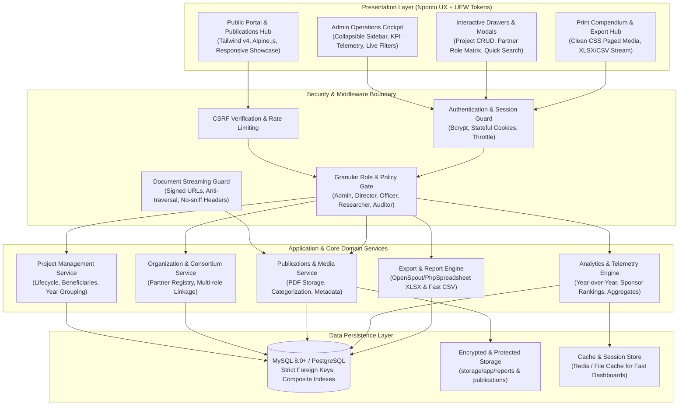
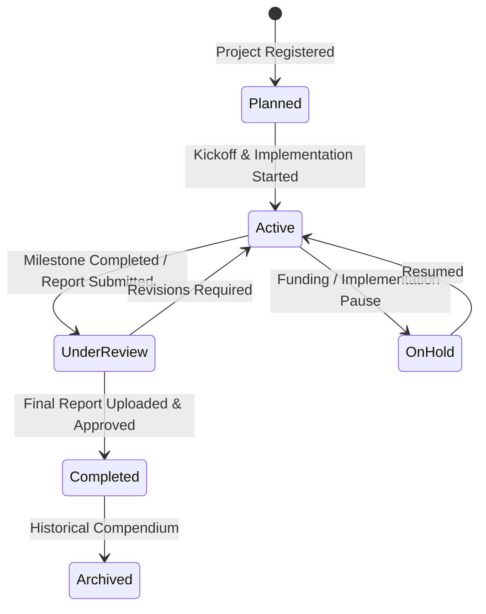

# Technical Architecture Specification

> **Platform**: UEW Innovation Hub Enterprise Management System  
> **Institution**: University of Education, Winneba (UEW)  
> **Architecture Pattern**: Clean Layered Architecture with Domain Services & Blade Components  
> **Target Framework**: Laravel 12.x on PHP 8.4+

---

## 1. System Overview & Layered Architecture

The rebuilt platform replaces disparate procedural PHP files with a cohesive, modular Laravel 12 architecture. The platform serves two primary audiences:
1. **The Public Innovation Showcase**: A high-impact university portal displaying research achievements, publications, and institutional metrics.
2. **The Operations & Analytics Cockpit**: An authenticated, Npontu-styled administrative dashboard for managing projects, partner organizations, grant allocations, documents, and system users.



---

## 2. Technology Stack

- **Backend Framework**: Laravel 12.x on PHP 8.4+
- **Database**: MySQL 8.0+ / PostgreSQL 16+ (Strict mode, UTF8mb4, InnoDB)
- **Frontend Engine**: Laravel Blade Components + Alpine.js 3.x
- **CSS Framework**: Tailwind CSS v4 using customized `@theme` design tokens
- **Build Tool**: Vite 6.x
- **Document Management**: Laravel `Storage` facade with restricted private disks (`local` or S3/MinIO)
- **Testing**: PHPUnit 11 / Pest 3 for unit and feature test coverage

---

## 3. Core Subsystems

### 3.1 Project Lifecycle & Consortium Management
- **Entity**: `Project` (`app/Models/Project.php`)
- Projects track:
  - Title, abstract/summary, pillar/category (EdTech, AgTech, Health, STEM, Inclusive Education).
  - Number of direct and indirect beneficiaries.
  - Start date, expected completion date, actual completion date.
  - Status state machine: `Draft` ➔ `Active` ➔ `Completed` ➔ `On Hold` ➔ `Archived`.
  - Financials: Funding grant size, currency (GHS / USD), budget utilization.
  - Attached partners with specific roles: `Funder`, `Lead Partner`, `Implementing Partner`, `Technical Advisor`, `Sponsor`, `Government Partner`.



### 3.2 Partner Organizations & Consortia Matrix
- **Entity**: `Organization` & Pivot `ProjectOrganization`
- Allows many-to-many relationship where an organization can hold different roles across different projects (e.g. UNESCO as Funder for Project A, and Technical Advisor for Project B).
- Supports seamless inline creation of new partner organizations during project registration.

### 3.3 Publication & Newsletter Repository
- **Entity**: `Publication` (`app/Models/Publication.php`)
- Types: `Publication`, `Newsletter`, `Policy Brief`, `Annual Report`, `Research Paper`.
- Metadata: Title, publication date, abstract, authors, file size, download count.
- Secure delivery via dedicated controller action with HTTP caching and streaming.

### 3.4 Telemetry & Analytics Engine
- Replaces legacy raw SQL queries in `dashboard.php` with cached aggregate services.
- Real-time computations:
  - Total projects count and percentage year-over-year change.
  - Total beneficiaries reached and average impact density.
  - Number of distinct partner organizations and institutional sponsor rankings.
  - Multi-year trend distribution.

### 3.5 Npontu-Inspired Dashboard Architecture
The dashboard follows the **Npontu SRE layout**:
- Fixed left collapsible navigation rail with section groups (`Control Plane`, `Registry`, `Research`, `Analytics`, `Audit`).
- Top cockpit header with live health indicator, fast search trigger (`Cmd+K`), quick action "+ New Project" button, and user profile drawer.
- Sub-header breadcrumbs and contextual filter controls (Year tabs, Status pills, Category dropdowns).
- High-density data grid with zebra striping, status pills, organization chips, action buttons, and pagination.

---

## 4. File Storage & Streaming Architecture

Direct web access to uploaded files is strictly eliminated.
```text
Storage Root: storage/app/private/
├── reports/
│   └── project_{id}_{hash}.pdf
└── publications/
    └── pub_{id}_{hash}.pdf
```
Requests route through `App\Http\Controllers\FileStreamController@show`:
1. Authenticates session or verifies public access permission.
2. Checks file existence on private disk.
3. Streams file binary with headers:
   - `Content-Type: application/pdf`
   - `X-Content-Type-Options: nosniff`
   - `Content-Disposition: inline; filename="{sanitized_name}.pdf"`
   - `Cache-Control: private, max-age=3600`
