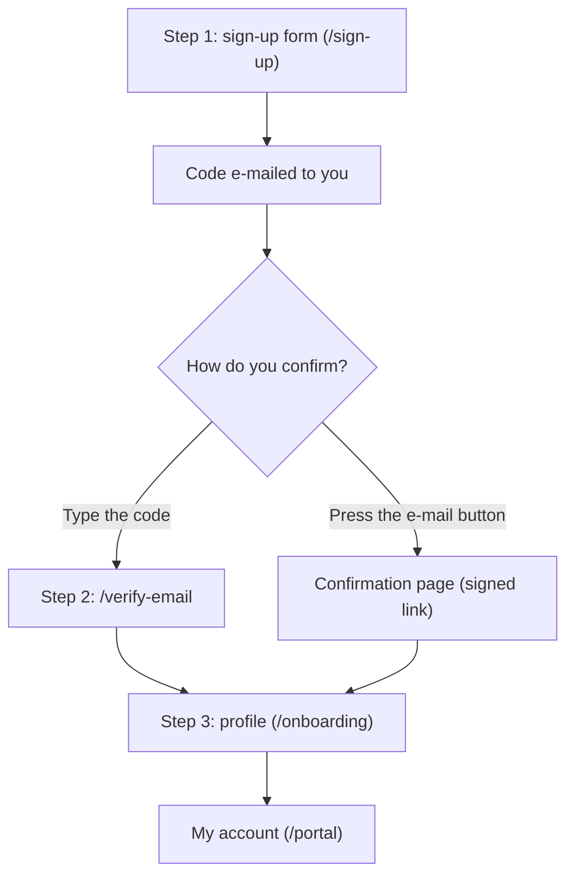

# Account registration

> **Audience:** Members of the public · **Last verified:** 2026-11-30 against commit `9f3bdee`
> **Related:** [Login and authentication](login-and-authentication.md), [Profile and account management](profile-and-account-management.md), [Common user issues](common-user-issues.md), [Getting started](getting-started.md)

This page explains how to create a member account in three steps: sign-up form, e-mail verification and profile completion. It lists every rule on the form and the exact messages you may see.

- **What it does:** creates a member account (`Role::Member`) that can apply to programmes.
- **Why:** the Hub needs to contact applicants, check eligibility and report anonymously to funders.
- **Who can use it:** anyone who is not signed in and is at least 15 years old.
- **Where:** **Create account** in the top menu, or `/sign-up`. Old addresses `/register` and `/signup` redirect there.

## Step 1: the sign-up form

1. Open `/sign-up`.
2. Fill in the fields below.
3. Tick the box for the terms and privacy notice.
4. Press **Create account and get my code**.

| Field | Rule | Message if wrong |
| --- | --- | --- |
| Full name | Required, 2 to 255 characters | Standard "required" or length message |
| E-mail address | Required, valid e-mail, up to 255 characters, not already used. The form lowercases it | "An account with this e-mail already exists. Sign in or reset your password." |
| Phone number | Required, 7 to 30 characters: digits, spaces, `+`, `(`, `)`, `-` | "Enter a valid phone number, for example +233 24 123 4567." |
| Gender | Required: Female, Male or Prefer not to say | Standard "required" message |
| Date of birth | Required, after 1 January 1920, and at least 15 years ago | "You need to be at least 15 years old to create an account." |
| Region | Required, one of the 16 regions of Ghana or **Outside Ghana** | Standard "required" message |
| Password | Required, typed twice, strength rule below | See below |
| Terms box | Must be ticked | "Please agree to the terms and privacy notice to continue." |

**Password strength.** On the live site (production) a password needs at least 12 characters, with upper and lower case letters and a number. In development and test environments the minimum is only 8 characters. The form always says "12 or more characters".

The form also has a hidden field called "Leave this field empty". It is a trap for automated programs. If it is filled in you see "Your sign-up could not be processed."

The form explains why it asks about gender, date of birth and region: they are "used to check eligibility for targeted programmes and for anonymous reporting to funders. Reviewers do not see your gender." The reviewer screen shows your age and leaves out gender and disability. One exception: if a programme's own form has a question linked to your gender, your answer to that question is visible to reviewers.

### What happens when you press the button

1. The account is created and you are signed in straight away.
2. A 6-digit code is e-mailed to you.
3. You are sent to `/verify-email` with the message "We sent a 6-digit code to your@email."

### Registration can be paused

The Hub Director can pause sign-ups. The page then shows "New registrations are paused at the moment. Please check back soon." If you still send the form, the site answers with a 403 error and "New registrations are paused."

### Limits

You can send the form 5 times a minute and 30 times a day from one internet connection. Beyond that you see the "Too many requests" page (429). Wait a minute.

## Step 2: confirm your e-mail

You have two ways. Use either one.

**Type the code.** On `/verify-email` ("Check your inbox") type the 6 digits. Spaces are fine, for example `123 456`.

**Press the button in the e-mail.** The e-mail has a button that opens a page saying "Confirm your e-mail". Press **Confirm my e-mail**. Opening the link alone changes nothing. This stops e-mail scanners from confirming your account by accident.

| Rule | Value |
| --- | --- |
| Code lifetime | 10 minutes |
| Wrong guesses allowed | 5 per code. After that you see "Too many incorrect attempts. Ask for a new code." |
| Asking for a new code | **Send a new code**, once every 60 seconds |
| A new code | Cancels the earlier code and the earlier e-mail button |
| Button link | Works once and expires with its code |

Messages you may see:

| Message | Meaning and fix |
| --- | --- |
| "Enter the 6-digit code from the e-mail." | You typed letters or the wrong length. Type 6 digits. |
| "That code is not correct. 3 attempt(s) left." | Re-read the e-mail. The number of attempts left is shown. |
| "This code has expired. Ask for a new one." | Press **Send a new code**. |
| "A code was sent recently. You can ask for a new one in 42 seconds." | Wait, then try again. |
| "A new code is on its way to you@example.com." | Check the inbox and the spam or promotions folder. |
| "This link has expired or has already been used. Ask for a new one." | Sign in at `/sign-in`. You are sent to `/verify-email`, where you can ask for a new code. |

Typed the wrong e-mail address when you registered? Press **Use a different account** on the verify page. This signs you out. You can then register again with the correct address.
> **Requires confirmation:** the code has no screen to change the e-mail address of an unverified account. The unverified account with the wrong address stays in the system.

When the e-mail is confirmed, the Hub sends you a welcome e-mail.

## Step 3: complete your profile (onboarding)

Until you finish this page, every portal page sends you back to `/onboarding` ("Step 3 of 3 · Your background"). Staff never see this step.

| Field | Rule |
| --- | --- |
| Name, phone, gender, date of birth, region | Already filled from sign-up. Same rules as above |
| I am a... (affiliation) | Required: UEW student, UEW staff or faculty, UEW alumni, Partner organisation, Member of the public |
| Highest education level | Required: Senior High School / WASSCE, TVET / Certificate, Diploma / HND, Undergraduate (Bachelor's), Master's, Doctorate (PhD), Other |
| Institution or organisation | Optional, up to 255 characters |
| Department, faculty or programme of study | Optional, up to 255 characters |
| Do you have a disability? | Optional: No, Yes, Prefer not to say. Never shown to reviewers |
| Short bio | Optional, up to 1,000 characters |
| Interests | Required: choose 1 to 12 from the focus areas and the types of opportunity |
| E-mail me when new programmes and events ... | Tick box. See consent note below |
| Show me on the public community page and leaderboard | Tick box. Off unless you tick it |

Press **Finish and go to my account**. You see "Welcome aboard! Your profile is complete." and land on `/portal`.

If you forget the interests, you see "Choose at least one area you are interested in."

> **Consent note:** on this first page the announcements box is already ticked for new members. Untick it if you do not want announcement e-mails. You can change it later in **Profile & settings** or with the unsubscribe link. See [E-mail preferences and unsubscribe](feature-guides/email-preferences-and-unsubscribe.md).

## Problems

See [Common user issues](common-user-issues.md) for e-mail that does not arrive and for sign-up errors.
