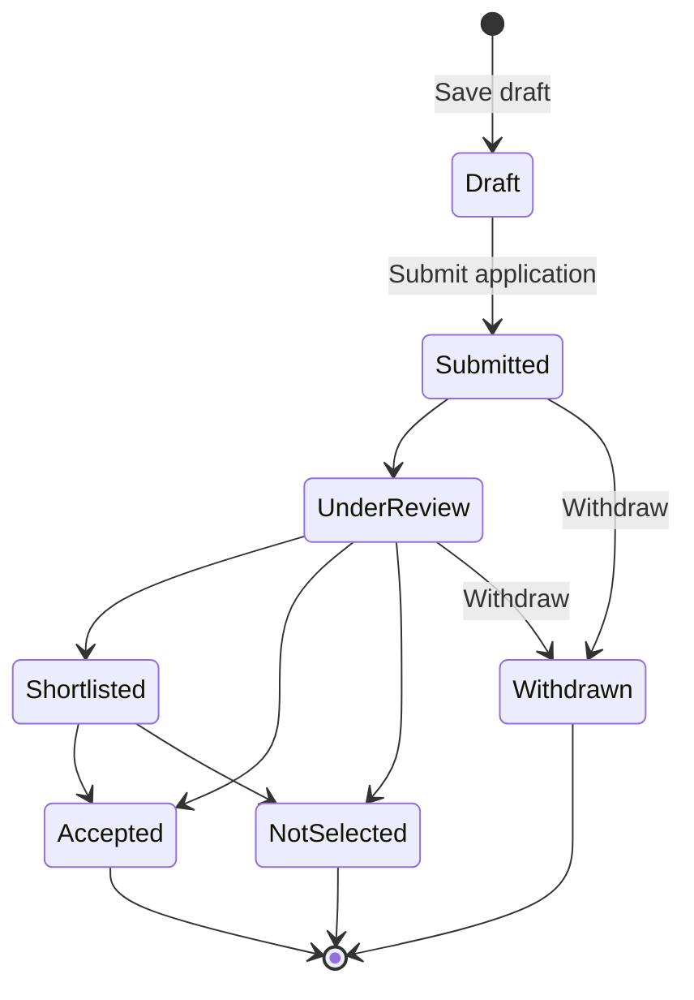

# Programme applications

> **Audience:** Members · **Last verified:** 2026-11-30 against commit `9f3bdee`
> **Related:** [Application messages](application-messages.md), [Progress reports](progress-reports.md), [Step-by-step workflows](../step-by-step-workflows.md), [Common user issues](../common-user-issues.md), [Business logic](../../04-architecture/business-logic.md)

This page explains how to apply to a Hub programme: opening the form, answering the questions, saving drafts, uploading PDF files, submitting, following the status and withdrawing.

- **What it does:** sends your answers to the Hub's review panel.
- **Why:** each programme (grant, fellowship, incubation, competition, training, event) has its own questions, set by staff.
- **Who:** members with a verified e-mail and a finished profile. Staff cannot apply.
- **Where:** **Apply now** on a programme page (`/programmes/{programme}/apply`). Your applications are under **My applications** (`/portal/applications`). The form is the same page whether you start or continue.

Reviewers set the status (Submitted, Under review, Shortlisted, Accepted, Not selected). The path in the diagram shows the usual order, not a strict order.

## Before you start

1. Read the programme page, especially **Who can apply** and **What you will be asked**. The list of questions shows which ones are required (a red `*`) and which need a PDF.
2. Check the opening and closing dates. A programme accepts applications only while it is published, has opened, has not closed, and still has places.
3. Keep your documents as **PDF** files. Word or image files are refused.
4. Finish your [profile](../profile-and-account-management.md). Some questions are filled in from it.

## Fill in and save a draft

1. On the programme page press **Apply now**.
2. The page shows an **Applicant** box (name, e-mail, phone from your profile, with an **Update profile** link) and the **Application questions**.
3. Answer the questions. Questions linked to your profile show "Filled from your profile. You can change it here." until you save once. After that, the answer you saved is used, even if you later change your profile.
4. Press **Save draft** at any time. You stay on the form with "Draft saved. You can come back and finish it before the deadline."
5. To return later: **My applications**, then **Continue**. Or press **Continue my draft** on the programme page. The Overview page also lists drafts in a yellow box.

A draft needs no required answers. The site still checks that what you did type is valid. Drafts are not reviewed. A draft stays editable until the programme closes.

## Question types and rules

Staff choose the question types. These are the rules the site applies, copied from [`FormSchema.php`](../../../app/Support/FormSchema.php).

| Question type | What to enter | Rule |
| --- | --- | --- |
| Short answer | A line of text | Up to 255 characters |
| Paragraph | Long text | Up to 10,000 characters |
| Number | A number | 0 or more, up to 1,000,000,000 |
| Email address | An e-mail address | Valid e-mail, up to 255 characters |
| Phone number | A phone number | 7 to 30 characters: digits, spaces, `+ ( ) -` |
| Website link | A web address | Must be a valid `http` or `https` address, up to 500 characters |
| Date | A date | A valid date |
| Dropdown, Multiple choice | One option | Must be one of the listed options |
| Checkboxes | Several options | Every ticked item must be a listed option |
| Yes / No | Yes or No | Only those two values |
| PDF upload | A PDF file | PDF only, up to the size shown under the box (default 20 MB) |

A form has at most 40 questions. Required questions are only enforced when you submit.

## Upload a PDF

1. Under a PDF question press the file button and choose the file.
2. Save the draft or submit. The file is stored with the application.
3. Once uploaded you see "PDF uploaded. Choose a new file only to replace it." Choosing a new file replaces the old one.
4. After submission, open your answers and press **Open PDF** to download your own file.

Files are private. Only you and reviewers can open them. Uploading is not saved until you press **Save draft** or **Submit application**.

## Submit

1. Tick "I confirm that the information in this application is accurate and my own work."
2. Press **Submit application**.

Expected result: "Application submitted. We have e-mailed you a confirmation." You get a notification, a confirmation e-mail with your reference (for example `UEW-AP-2026-7K3QX9`) and **+10 XP**. Staff who review applications are notified.

After you submit, the answers are locked. Reviewers assess what you sent. Your details (name, phone, region, affiliation, institution and so on) are frozen on the application at that moment too. If you made a mistake, send a [message](application-messages.md).

## Follow the status

Open **My applications** (`/portal/applications`) or the application page. The page shows the reference, the date submitted, a four-step bar (Submitted, Under review, Shortlisted, Decision) and a plain sentence for the current status. A reviewer can add a "Message from the review panel".

| Status | What it means |
| --- | --- |
| Draft | Saved, not submitted |
| Submitted | Received, waiting for review |
| Under review | The review panel is assessing it |
| Shortlisted | You are through to the next stage. The Hub will contact you |
| Accepted | You were selected. You can now send [progress reports](progress-reports.md). You also receive the Participant badge and 50 XP |
| Not selected | Not successful this time |
| Withdrawn | You withdrew it |

You always get a bell notification when the status changes. An e-mail is sent only if the reviewer chose to send one.

## Withdraw

1. Open the application page. The **Withdraw** card appears only for Submitted or Under review applications.
2. Press **Withdraw application** and confirm.

Result: "Your application was withdrawn." This cannot be undone and you cannot apply to the same programme again: the site says "You have already applied to this programme." You cannot withdraw once the application is Shortlisted, Accepted or Not selected: "This application can no longer be withdrawn."

A draft has no withdraw button. Leave it, or submit it.

## Errors and fixes

| Message | Cause | Fix |
| --- | --- | --- |
| "Some answers need attention" | One or more answers failed a rule. Your other answers are kept | Scroll to the red outlined questions |
| "The <question> field is required." | A required question is blank at submit | Answer it, or save as a draft |
| "Confirm that your answers are accurate before submitting." | The declaration box is not ticked | Tick it |
| "The <question> must be a file of type: pdf." | The file is not a PDF | Export the document as PDF |
| "The <question> must not be greater than 20480 kilobytes." | File too large. The limit is set by `MAX_UPLOAD_KB` | Compress or split the PDF |
| "This programme is not accepting applications right now." | Programme closed, not yet open, or full | See the programme page |
| "This programme is no longer accepting applications." | It closed while you were typing | Contact the Hub if the deadline just passed |
| "This application has already been submitted and can no longer be changed." | You tried to edit a submitted application | Send a message to the Hub |
| "You have already applied to this programme." | You have a submitted or withdrawn application | Open it from **My applications** |
| "This page expired" (419) | The form stayed open too long | Refresh and try again. Save drafts often |
| "Too many requests" (429) | Over 30 saves a minute | Wait a minute |

Drafts and submissions are limited to 30 form posts per minute.
