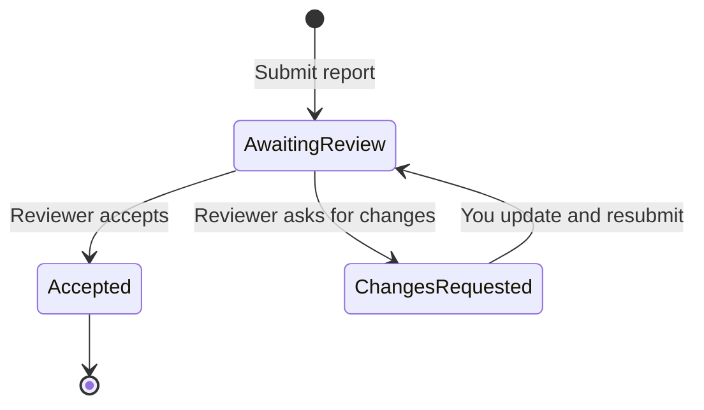

# Progress reports

> **Audience:** Members whose application was accepted · **Last verified:** 2026-11-30 against commit `9f3bdee`
> **Related:** [Programme applications](programme-applications.md), [Badges and leaderboard](badges-and-leaderboard.md), [Notifications guide](../notifications-guide.md), [Business workflows](../../13-product-and-business/business-workflows.md)

This page explains progress and budget reports: when you can send one, what each field means, how the budget table works, what happens after you submit, and how to fix a report the Hub sends back.

- **What it does:** tells the Hub how your funded or incubated project is going and how the money is used.
- **Why:** the Hub is accountable to its funders, and reports let staff track milestones and spending.
- **Who:** a member whose application has the status **Accepted**. No one else can create or open the report. Staff reviewers read and assess it.
- **Where:** **Progress reports** in the account menu or tab bar (`/portal/reports`). Or press **New report** on the accepted application page. The address of the form is `/portal/applications/{id}/reports/create`.

## The reports page

`/portal/reports` has two cards:

- **Programmes you report on:** your accepted applications with the number of reports sent. "None yet. Find a programme" appears if you have no accepted application.
- **Your reports:** every report with its period, status and "Spent / received (GH₵)". "No reports yet" appears when you have none.

An information box, "What goes in a report?", summarises the fields below.

## Send a report

1. Press **New report**.
2. Fill in the form (see the table).
3. Press **Submit report**.

Expected result: "Report submitted. The Hub team has been notified." You see the report with a reference like `UEW-PR-2026-K4M7QX` and the status **Awaiting review**. You earn **+20 XP** for each new report. Re-sending an old report earns nothing more.

| Field | Rule | Notes |
| --- | --- | --- |
| Period name | Required, up to 60 characters | For example "Month 2 (March 2026)" |
| Period ends | Required date, after 1 January 2015, no later than one month from today | Pre-filled with today |
| Summary | Required, 20 to 5,000 characters | What happened this period |
| Milestones reached | Required, up to 5,000 characters | One per line |
| Challenges | Optional, up to 5,000 characters | Include support you need |
| Next steps | Optional, up to 5,000 characters | |
| People reached so far | Optional whole number, 0 to 10,000,000 | Pre-filled from your last report |
| Funds received so far (GH₵) | Required number, 0 to 1,000,000,000 | Total from the Hub and other sources to date |
| Funds spent so far (GH₵) | Optional number | Used only if you add no spending lines |
| Spending lines | Up to 30 lines | See below |

### The budget table

1. Press **Add spending line** for each cost.
2. Choose a **category**: Equipment & materials, Software & hosting, Staff & stipends, Travel & transport, Training & workshops, Marketing & outreach, Professional services, or Other.
3. Write a **description** (up to 200 characters) and the **budgeted** and **spent** amounts (0 or more).
4. Empty lines are dropped automatically.

When you add at least one line, the total spent is the sum of the **spent** column, calculated by the server, and the "Funds spent so far" box is ignored. If spending is higher than funds received, the page warns "Spending is above funds received. Explain why under Challenges." The side box **Budget at a glance** shows totals and the programme's funding for comparison.

> **Tip:** keep receipts. The Hub may ask for them. The site does not collect receipts.

## After you submit

A reviewer marks the report:

| Status | Meaning | What you do |
| --- | --- | --- |
| Awaiting review | The Hub has not looked at it, or you just resubmitted | Wait. You cannot edit it |
| Accepted | The Hub is satisfied | Nothing |
| Changes requested | The Hub wants corrections. Feedback is shown on the report in a yellow box | Press **Make changes** on the report, update it and press **Resubmit report** |

You get a notification, "Progress report: Accepted" or "Progress report: Changes requested". It says "Feedback from the Hub is waiting" when there is feedback.

A report can be edited **only** while it is in **Changes requested**. The form then says "Update <period>". Resubmitting sets the status back to **Awaiting review**.

## Errors and fixes

| Message | Cause | Fix |
| --- | --- | --- |
| "Only accepted applicants can report on this programme." | The application is not Accepted, or it is not yours | Check the status of your application |
| "This report is being reviewed and can no longer be changed." | Status is Awaiting review or Accepted | Send a [message](application-messages.md) to ask the Hub to open it |
| "The end of the reporting period field must be a date before or equal to <date>." | Period end is more than a month ahead | Use the real end date |
| "The summary field must be at least 20 characters." | Summary too short | Write more |
| "The funds received field is required." | Blank | Enter 0 if nothing has arrived |
| "The category field is required" / "item description field is required" | A spending line is partly filled | Complete or remove the line |
| "Too many requests" | More than 10 new reports a minute | Wait |
| "Page not found" | The report belongs to another member | Open it from **Your reports** |
| No **Progress reports** content | You have no accepted application | Wait for a decision. See [Programme applications](programme-applications.md) |

The Hub's guidance on how often to report ("at the end of your first month, or when the Hub asks for one") is only advice. The site does not send reminders and has no due date.
