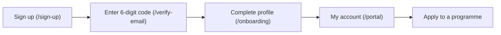

# Getting started

> **Audience:** Members of the public and new staff · **Last verified:** 2026-11-30 against commit `9f3bdee`
> **Related:** [Account registration](account-registration.md), [Login and authentication](login-and-authentication.md), [Dashboard guide](dashboard-guide.md), [User roles and permissions](user-roles-and-permissions.md), [Feature guides](feature-guides/README.md)

This page tells you what the UEW Innovation Hub website is, what you can do without an account, what an account adds, and what a new staff member should do on the first day. Each step links to a longer page.

## What the site is

The UEW Innovation Hub site has four parts. You will mostly use the first two.

| Part | Address | Who uses it |
| --- | --- | --- |
| Public website | `/` and the pages under it (programmes, projects, publications, news, gallery, partners, contact) | Anyone, no sign-in |
| Member portal | `/portal` (menu label **My account**) | People with a member account |
| Staff workspace | `/workspace` (menu label **Staff workspace**) | Hub staff |
| Open data API | `/api/v1` | Developers. Not covered in this guide |

## Without an account

You can do these things without signing in:

- Read about programmes, including who can apply and the deadline (**Programmes**, `/programmes`).
- Browse projects, publications, news, the photo gallery and partners.
- Look at the community leaderboard (`/community`, footer link **Community & leaderboard**).
- Send a message to the Hub on **Contact** (`/contact`).

See [Browsing the public website](feature-guides/browsing-the-public-website.md).

## What an account adds

A member account lets you:

- Apply to a programme, save drafts and upload PDF documents.
- Follow the status of each application and message the Hub team about it.
- Send progress and budget reports if you are accepted.
- Receive notifications under the bell icon.
- Earn XP and badges, and appear on the public leaderboard if you choose.

## Steps for a new member

1. **Create the account.** Choose **Create account** at the top right, or open `/sign-up`. Fill in the form. See [Account registration](account-registration.md).
2. **Confirm your e-mail.** The Hub sends a 6-digit code to your e-mail address. Enter it on the next page, or press the button in the e-mail.
3. **Complete your profile.** A third page asks about your background and interests. You cannot use the portal until you finish it.
4. **Find a programme.** Open **Programmes**, then **Open now**. Choose a programme and press **Apply now**.
5. **Follow your application.** Use **My applications** in the account menu.

Expected result: after step 3 you land on **My account** (`/portal`) with a welcome message.

## First day for new staff

Staff accounts are not created by the sign-up page. The Hub Director creates them and the e-mail address is marked as verified. You do not go through the code step or the profile step.

1. Open `/sign-in` and enter the e-mail address and password the Hub Director gave you. Staff use the same sign-in page as members.
2. You land on the staff workspace dashboard at `/workspace`.
3. Change your password straight away: in the left menu, under **You**, choose **Account settings** (`/workspace/account`). A password change signs you out on other devices.
   > **Requires confirmation:** the code does not force a new staff member to change the first password. Do it anyway.
4. Look at the left menu. You only see the items your role allows. A Read-only Staff user sees fewer items than a Programme Officer. See [User roles and permissions](user-roles-and-permissions.md).
5. Check the bell icon at the top. Staff who review applications get a notice when a member applies, sends a message or sends a progress report.
6. On **Account settings** you can switch the e-mail alerts **New programme applications** and **New contact-form enquiries** on or off.

Staff accounts cannot apply to programmes. The programme page tells staff to manage the programme from the workspace.

What each role sees on the workspace dashboard is in [Dashboard guide](dashboard-guide.md). Day-to-day staff tasks are in the [administration section](../03-administration/administrator-overview.md).

## If something does not work

- E-mail code did not arrive: see [Common user issues](common-user-issues.md).
- You cannot sign in: see [Login and authentication](login-and-authentication.md).
- Quick answers: [User FAQ](user-faq.md).
