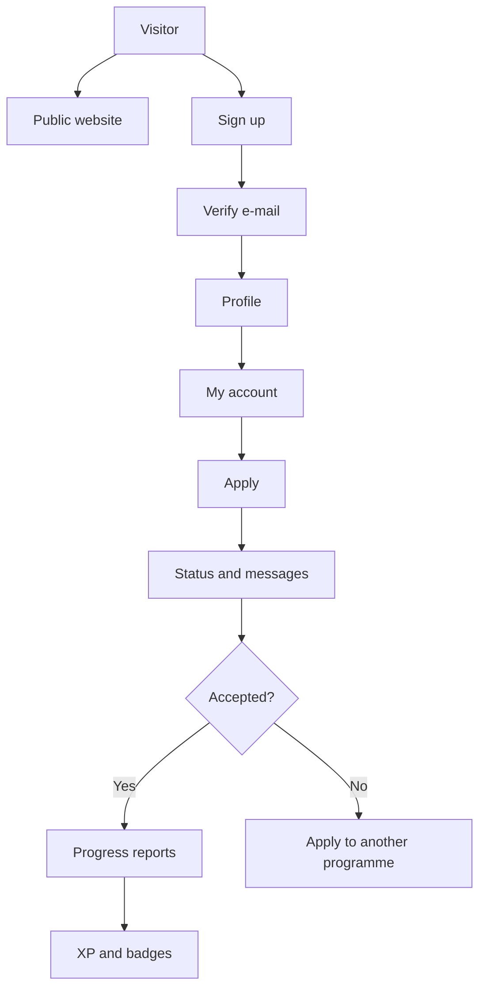

# Step-by-step workflows

> **Audience:** Members of the public and new staff · **Last verified:** 2026-11-30 against commit `9f3bdee`
> **Related:** [Getting started](getting-started.md), [Feature guides](feature-guides/README.md), [Common user issues](common-user-issues.md), [Business workflows](../13-product-and-business/business-workflows.md)

This page gives seven complete journeys from start to finish, each as a numbered list with the expected result at every step. Use it as a checklist. Each journey links to the feature guide with the full rules and error messages.

## Journey 1: new member to submitted application

Time needed: about 20 minutes, plus waiting for the e-mail.

1. Open the Hub site and press **Create account** (`/sign-up`).
2. Fill in name, e-mail, phone, gender, date of birth, region and a password (see [Account registration](account-registration.md)). Tick the terms box.
3. Press **Create account and get my code**. Result: you land on "Check your inbox" (`/verify-email`).
4. Open your e-mail. Type the 6-digit code, or press the button in the e-mail and then **Confirm my e-mail**. Result: "Your e-mail is verified."
5. On "Welcome" (`/onboarding`), choose your affiliation and education level, tick at least one interest, and decide on the announcement and community boxes. Press **Finish and go to my account**. Result: "Welcome aboard! Your profile is complete."
6. Press **Browse programmes**. On the **Open now** tab choose a programme and read **Who can apply** and **What you will be asked**.
7. Press **Apply now**. Answer the questions. Press **Save draft** when you need to stop. Result: "Draft saved."
8. Upload any PDF the form asks for.
9. When you are ready, tick the declaration and press **Submit application**. Result: "Application submitted. We have e-mailed you a confirmation." and +10 XP.

Details: [Programme applications](feature-guides/programme-applications.md).

## Journey 2: return later and finish a draft

1. Sign in at `/sign-in`.
2. On **My account**, look for the yellow box "Finish your drafts", or open **My applications**.
3. Press **Continue** next to the draft. Result: the form opens with your saved answers.
4. Finish, then press **Submit application**.

If the programme closed in the meantime you see "This programme is not accepting applications right now." Your draft cannot be submitted after that.

## Journey 3: follow a decision and talk to the Hub

1. Watch the bell icon. A status change creates a notice: "<Programme>: Shortlisted" or "Accepted" or "Not selected".
2. Press the notice. You see the application page with a progress bar and the sentence for your status. Read any "Message from the review panel".
3. To ask a question, scroll to **Messages**, type it and press **Send message**. Result: "Message sent to the Hub team."
4. When staff reply you get "New message about <Programme>". Press it to read.

Details: [Application messages](feature-guides/application-messages.md).

## Journey 4: after acceptance, send a progress report

1. Open **Progress reports** (`/portal/reports`). Your accepted programme is listed under **Programmes you report on**.
2. Press **New report** (also on the application page).
3. Fill in period name, end date, summary and milestones. Add challenges and next steps if useful.
4. Enter funds received. Press **Add spending line** for each cost, with category, description, budgeted and spent amounts.
5. Press **Submit report**. Result: "Report submitted. The Hub team has been notified." and +20 XP.
6. If you get "Progress report: Changes requested", open the report, read the Feedback box, press **Make changes**, correct the form and press **Resubmit report**.

Details: [Progress reports](feature-guides/progress-reports.md).

## Journey 5: forgot password

1. On `/sign-in` press **Forgot password?**.
2. Enter your e-mail and press **Send reset code**. Result: "If an account uses that address, we have sent it a 6-digit code."
3. Open the e-mail. Either type the code on the page that opened, or press the e-mail button.
4. Choose a new password (production rule: 12 or more characters with upper and lower case letters and a number). Result: "Your password was reset. Sign in with your new password."
5. Sign in. Your other devices were signed out.

Details: [Login and authentication](login-and-authentication.md).

## Journey 6: manage privacy and e-mail

1. Open **Profile & settings** (`/portal/profile`).
2. Under **Communication**, untick the announcement box to stop announcement e-mails. Untick the community box to leave the public leaderboard.
3. Press **Save profile**. Result: "Your profile was updated."
4. To stop announcements from an e-mail instead, press **Unsubscribe** in it, then press the **Unsubscribe** button on the page that opens.

Details: [E-mail preferences and unsubscribe](feature-guides/email-preferences-and-unsubscribe.md), [Profile and account management](profile-and-account-management.md).

## Journey 7: first day for a staff member

1. Sign in at `/sign-in` with the e-mail and password from the Hub Director. Result: you land on `/workspace`.
2. Open **Account settings** (left menu, **You**). Change your password. Choose which e-mail alerts you want.
3. Read the cards on your dashboard. See [Dashboard guide](dashboard-guide.md) for what your role sees.
4. Press the bell. Open any notification to see where it leads.
5. For your daily tasks, follow the [administration section](../03-administration/administrator-overview.md).

## Quick map

