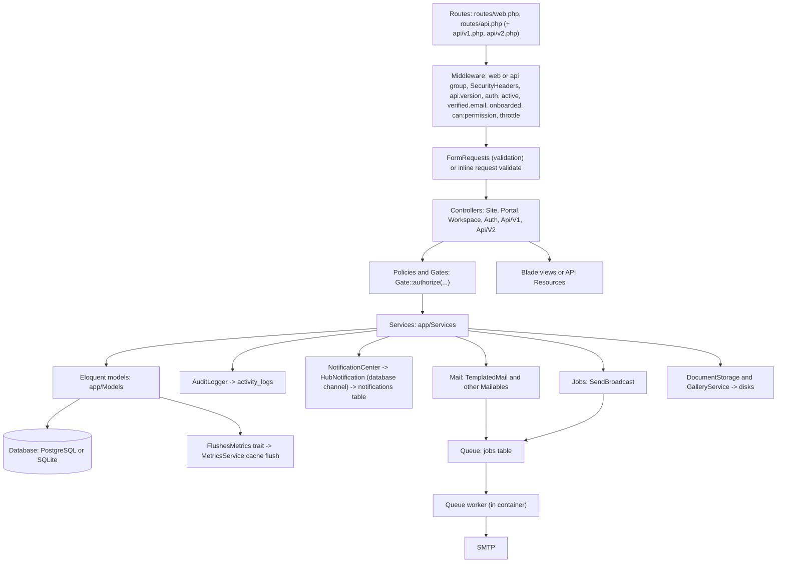

# Application Architecture

> **Audience:** Developers · **Last verified:** 2026-11-30 against commit `d1296b1`
> **Related:** [System architecture](system-architecture.md), [Backend architecture](backend-architecture.md), [Request/response lifecycle](request-response-lifecycle.md), [Design patterns](design-patterns.md), [Project structure](../05-developer-guide/project-structure.md)

This page shows how the Laravel code is layered: routes, middleware, form requests, controllers, policies and gates, services, models, and the side channels (jobs, mail, notifications). The rule of the codebase is that controllers stay thin and services own writes, audit entries and notifications.

## Component diagram



In the actual call order a controller first runs `Gate::authorize(...)` (or the route's `can:` middleware has already run), then calls a service. The diagram groups them by layer, not by timing. See [Request/response lifecycle](request-response-lifecycle.md) for the exact order.

## Layers and counts

| Layer | Location | Count at this commit | Responsibility |
| --- | --- | --- | --- |
| Routes | `routes/web.php`, `routes/api.php`, `routes/api/v1.php`, `routes/api/v2.php`, `routes/console.php` | 208 routes | URL map and middleware. `console.php` holds only Laravel's `inspire`. |
| Middleware | `app/Http/Middleware`, `bootstrap/app.php` | 5 custom | `EnsureAccountIsActive` (`active`), `EnsureEmailIsVerified` (`verified.email`), `EnsureOnboarded` (`onboarded`), `ApiVersion` (`api.version`, adds `API-Version` and deprecation headers), `SecurityHeaders` (appended to `web` and `api` groups). |
| Form requests | `app/Http/Requests/{Auth,Portal,Site,Workspace}` | 16 | Validation and normalisation. About 16 other controller actions call `$request->validate()` inline, mostly for small forms and for programme application answers, which are validated against a per-programme schema by `FormSchema::rules()`. |
| Controllers | `app/Http/Controllers/{Auth,Portal,Site,Workspace,Api}` (`Api` holds `VersionsController`, `V1/` and `V2/`) and `NotificationController` | See [Backend architecture](backend-architecture.md) | Authorise, call a service, return a view, redirect or JSON. |
| Policies | `app/Policies` | 9 | Record-level rules. Auto-discovered by Laravel (no `Gate::policy()` calls). See [Authorization architecture](authorization-architecture.md). |
| Services | `app/Services` | 24 | Business logic, transactions, file handling, audit, notifications. |
| Models | `app/Models` (+ `Concerns`) | 20 models, 3 traits | Relations, casts, scopes. |
| Enums | `app/Enums` | 13 | `Role`, `Permission` and status vocabularies with labels. |
| API resources | `app/Http/Resources/Api/V1`, `app/Http/Resources/Api/V2` | 5 (v1), 6 plus the abstract base `Resource` (v2) | Whitelist of public JSON fields. Each version has its own classes so v1 output never changes when v2 does. |
| Mail, jobs, notifications | `app/Mail`, `app/Jobs`, `app/Notifications` | 4, 1, 1 | `TemplatedMail`, `GrantStatusUpdatedMail`, `NewContactMessageStaffMail`, `PasswordChangedMail`; `SendBroadcast`; `HubNotification`. |
| Support classes | `app/Support` | 6 | `DateRange`, `Demographics`, `EmailTemplates`, `Format`, `FormSchema`, `Photos`. |
| Console commands | `app/Console/Commands` | 3 | `hub:create-admin`, `hub:import-documents`, `hub:secure-demo-accounts`. |
| Views | `resources/views` | See [Frontend architecture](frontend-architecture.md) | Blade templates and components. |

## Directory map

```text
app/
  Console/Commands/      hub:* artisan commands
  Enums/                 Role, Permission, statuses
  Http/
    Controllers/         Auth, Portal, Site, Workspace, Api (V1, V2)
    Middleware/          account, e-mail, onboarding, security headers
    Requests/            Auth, Portal, Site, Workspace
    Resources/Api/V1/    JSON shape of the open data API, version 1
    Resources/Api/V2/    JSON shape of the open data API, version 2
  Jobs/                  SendBroadcast
  Mail/                  Mailables
  Models/                Eloquent models and Concerns/
  Notifications/         HubNotification (database channel only)
  Policies/              record-level authorisation
  Providers/             AppServiceProvider (gates, rate limiters, defaults)
  Services/              business logic
  Support/               pure helpers
bootstrap/app.php        routing, middleware aliases, JSON error envelopes (v1 and v2)
config/hub.php           domain configuration
config/api.php           API versions, deprecation dates, limits
```

## Conventions the code follows

| Convention | Evidence |
| --- | --- |
| `declare(strict_types=1);` in every app class. | Top of each file in `app/`. |
| Services are `final` and take collaborators by constructor injection. | `app/Services/*.php`. |
| Privileged fields are not mass assignable. `User::$fillable` omits `role`, `is_active`, `email_verified_at`, `onboarded_at`, `xp`. Services set them explicitly. | `app/Models/User.php`, `UserService::create()`. |
| Every state change records an audit entry with the actor and IP taken from the server side. | `AuditLogger::record()`. |
| Notification failures never break the action that caused them. | `NotificationCenter::safely()`, `StaffNotifier`, `MemberService::markVerified()` (try/catch around queueing). |
| Lazy loading is an error outside production, which catches N+1 queries in tests. | `Model::preventLazyLoading(! isProduction())` in `AppServiceProvider::boot()`. |
| Enums are stored as strings and cast on the model. | `User::casts()` (`role`), others in `app/Models`. |

## Where each surface enters the code

| Surface | Controllers | Views or output | Notes |
| --- | --- | --- | --- |
| Public website | `Site\*` (13 controllers incl. `HomeController`, `PageController`, `SeoController`) | `resources/views/site`, `layouts.site` | `PageController` serves CMS pages (`/about`, `/faq`, ...) as the last route. |
| Accounts | `Auth\*` (5 controllers) | `resources/views/auth`, `layouts.auth` | Sign-up, sign-in, code verification, e-mail links, password reset. |
| Member portal | `Portal\*` (6 controllers) | `resources/views/portal`, `layouts.portal` | Applications, messages, progress reports, profile, onboarding. |
| Staff workspace | `Workspace\*` (24 controllers) | `resources/views/workspace`, `layouts.workspace` | Per-area `can:` middleware plus policies. |
| Open data API | `Api\VersionsController` (`GET /api`), `Api\V1\*` (9 controllers incl. the abstract `ApiController`), `Api\V2\*` (11 controllers incl. the abstract `ApiController`) | JSON via `Http/Resources/Api/V1` and `Http/Resources/Api/V2` | v1 is frozen, v2 is current. See [Request/response lifecycle](request-response-lifecycle.md#api-request-lifecycle) and [Architectural decisions](architectural-decisions.md#adr-14-api-versioning-by-url-prefix). |
| Notifications | `NotificationController` | `resources/views/notifications` | Shared by members and staff. |

## Leftover view folders

`resources/views/admin`, `dashboard`, `grants`, `organizations`, `posts`, `projects`, and `publications` are **empty directories** at this commit (0 files each). `reports/` holds one shared partial (`_details.blade.php`, included by a progress-report view); the PDF report view is `workspace/reports/pdf.blade.php`. They are leftovers from the legacy structure and no controller renders them. Active views are in `workspace/`, `portal/`, `site/`, `auth/`, `emails/`, `errors/`, `notifications/`, `pagination/`, `partials/` and `reports/`. Git does not track empty directories, so they exist only in this working copy.

## Differences from older documentation

[`docs/architecture.md`](../architecture.md) predates the programme and member features. Compared with the code:

| Older claim | Current code |
| --- | --- |
| The public site has "two write actions, grant submission and tracking lookup". | `routes/web.php` has no public grant submission. `GET /apply` redirects to `/programmes` and `GET /track` redirects to `/portal`. The only public write actions are the contact form (`POST /contact`) and sign-up. Grant applications are legacy records reviewed in the workspace (`grants.*`). |
| The data model lists 8 tables. | There are 30 tables, including programmes, applications, progress reports, albums, broadcasts and settings. See [Database architecture](database-architecture.md). |
| Services listed: `ProjectService`, `GrantApplicationService`, `PostService`, `PublicationService`, `UserService`, `MetricsService`, `DocumentStorage`, `AuditLogger`, `ReportExportService`. | 24 services exist. See [Dependency map](dependency-map.md). |
