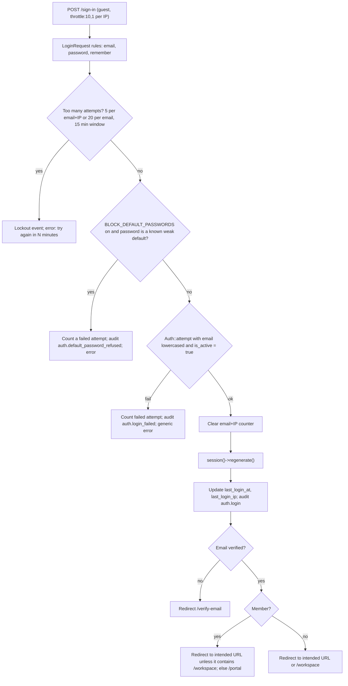
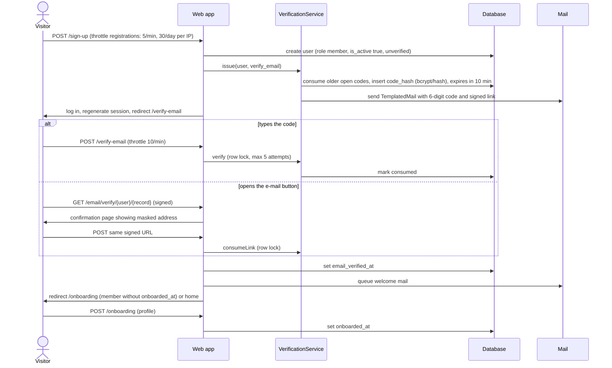
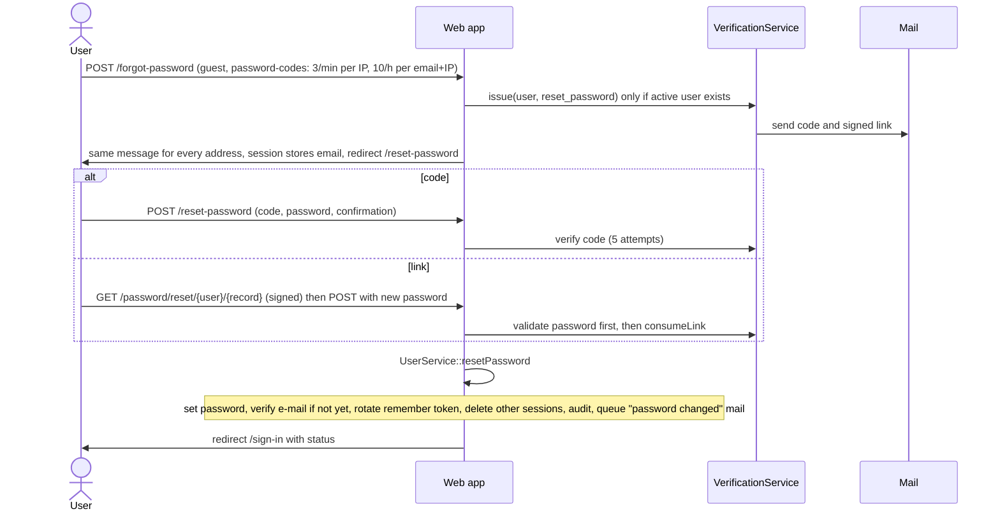

# Authentication Architecture

> **Audience:** Developers, security reviewers · **Last verified:** 2026-11-30 against commit `d1296b1`
> **Related:** [Authorization architecture](authorization-architecture.md), [Authentication security](../08-security/authentication-security.md), [Login and authentication (user guide)](../02-user-guide/login-and-authentication.md), [Authentication problems](../11-troubleshooting/authentication-problems.md)

Authentication uses Laravel's session guard with the Eloquent `users` table. There are no API tokens: the open data API is public and read-only. Passwords are never reset by a token in the URL alone. The application sends a six-digit code by e-mail, plus a signed link to the same one-time record that opens a confirmation page.

**Simple explanation:** a person signs up, gets a code by e-mail, types it in, then fills in a short profile. Staff accounts are created by a Hub Director and start already verified. Wrong passwords lock the sign-in for a while. A forgotten password is reset with another e-mailed code.

**Technical explanation:** `web` guard, `eloquent` provider, `User` model with `password` cast `hashed`. Sign-in goes through `LoginRequest::authenticate()`. Verification and reset codes are stored hashed in `verification_codes` and checked under a row lock. Emailed links are signed temporary URLs with a GET confirmation page and a POST action.

## Components

| Part | File | Role |
| --- | --- | --- |
| Guard and provider | `config/auth.php` | `web` guard, session driver, `eloquent` provider with `User::class`. |
| Sign-in and sign-out | [`Auth\SessionController`](../../app/Http/Controllers/Auth/SessionController.php) | `store()` authenticates, regenerates the session, updates last login, writes audit entries. `destroy()` logs out, invalidates the session, regenerates the CSRF token. |
| Throttling and lockout | [`LoginRequest`](../../app/Http/Requests/Auth/LoginRequest.php) | Two counters, default-password block, `Lockout` event. |
| Sign-up | `Auth\RegisterController`, `RegisterRequest`, `MemberService::register()` | Creates a `member`, logs them in, issues a code. Honours the `registration_open` site setting (403 when paused). |
| Code verification | `Auth\EmailVerificationController`, `MemberService::verifyEmail()` | `GET/POST /verify-email`, `POST /verify-email/resend`. |
| E-mail link | `Auth\EmailLinkController` | `GET` shows a confirmation page, `POST` makes the change. Routes `verification.link(.store)` and `password.link(.store)`. |
| Password reset by code | `Auth\PasswordResetController` | `/forgot-password`, `/reset-password`. |
| Codes | [`VerificationService`](../../app/Services/VerificationService.php), `VerificationCode` | Issue, verify, consume. |
| Middleware | `EnsureAccountIsActive` (`active`), `EnsureEmailIsVerified` (`verified.email`), `EnsureOnboarded` (`onboarded`) | Gate every protected route. |
| Password policy | `AppServiceProvider::boot()` | Production: 12+ characters, upper and lower case, a number. Elsewhere: 8+. |

## Sign-in flow

Details:

- **Counters.** `throttleKey()` is `lower(email)|ip` (5 attempts). `accountKey()` is a SHA-256 of the lowercased e-mail (20 attempts, across all IPs). Both decay after 900 seconds. A successful sign-in clears only the e-mail+IP counter. Counters live in the `cache` table.
- **Generic failure message.** "These details do not match an active account." covers unknown e-mail, wrong password and deactivated account alike.
- **Remember me.** `remember` passes to `Auth::attempt`. `UserService::revokeOtherSessions()` rotates the `remember_token`, which invalidates remember cookies on other devices.
- **Default passwords.** When `BLOCK_DEFAULT_PASSWORDS=true`, sign-in with any password in `SecureDemoAccounts::WEAK` is refused before the attempt and counts as a failure. It is off by default (`config/hub.php`). `docker/entrypoint.sh` runs `hub:secure-demo-accounts` on every boot.
- **Intended URL for members.** `SessionController::store()` drops an intended `/workspace` URL for members so they never land in the staff area.
- **Sign-out** is `POST /sign-out` (CSRF protected), middleware `auth, active`.

## Sign-up, code verification and onboarding

Rules in `VerificationService`:

| Rule | Value | Constant |
| --- | --- | --- |
| Code lifetime | 10 minutes | `EXPIRY_MINUTES` |
| Wrong guesses allowed | 5, then the code is consumed | `MAX_ATTEMPTS` |
| Resend interval | 60 seconds per user and purpose | `RESEND_SECONDS` (rate limiter key `otp:{purpose}:{user}`) |
| Route throttles | `verify-email` 10 per minute, `verify-email/resend` 5 per 10 minutes, link routes 10 per minute | `routes/web.php` |
| Code format | 6 digits, `random_int(100000, 999999)`, stored with `Hash::make` | `issue()` |
| Input format | `^\s*\d{3}\s?\d{3}\s*$`; non-digits are stripped before the hash check | `EmailVerificationController::verify()`, `check()` |
| Purposes | `verify_email`, `reset_password` | `VerificationCode` constants |
| Previous codes | Marked consumed when a new one is issued | `issue()` |

Why the link needs a POST: mail scanners and link previewers open links with GET. A GET that changed state would let a scanner use up the one-time record. So the signed GET only shows a page. The POST on the same signed URL consumes the record. See [Architectural decisions](architectural-decisions.md).

The code is never shown on screen, written to the session or logged by the application. With `MAIL_MAILER=log` (the default in `.env.example` and `render.yaml`) the message, including the code, is written to the Laravel log. Do not use the log mailer on a public site that people sign up to.

Verification state in the middleware:

| Middleware | Condition | Action |
| --- | --- | --- |
| `active` | `is_active` is false | Log out, invalidate session, redirect to sign-in with a deactivation message |
| `verified.email` | `email_verified_at` is null | `redirect()->guest(route('verification.notice'))` |
| `onboarded` | member with `onboarded_at` null | `redirect()->guest(route('onboarding.show'))` |

Staff accounts are created by `UserService::create()` with `email_verified_at = now()`, so they skip verification. They never need onboarding (`needsOnboarding()` is true for members only).

## Password reset

- The response to `/forgot-password` is the same whether or not the address exists. A throttled resend is swallowed to keep it identical.
- The link flow validates the new password **before** consuming the record, so a weak password does not use up the link (comment in `EmailLinkController::reset()`).
- `reset_password` links for deactivated users return 404.
- A successful reset signs out all other sessions for that user.

## Sessions

| Setting | Value | Source |
| --- | --- | --- |
| Driver | `database` | `SESSION_DRIVER` |
| Lifetime | 120 minutes | `SESSION_LIFETIME` |
| Cookie | HttpOnly (`SESSION_HTTP_ONLY` true), `SameSite=Lax`, secure when `SESSION_SECURE_COOKIE=true` (set in `render.yaml`) | `config/session.php` |
| PHP-level | `session.cookie_httponly = 1`, `session.use_strict_mode = 1` | `docker/php.ini` |
| Regeneration | On sign-up, sign-in; invalidate and token regeneration on sign-out and on deactivation | controllers and `EnsureAccountIsActive` |
| Revocation | `UserService::revokeOtherSessions()` deletes the user's other rows from `sessions` | Used after password change or reset, deactivation, deletion, and `DELETE /workspace/account/sessions` |

## Observations

- **Account enumeration at sign-up.** `RegisterRequest` validates `unique:users,email`, so the sign-up form reveals whether an address is registered. Sign-in and password reset do not. Rate limit `registrations` (5/min, 30/day per IP) bounds it.
- **E-mail code and the log mailer.** See the note above. The code is only secret if the mailer is not `log`.
- **Verification mail is sent inline.** A mail transport failure during sign-up or resend would surface as an error in the request (`Mail::send`, not queued).
- **No two-factor authentication.** Not implemented. Hub Director accounts use a password only. **Recommended, not implemented.**
- **No `password_reset_tokens` use.** The Laravel default table exists but is unused.
- Tested in `tests/Feature/Auth/AuthenticationTest.php`, `EmailLinksTest.php` and `MemberAccountTest.php`.
