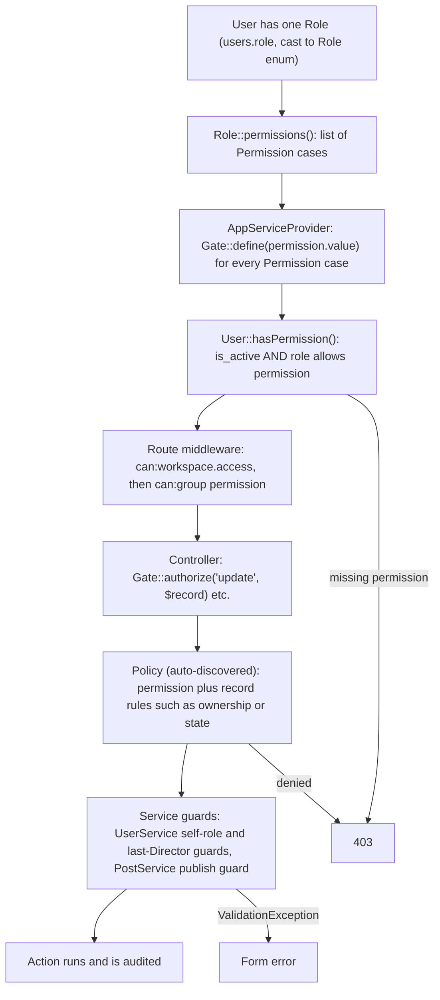

# Authorization Architecture

> **Audience:** Developers, security reviewers, administrators · **Last verified:** 2026-11-30 against commit `d1296b1`
> **Related:** [User roles and permissions (plain language)](../02-user-guide/user-roles-and-permissions.md), [Authentication architecture](authentication-architecture.md), [Authorization security](../08-security/authorization-security.md), [Role and permission management](../03-administration/role-and-permission-management.md), [Testing guide](../05-developer-guide/testing-guide.md)

This is the canonical technical page for roles and permissions. The matrix below is generated from [`app/Enums/Role.php`](../../app/Enums/Role.php) and [`app/Enums/Permission.php`](../../app/Enums/Permission.php) at the commit above. Roles are fixed in code. There is no screen to create roles or edit the matrix (the Roles and permissions page, `GET /workspace/roles`, only displays it).

**Simple explanation:** each person has one role. Each role holds a fixed list of permissions. A page or action needs one permission. Some actions also depend on the record (an intern may edit only their own unpublished post), and a few have extra safety rules (nobody changes their own role).

**Technical explanation:** `Role::permissions()` returns the list. `AppServiceProvider` registers one Gate per permission. Routes use `can:` middleware, controllers call `Gate::authorize()` with policies, and services add guards that do not depend on who is calling.

## Authorization flow

Order for a staff request: `auth` -> `active` -> `verified.email` -> `can:workspace.access` -> group `can:` -> controller policy check -> service guard.

## Roles

| Role value | Label | Staff | Purpose (`Role::description()`) | Permissions |
| --- | --- | --- | --- | --- |
| `super_admin` | Hub Director | yes | Full access, including staff accounts, site settings, e-mail and the audit log. | 20 (all) |
| `officer` | Programme Officer | yes | Runs programmes and applications, members, broadcasts, projects, content and enquiries. | 16 |
| `reviewer` | Reviewer | yes | Reviews programme and grant applications and sees reports. | 6 |
| `intern` | Communications Intern | yes | Drafts news and blog posts for an officer to publish. | 3 |
| `viewer` | Read-only Staff | yes | Read-only access to the project portfolio. | 2 |
| `member` | Member | no | Public account used to apply for programmes. | 0 |

`Role::isStaff()` is true for every role except `member`. A user model default of `viewer` applies to a new `User` object that has no role set (`User::$attributes`). `MemberService::register()` sets `member` explicitly.

## Permission matrix

Generated from `Role::permissions()`. `member` has no permissions, so it has no column.

| Permission | Meaning (`Permission::label()`) | `super_admin` | `officer` | `reviewer` | `intern` | `viewer` |
| --- | --- | :-: | :-: | :-: | :-: | :-: |
| `workspace.access` | Sign in to the staff workspace | yes | yes | yes | yes | yes |
| `projects.view` | View the project portfolio | yes | yes | yes | yes | yes |
| `projects.manage` | Create and edit projects | yes | yes |  |  |  |
| `projects.delete` | Archive or delete projects | yes |  |  |  |  |
| `reports.export` | Export portfolio data (CSV) | yes | yes | yes |  |  |
| `reports.view` | View reports and export PDF reports | yes | yes | yes |  |  |
| `grants.review` | Review legacy grant applications | yes | yes | yes |  |  |
| `programs.manage` | Create programmes and application forms | yes | yes |  |  |  |
| `applications.review` | Review applications, message applicants, review progress reports | yes | yes | yes |  |  |
| `members.manage` | Manage members, award badges, export member data | yes | yes |  |  |  |
| `broadcasts.send` | Send announcement e-mails to members | yes | yes |  |  |  |
| `content.draft` | Draft news posts and gallery albums | yes | yes |  | yes |  |
| `content.publish` | Publish news and gallery albums | yes | yes |  |  |  |
| `pages.manage` | Edit website pages (About, FAQ, Privacy...) | yes | yes |  |  |  |
| `publications.manage` | Manage publications | yes | yes |  |  |  |
| `partners.manage` | Manage partner organisations | yes | yes |  |  |  |
| `messages.manage` | Read and answer contact enquiries | yes | yes |  |  |  |
| `users.manage` | Manage staff accounts and roles | yes |  |  |  |  |
| `settings.manage` | Change site settings, e-mail (SMTP) and templates | yes |  |  |  |  |
| `audit.view` | View the audit log | yes |  |  |  |  |

Permission groups used on the Roles page (`Permission::group()`): Workspace; Portfolio and reports (`projects.*`, `reports.*`, `publications.manage`, `partners.manage`); Programmes (`grants.review`, `programs.manage`, `applications.review`); People (`members.manage`, `broadcasts.send`, `messages.manage`); Website (`content.*`, `pages.manage`); Administration (`users.manage`, `settings.manage`, `audit.view`).

### A deactivated account has no permissions

`User::hasPermission()` returns `is_active && role->allows(permission)`. A deactivated user fails every gate immediately. `EnsureAccountIsActive` also signs them out on their next request, and `UserService::setActive(false)` deletes their other session rows.

## Where each permission is enforced

Some routes carry a `can:` middleware. Others rely on the controller's `Gate::authorize()` with a policy. Both layers exist for most actions.

| Area | Route-level middleware (`routes/web.php`) | Controller / policy check |
| --- | --- | --- |
| Workspace entry | `can:workspace.access` on the whole `/workspace` prefix | none extra for the dashboard and account pages |
| Programmes (create, edit, delete, announce) | `can:programs.manage` | none (permission only) |
| Applications, programme view and export, progress reports (staff) | `can:applications.review` | `ProgramApplicationPolicy::view/review/message`, `ProgressReportPolicy::view/review` |
| Members, badges | `can:members.manage` | none |
| Account e-mails to members | `can:members.manage` on `/members/{user}/...` | `AccountEmailController::authorizeFor()`: members need `members.manage`; staff targets need `UserPolicy::update` |
| Broadcasts | `can:broadcasts.send` | none |
| Projects | none | `ProjectPolicy` (`viewAny`, `view`, `create`, `update`, `delete`, `export`) |
| Legacy grants | none | `GrantApplicationPolicy` |
| News posts | none | `PostPolicy` |
| Gallery albums | `can:content.draft` | `AlbumPolicy` |
| Publications, partners | none | `PublicationPolicy`, `OrganizationPolicy` |
| Pages | `can:pages.manage` | none |
| Enquiries | `can:messages.manage` | none |
| Reports | `can:reports.view` | none (CSV export of projects uses `ProjectPolicy::export` = `reports.export`) |
| Staff accounts | none (`users.*` resource and `users.toggle`, `users.password-reset`) | `UserPolicy` |
| Roles page | `can:users.manage` | none |
| Settings, e-mail templates | `can:settings.manage` | none |
| Audit log | `can:audit.view` | none |
| Member portal | `auth, active, verified.email, onboarded` | `ProgramApplicationPolicy::view/withdraw/message/report`, `ProgressReportPolicy::view/update`, plus ownership `abort_unless` checks |
| Notifications | `auth, active, verified.email` | Always the signed-in user's own |

## Policies

Nine policies in `app/Policies`. Laravel discovers them by name (`Post` -> `PostPolicy`). `AppServiceProvider` has no `Gate::policy()` calls.

| Policy | Method | Rule |
| --- | --- | --- |
| `AlbumPolicy` | `viewAny`, `create` | `content.draft` |
| | `update` | `content.publish`, or (`content.draft` and the album is not published) |
| | `delete` | `content.publish` |
| | `viewUnpublished` | `content.draft` (used to preview drafts on `/media/photos` and `/gallery/{album}`) |
| `GrantApplicationPolicy` | `viewAny`, `view`, `review` | `grants.review` |
| `OrganizationPolicy` | `viewAny` | `projects.view` |
| | `create`, `update`, `delete` | `partners.manage` |
| `PostPolicy` | `viewAny`, `create` | `content.draft` |
| | `update` | `content.publish`, or (`content.draft` and the user is the author and `published_at` is null) |
| | `delete` | Same as `update` |
| | `publish` | `content.publish` |
| `ProgramApplicationPolicy` | `view` | The applicant, or `applications.review` and the application is not a draft |
| | `withdraw` | The applicant and the status is `draft`, `submitted` or `under_review` |
| | `message` | Not a draft, and (the applicant or `applications.review`) |
| | `report` | The applicant and the status is `approved` |
| | `review` | `applications.review`, not a draft, and the reviewer is not the applicant |
| `ProgressReportPolicy` | `view` | The owner or `applications.review` |
| | `update` | The owner and the report status is `changes_requested` (`ProgressReport::isEditable()`) |
| | `review` | `applications.review` and not the owner |
| `ProjectPolicy` | `viewAny`, `view` | `projects.view` |
| | `create`, `update` | `projects.manage` |
| | `delete` | `projects.delete` |
| | `export` | `reports.export` |
| `PublicationPolicy` | all four | `publications.manage` |
| `UserPolicy` | `viewAny`, `create` | `users.manage` |
| | `update` | `users.manage` and the target is staff (members cannot be edited here) |
| | `deactivate`, `delete` | `users.manage`, the target is staff, and the target is not the acting user |

`Program`, `ContactMessage`, `Broadcast`, `Page`, `Setting` and `EmailTemplate` have no policy. They are protected by route-level `can:` middleware only.

## Service-level guards

These hold no matter which controller or command calls the service.

| Guard | Where | Rule |
| --- | --- | --- |
| No self role change | `UserService::update()` | If the actor is the same user and the role differs: `ValidationException` "You cannot change your own role." |
| Last Hub Director | `UserService::guardLastAdministrator()` | Cannot demote, deactivate or delete the only active `super_admin`. |
| Publish guard | `PostService::publishDate()` | If the editor lacks `content.publish`, the existing `published_at` is kept and the requested publish action is ignored. An intern's draft stays a draft even if the form asks to publish. |
| Staff form cannot create a member | `StoreUserRequest` and `UpdateUserRequest` validate `role` with `Rule::enum(Role::class)->only(Role::staff())` | Test: `test_staff_form_cannot_turn_anyone_into_a_member`. |
| Privileged fields not mass assignable | `User::$fillable` excludes `role`, `is_active`, `email_verified_at`, `onboarded_at`, `xp` | Test: `test_role_cannot_be_mass_assigned_through_other_forms`. |
| Review separation | `ProgramApplicationPolicy::review`, `ProgressReportPolicy::review` | A staff member cannot review their own application or report. |
| Bulk review limits | `ApplicationService::bulkReview()` | Skips `draft` and `withdrawn` applications. |

## Open data API

`/api`, `/api/v1/*` and `/api/v2/*` use no gates, policies or sessions. Every route is `GET`, and the controllers return only rows that pass a public scope (`Project::public()`, `Post::published()`, visible programmes, published albums). The `api.version` middleware only adds headers, and `throttle:api` limits requests per IP. A signed-in user gets no extra data from the API.

## How tests enforce it

| Test | What it proves |
| --- | --- |
| [`tests/Feature/Workspace/AccessControlTest.php`](../../tests/Feature/Workspace/AccessControlTest.php) | The full role x page matrix. For each of the 6 roles it opens 23 workspace URLs and expects exactly 200 or 403 (members: 403 on all). Guests are redirected to sign-in for every page. The sidebar shows only links the role can use. Workspace pages carry `noindex`. The test file says: if a permission changes in `Role`, this test must be updated deliberately. |
| [`tests/Feature/Workspace/PrivilegesTest.php`](../../tests/Feature/Workspace/PrivilegesTest.php) | Loops over every `POST/PUT/PATCH/DELETE` route under `workspace` that has a `can:` middleware. For each role lacking the permission it expects 403 or 404 (and guests go to sign-in). It requires at least 120 checked pairs (144 at time of writing). Also tests: nobody can change their own role, only `users.manage` changes roles, staff form cannot create members, role changes are audited with old and new values, admin-sent reset and verification e-mails, officers help members but not staff, the Roles page is Director-only, the sidebar matches the role, and deactivated staff are signed out on their next request. |
| `tests/Feature/Workspace/UserManagementTest.php` | Creating accounts for each role, invalid roles, self-deactivation and self-deletion, last Director guard. |
| `tests/Feature/Workspace/ContentPublishingTest.php` | Intern draft rules and officer publishing. |
| `tests/Feature/Workspace/ProjectManagementTest.php` | Read-only roles cannot write, only the Director can archive. |
| `tests/Feature/Auth/AuthenticationTest.php`, `Portal/EngagementTest.php` | Sign-in, member access, application and report ownership. |

Coverage limits worth knowing:

- `PrivilegesTest` only checks routes that have a `can:` middleware. State-changing routes that are guarded **only by a policy** (`users.*`, `posts.*`, `projects.*`, `publications.*`, `organizations.*`, `grants.update`) are skipped by that loop. They are covered by `AccessControlTest` (GET pages) and by the feature tests listed above, not by a systematic role x route sweep.
- `AccessControlTest` checks `GET` pages only. Write actions on policy-only routes rely on the per-feature tests.

## Findings

| Finding | Where | Detail |
| --- | --- | --- |
| Portal routes do not check the member role. | `routes/web.php` (portal group), `app/Http/Controllers/Portal/*` | The group requires `auth, active, verified.email, onboarded`. `onboarded` only redirects members. A staff account can therefore open `/portal/*` and apply to a programme. No controller calls `isMember()` (grep of `Portal/`). Review separation still stops them reviewing their own application. **Requires confirmation:** whether this is intended. |
| `Program`, `Broadcast`, `ContactMessage`, `Page` rely on route middleware alone. | `routes/web.php` | Correct today because every route sits in a `can:` group. A new route added outside the group would be unprotected. |
| Roles are not editable at run time. | `Role::permissions()` | Changing a role needs a code change, a test update and a deploy. This is deliberate ("the role -> permission matrix lives here and nowhere else"). |
| `PostPolicy::publish()` takes no post. | `app/Policies/PostPolicy.php` | It is a permission wrapper. The real guard is in `PostService::publishDate()`. |

## Changing the matrix

1. Edit `Role::permissions()` (and `Permission` if adding a case, with `label()` and `group()`).
2. Add `can:` middleware to any new route, and a policy method if the rule depends on the record.
3. Update `AccessControlTest::ALLOWED` and run `php artisan test` (see [Testing guide](../05-developer-guide/testing-guide.md)).
4. Update this page and [User roles and permissions](../02-user-guide/user-roles-and-permissions.md).
