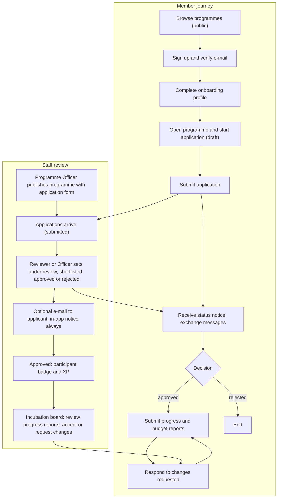
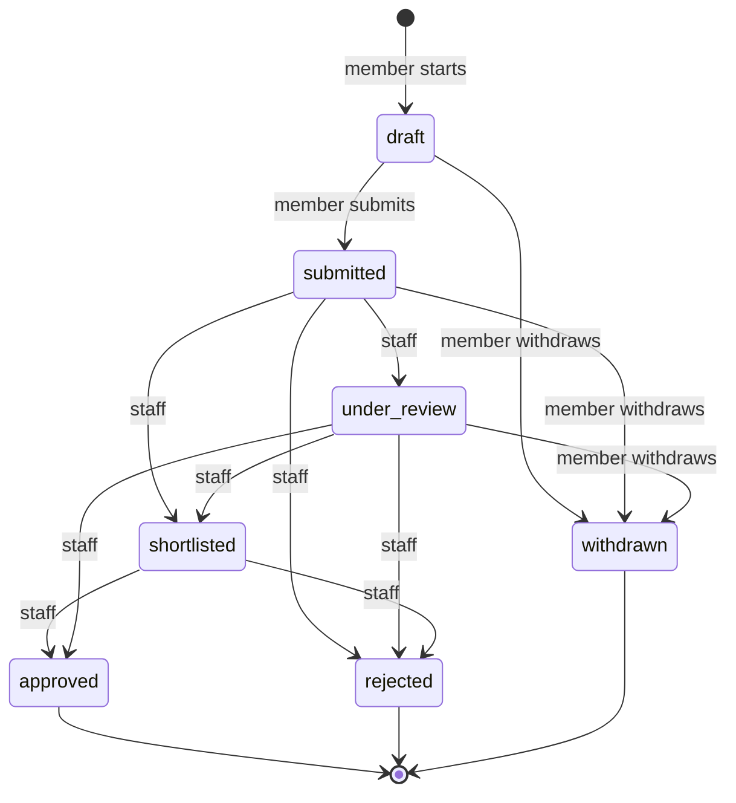

# Business Logic

> **Audience:** Developers, product owners · **Last verified:** 2026-11-30 against commit `d1296b1`
> **Related:** [Data flow](data-flow.md), [Authorization architecture](authorization-architecture.md), [Business workflows](../13-product-and-business/business-workflows.md), [Functional requirements](../13-product-and-business/functional-requirements.md), [Step-by-step workflows (user guide)](../02-user-guide/step-by-step-workflows.md)

This page lists the rules the application enforces and where they live. Rules sit in services, enums and model scopes, not in controllers or views. Each rule names its source so it can be changed in one place.

## Main user workflows

## State machines

### Programme (`ProgramStatus`)

States: `draft`, `published`, `closed`, `archived`. A programme is publicly visible when `published` or `closed` (`Program::isVisible()`, `ProgramStatus::publicValues()`). `published_at` is set the first time it becomes `published` (`ProgramService::applyStatus()`).

A programme **accepts applications** (`Program::isAcceptingApplications()`) when all hold: status `published`, `opens_at` is null or past, `closes_at` is null or future, and it is not full. "Full" means `capacity` is set and the number of applications with a status other than `draft` or `withdrawn` has reached it.

> **Note:** The capacity check is a count taken before the insert, with no lock on the programme. Two members submitting at the same moment on the last place could both pass. Not covered by a test. **Requires confirmation** if capacity must be exact.

When a programme is full, members who hold drafts cannot save or submit them (`ApplicationService::save()` throws "no longer accepting applications").

### Application (`ApplicationStatus`)

The stored value pproved is shown to people as **Accepted** (ApplicationStatus::label()). The same word appears in ReportStatus::Accepted for reports.

| Rule | Source |
| --- | --- |
| Only `draft` is editable by the member. | `ProgramApplication::isEditable()` |
| Withdraw allowed from `draft`, `submitted`, `under_review`. | `ApplicationStatus::canWithdraw()` |
| Final statuses: `approved`, `rejected`, `withdrawn`. `decided_at` is set when staff move to a final status. | `ApplicationStatus::isFinal()`, `ApplicationService::review()` |
| One application per member per programme. | Unique index `(program_id, user_id)` |
| Staff cannot see drafts and cannot review their own application. | `ProgramApplicationPolicy` |
| Reviewers set any status from the list. The code does not enforce the arrows above, so a staff member can, for example, move `rejected` back to `under_review`. The diagram shows the intended flow. | `ApplicationService::review()` accepts any `ApplicationStatus` value |
| Messages are allowed once the application is no longer a draft. | `ProgramApplicationPolicy::message()` |
| Progress reports are allowed only when `approved`. | `ProgramApplication::canReportProgress()` |
| Bulk review skips drafts and withdrawn applications. | `ApplicationService::bulkReview()` |

On a status change `ApplicationService::review()` creates an in-app notification for the applicant. If the new status is `approved` the applicant gets the `participant` achievement (50 XP). The e-mail is sent only when the reviewer ticks "notify".

### Progress report (`ReportStatus`)

States: `submitted`, `accepted`, `changes_requested`.

- A member can create reports only for an `approved` application and edit a report only while it is `changes_requested` (`ProgressReport::isEditable()`).
- Submitting sets status `submitted`. First submission gives +20 XP. Resubmission does not.
- Budget spent is recomputed on the server as the sum of line items when items exist, otherwise the number entered (`ProgressReportService::submit()`, `cleanLineItems()`).
- Staff with `applications.review`, other than the author, set the status and write feedback. The author gets an in-app notice.
- `budgetByProgramme()` compares programme funding with reported spending for the Reports page.

### Legacy grant application (`GrantStatus`)

States: `submitted`, `under_review`, `shortlisted`, `approved`, `rejected`. Reviewed in `/workspace/grants` by roles with `grants.review`. `GrantApplicationService::review()` stores notes, reviewer and time in a transaction, audits, and queues `GrantStatusUpdatedMail` to the applicant's e-mail if the status changed and notification is on. No new legacy applications can be created from the website (the old `/apply` redirects to `/programmes`).

### Post (derived state)

| `published_at` | State |
| --- | --- |
| null | draft |
| in the future | scheduled |
| now or past | published (`Post::scopePublished()`, `isPublished()`) |

`PostService::publishDate()`:

- An editor without `content.publish` (intern) never changes `published_at`. Their post stays a draft or keeps its current value.
- With `content.publish`: action `publish` sets now (or keeps an existing past date), `schedule` uses the given date (validation rejects past dates, tested in `ContentPublishingTest`), anything else clears it (unpublish).
- Interns can edit only their own post while `published_at` is null (`PostPolicy::update`).

Albums work the same way with `is_published`: `content.publish` holders can edit any album, `content.draft` holders can edit albums that are not published.

### Broadcast (`BroadcastStatus`) and enquiry (`ContactStatus`)

| Entity | States | Rule |
| --- | --- | --- |
| Broadcast | `draft` -> `sending` -> `sent`, or `sending` -> `failed` | `BroadcastService::send()` only acts on a `draft`. The job only acts on `sending`. If the job throws, `SendBroadcast::failed()` sets `failed` and audits `broadcast.failed`. A failed broadcast is not retried and has no resend screen. Audience: active, verified members with `marketing_opt_in`, filtered by affiliation and interests. |
| Contact message | `new`, `read`, `replied`, `archived` | `ContactMessageService::markRead()` and `setStatus()`. New enquiries notify staff with `messages.manage` who have `notify_contact_messages` on. Public form throttled to 3 per minute and 20 per day per IP. |

## Engagement: XP, levels and badges

| Event | XP | Source |
| --- | --- | --- |
| Submit an application | +10 | `EngagementService::XP_APPLICATION` |
| First progress report | +20 | `XP_REPORT` |
| Achievement: winner / finalist / participant / alumni / mentor / custom | 300 / 150 / 50 / 100 / 120 / 50 (staff may override, clamped to 0 through 1000) | `AchievementType::xp()`, `award()` |

Levels by total XP (`EngagementService::LEVELS`): 0 Newcomer, 50 Explorer, 150 Builder, 400 Innovator, 800 Trailblazer, 1500 Hub Legend.

- An achievement is unique per member, programme and type. Awarding again returns the existing one and adds no XP. The database enforces `(user_id, program_id, type)`.
- For awards without a programme, the unique index cannot stop duplicates (PostgreSQL and SQLite treat NULLs as distinct). The service check (program_id IS NULL) does, but it is not atomic. > **Requires confirmation:** behaviour under a concurrent double submit.
- `users.xp` is a running total. The public leaderboard lists active members with `public_profile` and `xp > 0` (`User::scopeOnLeaderboard`). Revoking an achievement subtracts its XP (`revoke()`).

## Accounts and access rules

| Rule | Source |
| --- | --- |
| Registration can be paused by the setting `registration_open` (403). | `RegisterController::store()` |
| Members cannot enter the workspace. Staff accounts are created by a Hub Director only and start verified. | `can:workspace.access`, `UserService::create()` |
| Nobody changes their own role. The last active Hub Director cannot be demoted, deactivated or deleted. | `UserService` |
| Deactivation signs the user out everywhere and blocks sign-in. | `EnsureAccountIsActive`, `UserService::setActive()` |
| Members are suspended and re-enabled from the Members page (`members.toggle`). Staff are managed on the Staff accounts page. | `MemberController::toggle()`, `UserController::toggle()` |
| Officers can send reset and verification e-mails to members. Only a Hub Director can do it for staff. | `AccountEmailController::authorizeFor()` |
| Partners linked to projects cannot be deleted. | `UserManagementTest::test_partners_linked_to_projects_cannot_be_deleted` |

## Reporting rules

- Public figures count only projects marked public (`MetricsService::publicStats()`). Workspace figures include private projects and grants.
- Reports are computed for a `DateRange` (preset or custom). Demographic breakdowns are totals only, in age bands: Under 18, 18 to 24, 25 to 35, 36 to 50, Over 50.
- Leaderboard in a period counts XP earned in that period using the same XP rules. "All time" uses `users.xp`.
- Metrics are cached for `METRICS_CACHE_TTL` seconds and flushed on writes to the models that feed them.

## Where to change a rule

| Change | Edit |
| --- | --- |
| Who can do what | `Role::permissions()`, policies, tests (see [Authorization architecture](authorization-architecture.md#changing-the-matrix)) |
| Allowed application transitions | `ApplicationService::review()` and `ApplicationStatus` |
| XP values and levels | `EngagementService` constants, `AchievementType::xp()` |
| Application form fields | Workspace programme form builder (`FormSchema`) |
| E-mail wording | Workspace E-mail templates (`EmailTemplates`) |
| Focus areas, post categories, publication types, partner roles | `config/hub.php` |
