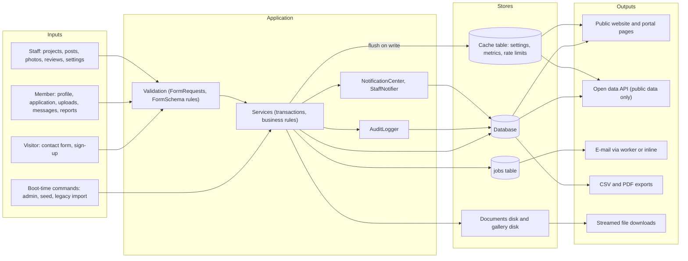
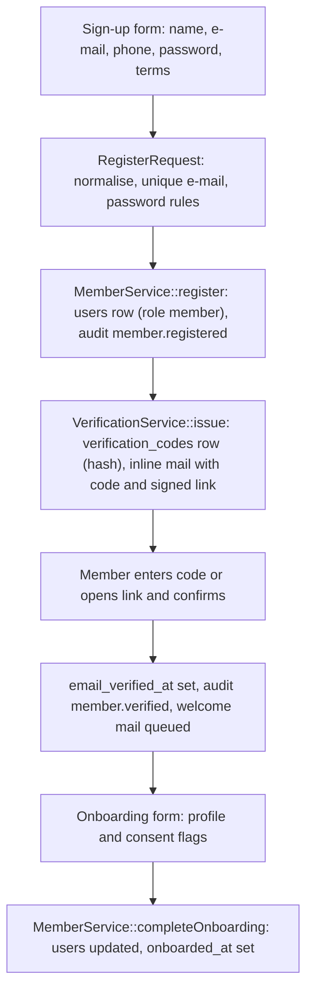
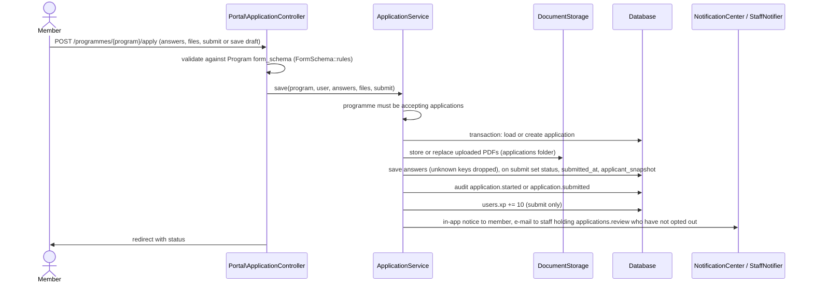

# Data Flow

> **Audience:** Developers, data protection reviewers · **Last verified:** 2026-11-30 against commit `d1296b1`
> **Related:** [Request/response lifecycle](request-response-lifecycle.md), [Database architecture](database-architecture.md), [Business logic](business-logic.md), [Data protection](../08-security/data-protection.md), [Data retention](../07-database/data-retention.md)

This page follows data through the system: where it enters, what validates and transforms it, where it is stored, and where it leaves. Personal data is called out because the Hub holds member profiles, demographics and application answers.

## Overall data flow

## Data classes

| Class | Examples | Stored in | Who can read it | Leaves the system through |
| --- | --- | --- | --- | --- |
| Public content | Published posts, public projects, publications, visible programmes, published albums, partner names, CMS pages | `posts`, `projects`, `publications`, `programs`, `albums`, `organizations`, `pages` | Everyone | Website, API, sitemap |
| Member profile | Name, e-mail, phone, gender, date of birth, region, affiliation, institution, education level, disability, bio, interests | `users` | The member, staff with `members.manage` | Staff CSV export of members, applicant snapshot on submit. Public profile shows only if `public_profile` is set. |
| Application data | Answers (`answers` JSON), uploaded files, applicant snapshot, scores, internal notes, decision message | `program_applications`, documents disk | The applicant (the portal view shows the decision message, not internal notes or score), staff with `applications.review` | Application CSV export, file downloads, status e-mail |
| Messages | Applicant and staff messages, enquiries | `application_messages`, `contact_messages` | Parties to the conversation, staff with `messages.manage` | E-mail notice to staff |
| Credentials | Password hash, verification and reset code hashes, remember token | `users`, `verification_codes` | Nobody in clear text | None |
| Audit trail | Who did what, IP, field-level changes | `activity_logs` | `audit.view` (Hub Director) | None |
| Configuration | Site settings, encrypted SMTP password, e-mail templates | `settings`, `email_templates` | `settings.manage` | None |

Aggregated demographics for reports leave the system as totals only (`InsightsService`, "Demographics are only ever returned as totals").

## Flow 1: public read (website and API)

1. Request reaches a `Site`, `Api\V1` or `Api\V2` controller. No sign-in.
2. The controller queries scoped models (`Project::public()`, `Post::published()`, `Program::visible()`, `Album::published()`). Draft and private rows are excluded in the query, not in the view.
3. Counters and figures come from `MetricsService`, cached for `METRICS_CACHE_TTL` seconds.
4. API: results pass through a Resource (`Http/Resources/Api/V1` or `V2`) so only whitelisted fields are output. Responses carry `Cache-Control: public, max-age=60, s-maxage=60` (v2: `API_CACHE_SECONDS`) and a weak ETag, and a matching `If-None-Match` returns 304. v2 lists are cursor-paginated, accept `updated_since`, and `/api/v2/albums` returns only photos whose files exist. v2 has no record of deleted or unpublished rows, so a client that syncs with `updated_since` cannot learn that a record disappeared.
5. Any write to `GrantApplication`, `Organization`, `Project`, `Publication` or `ProgramApplication` flushes the metrics cache through the `FlushesMetrics` trait.

The scheduled state of a post is derived at read time: `published_at` null is a draft, in the future is scheduled, in the past is published. No job flips a flag.

## Flow 2: member registers and verifies

Consent flags `marketing_opt_in` (announcement e-mail) and `public_profile` (community page and leaderboard) are plain booleans on `users`, both default false.

## Flow 3: application submission

Drafts skip `required` rules so members can save partial work. After submit the application is no longer editable (`ProgramApplication::isEditable()` is true only for `draft`).

## Flow 4: file upload and download

| Step | Documents (reports, publications, application files) | Gallery photos |
| --- | --- | --- |
| Validate | Form request or inline rules: PDF, size up to `MAX_UPLOAD_KB` (default 20480) | `image`, `mimes:jpg,jpeg,png,webp`, 10 MB each, minimum 300 x 300 |
| Process | `DocumentStorage::store()`: random name `{prefix}_{date}_{random}.pdf` | `GalleryService`: refuse over 30 megapixels, decode with GD, apply EXIF orientation, flatten to white, resize, re-encode to JPEG quality 82 (large and thumb) |
| Store | Documents disk, relative path saved on the record | Gallery disk (or S3), path and disk saved on `album_photos` |
| Serve | Controller authorises, then `DocumentStorage::download()` streams the file | `/media/photos/{photo}/{size}` checks the album is published (staff with `content.draft` may preview), then streams with `nosniff` and `inline` |
| Replace or delete | Old file deleted when a record's file is replaced (tested in `ProjectManagementTest`) | `deletePhoto()` and album delete remove both renditions |

The original uploaded photo is never stored. Metadata such as GPS EXIF data is dropped because the image is re-encoded. The paths in the database are relative to the disk root.

> **Warning:** On the free Render plan the container disk is not persistent. Files on the `private` and `gallery` disks disappear on redeploy while their database rows remain. Use S3-compatible storage for anything that must last.

## Flow 5: staff review and notification

1. Staff opens `/workspace/applications/{application}` (`applications.review`, policy `view`).
2. `PUT` sets status, internal notes, decision message, score and an optional "notify" flag. `ApplicationService::review()` records `reviewed_by`, sets `decided_at` for final statuses, audits with a field-level diff.
3. If the status changed: an in-app notification goes to the applicant (always). If approved, the "participant" achievement is awarded and XP added. If the reviewer ticked notify, a templated e-mail is queued.
4. Bulk review applies the same method to many applications and skips drafts and withdrawn ones.

## Flow 6: broadcast e-mail

1. Staff drafts a broadcast (`broadcasts` row, status `draft`). Audience: interests and affiliations.
2. `BroadcastService::send()` sets `sending`, stores `recipients_count`, audits, dispatches `SendBroadcast` to the queue.
3. The worker reads recipients in chunks of 200 (`lazyById`), restricted to active, verified members who opted in. Each gets one queued `TemplatedMail` with a personal signed unsubscribe link.
4. When finished the job sets `sent`, the final count and `sent_at`. If the job throws, `SendBroadcast::failed()` sets `failed` and writes the audit action `broadcast.failed`.

## Flow 7: exports

| Export | Route | Permission | Mechanism |
| --- | --- | --- | --- |
| Projects CSV | `GET /workspace/projects/export` | `reports.export` | `ReportExportService`, chunked stream. Audit action `report.projects_exported`. |
| Applications CSV | `GET /workspace/programmes/{program}/export` | `applications.review` | `ApplicationService::exportCsv()`, `lazy(500)`, `Cache-Control: no-store`. Audit action `application.exported`. |
| Members CSV | `GET /workspace/members/export` | `members.manage` | `Workspace\MemberController::export`. Audit action `member.exported`. |
| Reports PDF | `GET /workspace/reports/pdf` | `reports.view`, throttle 10 per minute | DomPDF from `InsightsService` figures. Audit action `report.exported`. |

CSV cells beginning with `=`, `+`, `-`, `@`, tab or carriage return get a leading apostrophe to block spreadsheet formula injection (`ApplicationService::cell()`, `ReportExportService::cell()`).

## Flow 8: audit and metrics side effects

Every service write that matters calls `AuditLogger::record()`. It stores the acting user, action key (for example `application.reviewed`), a description, the request IP, optional field diff and the subject (polymorphic). Actor and IP come from the server. Passwords appear in diffs only as "changed". Large text such as post bodies is removed from diffs. The Audit log page searches these rows.

## Data that is deliberately not stored

- The six-digit code in clear text. Only a hash is stored. It is e-mailed and never logged by the application (but see the log mailer note in [Authentication architecture](authentication-architecture.md)).
- Original uploaded photos and their metadata.
- The SMTP password in clear text (encrypted with `APP_KEY`).
- Payment data. The system holds no payment features.
