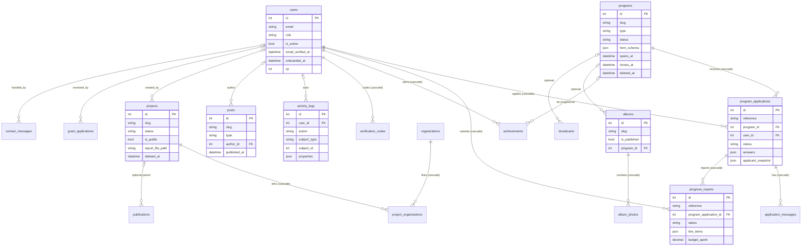

# Database Architecture

> **Audience:** Developers, database administrators · **Last verified:** 2026-11-30 against commit `d1296b1`
> **Related:** [Database overview](../07-database/database-overview.md), [Tables and columns](../07-database/tables-and-columns.md), [Entity relationships](../07-database/entity-relationships.md), [Migrations](../07-database/migrations.md), [tables-and-columns](../07-database/tables-and-columns.md)

The application uses 30 tables. PostgreSQL is the production database (Render). SQLite is the local default and one CI job. This page explains the structure and the design choices. Full column lists are in [Tables and columns](../07-database/tables-and-columns.md) and in the generated [tables-and-columns](../07-database/tables-and-columns.md).

## Entity-relationship diagram (core entities)

Only key columns are shown. Every foreign key to `users` that is not drawn here uses `ON DELETE SET NULL` unless noted.

The diagram omits `activity_logs.subject_type/subject_id`, which is a polymorphic reference to any model, so it has no database foreign key. `publications`, `grant_applications`, `contact_messages`, `pages`, `settings`, `email_templates` and `broadcasts` have few or no relations to the rest and are detailed in [Tables and columns](../07-database/tables-and-columns.md).

## Table groups

| Group | Tables | Notes |
| --- | --- | --- |
| Accounts | `users`, `verification_codes`, `password_reset_tokens`, `sessions` | `users.role` is a string cast to `Role`. `password_reset_tokens` is the Laravel default and is not used by the code-based reset (`verification_codes` is). |
| Programmes | `programs`, `program_applications`, `application_messages`, `progress_reports`, `achievements`, `broadcasts` | Applications are unique per `(program_id, user_id)`. Achievements are unique per `(user_id, program_id, type)`. |
| Portfolio (legacy origin) | `projects`, `organizations`, `project_organizations`, `publications`, `grant_applications` | `projects.legacy_id` and `publications.legacy_id` keep the old system's ids. `grant_applications` holds legacy grant submissions. |
| Website content | `posts`, `pages`, `albums`, `album_photos`, `contact_messages` | Post state is derived from `published_at`. Pages have `is_published`. |
| Configuration | `settings`, `email_templates` | `settings` and `email_templates` use a string key as primary key. |
| Audit and notifications | `activity_logs`, `notifications` | Audit is append-only by convention: the code only creates rows. |
| Framework | `cache`, `cache_locks`, `jobs`, `job_batches`, `failed_jobs`, `migrations` | Database-backed cache and queue. |

## Design decisions visible in the schema

| Decision | Evidence | Consequence |
| --- | --- | --- |
| Enums stored as strings, not database enums. | `users.role`, `programs.status`, `program_applications.status` are `varchar` in `schema.md`. | Portable across SQLite and PostgreSQL. Allowed values are enforced in PHP (casts, validation), not by the database. |
| JSON columns for variable data. | `programs.form_schema`, `program_applications.answers`, `applicant_snapshot`, `progress_reports.line_items`, `activity_logs.properties`, `users.interests`, `broadcasts.audience`. | The application form is defined per programme without schema changes. Answers are validated against `form_schema` on the server (`FormSchema::rules()`). |
| Soft deletes on content and portfolio. | `deleted_at` on `programs`, `projects`, `publications`, `posts`, `grant_applications`. | Deleted records can be recovered by hand. There is no restore screen. |
| Applicant snapshot. | `program_applications.applicant_snapshot` is set at submit time (`Demographics::snapshot()`). | Reports keep the applicant's demographic data as it was when they applied. |
| Running XP total. | `users.xp` is updated by `EngagementService::addXp()`. | Leaderboards are a single indexed query. The total can drift if rows are changed outside the service. |
| Cascade versus keep. | Applications, reports, messages, achievements and verification codes cascade on user delete. Authors, creators, reviewers and the audit actor become `NULL`. | Deleting a member removes their applications. Deleting staff keeps their content and audit entries without a name. Only staff can be deleted from the UI (`UserPolicy::delete` requires `target->isStaff()`). |
| Polymorphic audit subject. | `activity_logs.subject_type`, `subject_id`. | History survives deletion of the subject, and there is no foreign key to break. |
| Legacy ids preserved. | `legacy_id` columns. | Supports the migration from the old `project_mysql` system. |
| Plain file paths. | `projects.report_file_path`, `publications.pdf_file_path`, answers for file fields, `album_photos.path_large/path_thumb/disk`. | The database stores relative paths. The file itself lives on a disk. Losing the disk leaves dangling paths (`AlbumPhoto::isAvailable()` hides missing photos). |

## Connection and portability

- `config/database.php` reads `DB_CONNECTION` (default `sqlite`) and `DB_URL` for PostgreSQL. `render.yaml` sets `DB_CONNECTION=pgsql` and `DB_URL` from the managed database.
- The Docker image installs `pdo_pgsql` and `pdo_mysql`. MySQL appears in `Searchable` ("same behaviour on SQLite, MySQL and PostgreSQL") but CI runs only SQLite and PostgreSQL.
- Search uses a portable case-insensitive `LIKE` helper (`Searchable::scopeSearch`). No full-text search.
- `MetricsService` uses a handful of aggregate queries cached for `METRICS_CACHE_TTL` seconds.
- The queue, cache and session tables share the application database. A heavy queue or cache workload competes with application queries. Redis is mentioned in `.env.example` as optional and is **Recommended, not implemented**.

## Migrations and seeding

Migrations are in `database/migrations`. The entrypoint runs `php artisan migrate --force` on every boot (unless `RUN_MIGRATIONS=false`). Seeders in `database/seeders`: `PageSeeder` runs on every boot and never overwrites edited pages. The full demo seeder runs only if `SEED_DEMO_DATA=true`. See [Migrations](../07-database/migrations.md) and [Seed data](../07-database/seed-data.md).

> **Warning:** Migrations run automatically on deploy. A destructive migration reaches production as soon as `main` deploys. There is no pre-deploy backup step in the repository. See [Backup and recovery](../09-deployment-and-operations/backup-and-recovery.md).

## Observations

- `password_reset_tokens` is created by the default Laravel migration but the application resets passwords through `verification_codes`. The table is unused by application code (verified by reading `PasswordResetController` and `EmailLinkController`).
- `users.notify_new_grants` keeps its legacy name, but `ApplicationService::notifySubmitted()` passes it to `StaffNotifier` as the opt-out flag for the "new programme application" e-mail to staff with `applications.review`. The column name is misleading.
