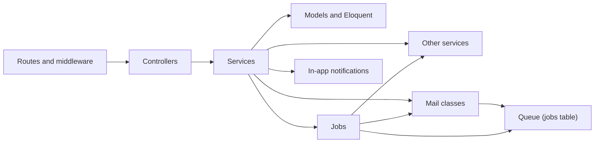
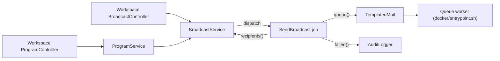

# Dependency map

> **Audience:** Developers, maintainers · **Last verified:** 2026-11-30 against commit `d1296b1`
> **Related:** [Backend architecture](backend-architecture.md), [Design patterns](design-patterns.md), [Application architecture](application-architecture.md), [Dependency management](../05-developer-guide/dependency-management.md), [Dependency security](../08-security/dependency-security.md)

This page maps what depends on what. Part 1 covers the application's own code: which controllers call which services, which services call other services, and where jobs, mail and notifications fit. Part 2 lists the external packages from `composer.json` and `package.json` and what uses them. The internal map was built by reading `use` statements and constructor and method injection in `app/Http/Controllers/**`, `app/Services/*`, `app/Jobs/*`, `app/Mail/*`, `app/Console/Commands/*` and `app/Http/Requests/*`.

## Layers

Controllers depend on services and on models. Services never depend on controllers. One cycle exists: `BroadcastService` dispatches `SendBroadcast`, and `SendBroadcast::handle()` calls back into `BroadcastService::recipients()`. It works because the job receives the service at run time from the container, not through the constructor.

## Service-to-service dependencies

All 24 classes in `app/Services` are listed. Dependencies are constructor injections unless noted.

| Service | Depends on |
| --- | --- |
| `AuditLogger` | none (writes `activity_logs` through `ActivityLog`) |
| `DocumentStorage` | none (Laravel `Storage`) |
| `MetricsService` | none |
| `NotificationCenter` | none (uses `HubNotification` and Laravel `Notification`) |
| `StaffNotifier` | none (queues mail with `Mail::to()->queue()`) |
| `ReportExportService` | `AuditLogger` through `app(AuditLogger::class)`, not the constructor |
| `SettingsService` | `AuditLogger` |
| `MailSettings` | `SettingsService` |
| `VerificationService` | `AuditLogger`, `TemplatedMail` |
| `MemberService` | `VerificationService`, `AuditLogger`, `TemplatedMail` |
| `UserService` | `AuditLogger`, `PasswordChangedMail` |
| `PostService` | `AuditLogger` |
| `GalleryService` | `AuditLogger` |
| `GrantApplicationService` | `AuditLogger`, `GrantStatusUpdatedMail` |
| `BroadcastService` | `AuditLogger`, dispatches `SendBroadcast` |
| `ProgramService` | `AuditLogger`, `BroadcastService` |
| `ProjectService` | `DocumentStorage`, `AuditLogger` |
| `PublicationService` | `DocumentStorage`, `AuditLogger` |
| `ContactMessageService` | `AuditLogger`, `StaffNotifier`, `NewContactMessageStaffMail` |
| `ConversationService` | `NotificationCenter`, `AuditLogger` |
| `EngagementService` | `AuditLogger`, `NotificationCenter` |
| `ProgressReportService` | `AuditLogger`, `NotificationCenter`, `EngagementService` |
| `ApplicationService` | `DocumentStorage`, `AuditLogger`, `StaffNotifier`, `NotificationCenter`, `EngagementService`, `TemplatedMail` |
| `InsightsService` | `MetricsService`, `ProgressReportService`, and the constants of `EngagementService` |

`GrantApplicationService` does not call `ApplicationService`. Its class comment points to it only to explain that legacy grant applications are kept as records.

```mermaid
flowchart TD
    AUD["AuditLogger"]
    DOC["DocumentStorage"]
    NC["NotificationCenter"]
    SN["StaffNotifier"]
    MET["MetricsService"]
    SET["SettingsService"]
    MS["MailSettings"]
    VER["VerificationService"]
    MEM["MemberService"]
    USR["UserService"]
    ENG["EngagementService"]
    PRG["ProgressReportService"]
    APP["ApplicationService"]
    CON["ConversationService"]
    CMS["ContactMessageService"]
    BRC["BroadcastService"]
    PRM["ProgramService"]
    PRJ["ProjectService"]
    PUB["PublicationService"]
    INS["InsightsService"]
    GAL["GalleryService"]
    POS["PostService"]
    GRA["GrantApplicationService"]
    EXP["ReportExportService"]
    SET --> AUD
    MS --> SET
    VER --> AUD
    MEM --> VER
    MEM --> AUD
    USR --> AUD
    ENG --> AUD
    ENG --> NC
    PRG --> ENG
    PRG --> NC
    PRG --> AUD
    APP --> ENG
    APP --> NC
    APP --> SN
    APP --> DOC
    APP --> AUD
    CON --> NC
    CON --> AUD
    CMS --> SN
    CMS --> AUD
    BRC --> AUD
    PRM --> BRC
    PRM --> AUD
    PRJ --> DOC
    PRJ --> AUD
    PUB --> DOC
    PUB --> AUD
    INS --> MET
    INS --> PRG
    INS -.-> ENG
    GAL --> AUD
    POS --> AUD
    GRA --> AUD
    EXP -.-> AUD
```

A solid arrow is constructor injection. A dotted arrow is a lookup at run time (`app(AuditLogger::class)` or a class constant). 16 services take `AuditLogger` by constructor. `ReportExportService`, `SendBroadcast`, `LoginRequest` and several controllers use it too. Changing its `record()` signature touches most of the code base.

Two other places use services outside the controller layer:

| Caller | Uses | How |
| --- | --- | --- |
| `app/Providers/AppServiceProvider.php` | `SettingsService` (registered as a singleton), `MailSettings` | `register()` and `boot()` (`MailSettings::apply()`, skipped in unit tests) |
| `app/Models/User.php` | `EngagementService` | Static `level()` for the XP level |
| `app/Http/Requests/Auth/LoginRequest.php` | `AuditLogger` | `app()`, writes audit entries (for example `auth.default_password_refused`) |
| `app/Http/Requests/Auth/RegisterRequest.php` | `SettingsService` | `app()`, reads `registration_open` |
| `app/Console/Commands/CreateAdministrator.php`, `SecureDemoAccounts.php` | `AuditLogger` | Method injection in `handle()` |
| `app/Console/Commands/ImportLegacyDocuments.php` | `DocumentStorage` | `use` statement |
| Blade layout `resources/views/components/emails/layout.blade.php` | `SettingsService` | `app()` for the contact e-mail |

## Controllers and the services they use

Controllers receive services by constructor or method injection. Controllers that are not listed use only models, policies and Laravel facilities.

### Auth, Portal and Site

| Controller | Services |
| --- | --- |
| `Auth\RegisterController` | `MemberService`, `SettingsService` |
| `Auth\SessionController` | `AuditLogger` |
| `Auth\EmailVerificationController` | `MemberService`, `VerificationService` |
| `Auth\PasswordResetController` | `UserService`, `VerificationService`, `AuditLogger` |
| `Auth\EmailLinkController` | `MemberService`, `UserService`, `VerificationService` |
| `Portal\ApplicationController` | `ApplicationService`, `ConversationService` |
| `Portal\MessageController` | `ConversationService` |
| `Portal\OnboardingController` | `MemberService` |
| `Portal\ProfileController` | `MemberService`, `UserService` |
| `Portal\ProgressReportController` | `ProgressReportService` |
| `Site\ContactController` | `ContactMessageService`, `SettingsService` |
| `Site\DocumentController` | `DocumentStorage`, `PublicationService` |
| `Site\HomeController` | `MetricsService`, `SettingsService` |
| `Site\UnsubscribeController` | `MemberService` |
| `NotificationController` | none (reads the signed-in user's `notifications` relation) |

`Site\GalleryController` serves photos with `Storage` and `Gate` directly. It does not use `GalleryService`, which is only used for uploads and deletes in the workspace.

### Workspace

| Controller | Services and mail |
| --- | --- |
| `AccountEmailController` | `VerificationService`, `AuditLogger` |
| `AchievementController` | `EngagementService` |
| `AlbumController` | `GalleryService` |
| `ApplicationController` | `ApplicationService`, `ConversationService` |
| `BroadcastController` | `BroadcastService`; `TemplatedMail` for the preview only |
| `ContactMessageController` | `ContactMessageService` |
| `DashboardController` | `MetricsService` |
| `EmailTemplateController` | `AuditLogger`; `TemplatedMail` for preview and test send |
| `GrantApplicationController` | `GrantApplicationService`, `DocumentStorage`, `MetricsService` |
| `MemberController` | `ApplicationService`, `UserService`, `AuditLogger` (also writes `member.exported` itself) |
| `MessageController` | `ConversationService` |
| `OrganizationController` | `AuditLogger` |
| `PageController` | `AuditLogger` |
| `PostController` | `PostService` |
| `ProfileController` | `UserService` |
| `ProgramController` | `ProgramService`, `ApplicationService` |
| `ProgressReportController` | `ProgressReportService` |
| `ProjectController` | `ProjectService`, `ReportExportService`, `DocumentStorage`, `MetricsService` |
| `PublicationController` | `PublicationService` |
| `ReportController` | `InsightsService`, `AuditLogger`; PDF through `Barryvdh\DomPDF\Facade\Pdf` |
| `SettingsController` | `SettingsService`, `MailSettings`, `AuditLogger` |
| `UserController` | `UserService` |
| `RoleController`, `AuditLogController` | none (models and enums only) |

### Open data API

| Controller | Services |
| --- | --- |
| `Api\V1\StatsController`, `Api\V2\StatsController` | `MetricsService` |
| All other `Api\V1\*` and `Api\V2\*` controllers | none. They query models through public scopes and return an API Resource from `app/Http/Resources/Api/V1` or `V2`. |
| `Api\VersionsController` | none (reads `config/api.php`) |

The API is the one surface that bypasses the service layer for reads. Visibility rules live in model scopes such as `Project::public()` and `Post::published()`, so the API and the website use the same filters.

## Jobs, mail and notifications

| Class | Type | Called by | Calls | Queued |
| --- | --- | --- | --- | --- |
| `Jobs\SendBroadcast` | Job (`$tries = 1`, `$timeout = 600`) | `BroadcastService::send()` | `BroadcastService::recipients()`, `TemplatedMail`, `AuditLogger` (from `failed()`) | Yes |
| `Mail\TemplatedMail` | Mailable (`$tries = 3`, not `ShouldQueue`) | `ApplicationService`, `MemberService`, `VerificationService`, `MailSettings`, `SendBroadcast`; preview in `BroadcastController` and `EmailTemplateController` | `App\Support\EmailTemplates` (default texts), the e-mail layout component | The caller chooses. `VerificationService` and `MailSettings::sendTest()` use `send()`. The rest use `queue()`. |
| `Mail\GrantStatusUpdatedMail` | Mailable (`ShouldQueue`, `$tries = 3`) | `GrantApplicationService` | none | Yes |
| `Mail\NewContactMessageStaffMail` | Mailable (`ShouldQueue`, `$tries = 3`) | `ContactMessageService` through `StaffNotifier` | none | Yes |
| `Mail\PasswordChangedMail` | Mailable (`ShouldQueue`, `$tries = 3`) | `UserService` | none | Yes |
| `Notifications\HubNotification` | In-app notification | `NotificationCenter::toUser()` and `toStaff()` | none | Stored in `notifications`. |

`StaffNotifier` and `NotificationCenter` are the two fan-out helpers. `StaffNotifier` queues one e-mail per staff member who holds a permission. `NotificationCenter` writes in-app notifications. Both catch failures and log a warning, so a notification problem never rolls back the business action. When a broadcast job fails, `SendBroadcast::failed()` sets the broadcast status to `failed` and writes the audit action `broadcast.failed`.

## External packages

### PHP (`composer.json`)

| Package | Type | Used by |
| --- | --- | --- |
| `php` `^8.2` | runtime | Whole app. The Docker image sets the PHP version. |
| `laravel/framework` `^12.0` | require | Everything: routing, Eloquent, queue, mail, validation, storage, rate limiting. |
| `barryvdh/laravel-dompdf` `^3.1` | require | `Workspace\ReportController` (PDF export of the Hub report). |
| `league/flysystem-aws-s3-v3` `^3.0` | require | The `s3` disk in `config/filesystems.php`, used when `DOCUMENTS_DISK=s3` or `GALLERY_DISK=s3`. |
| `laravel/tinker` `^2.10.1` | require | `php artisan tinker` for developers. It is in `require`, so it is also installed in production images. |
| `phpunit/phpunit` `^11.5.50` | dev | `tests/Feature`, `tests/Unit`. |
| `laravel/pint` `^1.24` | dev | Code style; CI step `vendor/bin/pint --test`. |
| `mockery/mockery` `^1.6`, `fakerphp/faker` `^1.23` | dev | Tests and factories. |
| `nunomaduro/collision` `^8.6` | dev | Readable test and artisan errors. |
| `laravel/pail` `^1.2.2` | dev | `php artisan pail` log tailing, included in the `dev` composer script. |
| `laravel/sail` `^1.41` | dev | Optional Docker development setup. The project's own `Dockerfile` is used for deployment. |

`composer.json` still carries the skeleton name `laravel/laravel` (see the [Technical debt register](../12-maintenance/technical-debt-register.md)).

### JavaScript (`package.json`, Node `^20.19.0 || >=22.12.0`)

| Package | Type | Used by |
| --- | --- | --- |
| `alpinejs` `^3.17.5` | dependency | `resources/js/app.js`, behaviour in Blade views. |
| `@fontsource-variable/inter`, `@fontsource-variable/jetbrains-mono` | dependency | `resources/js/app.js`, self-hosted fonts (no third-party font request). |
| `tailwindcss` `^4.0.0`, `@tailwindcss/vite` `^4.0.0` | dev | `resources/css/app.css` (`@import 'tailwindcss'`). |
| `vite` `^7.0.7`, `laravel-vite-plugin` `^2.0.0` | dev | `npm run dev`, `npm run build`. |
| `axios` `^1.11.0` | dev | `resources/js/bootstrap.js` sets `window.axios` and the `X-Requested-With` header. |
| `concurrently` `^9.0.1` | dev | The `composer dev` script runs server, queue, logs and Vite together. |
| `@playwright/test` `^1.65.1`, `@axe-core/playwright` `^4.13.0` | dev | `tests/e2e` (`npm run test:e2e`), including `a11y.spec.ts`. |

Runtime services outside the packages (PostgreSQL, SMTP, optional S3 bucket) are in [Integration architecture](integration-architecture.md).

## Reading this map

- **Changing a service.** Search for its class name in `app/Http/Controllers`, `app/Services`, `app/Jobs` and `app/Console/Commands`. Constructor injection makes the list complete, except for the run-time lookups marked with a dotted arrow above and `app()` calls in requests.
- **Adding a service.** Type-hint it in a constructor. Laravel resolves it with no registration. Register it in `AppServiceProvider` only when it must be a singleton (`SettingsService` is one).
- **Hotspots.** `AuditLogger` (almost every write path), `ApplicationService` (6 collaborators) and `NotificationCenter` (4 services use it).
