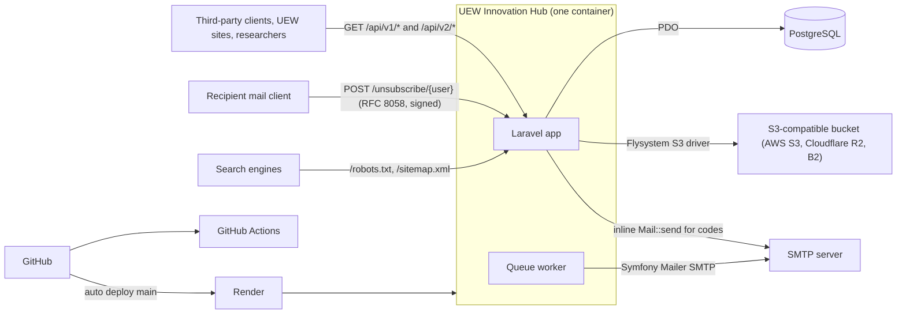

# Integration Architecture

> **Audience:** Developers, operators · **Last verified:** 2026-11-30 against commit `d1296b1`
> **Related:** [System architecture](system-architecture.md), [Backend architecture](backend-architecture.md), [API integrations](../06-api-reference/api-integrations.md), [Webhooks](../06-api-reference/webhooks.md), [Environment configuration](../09-deployment-and-operations/environment-configuration.md)

The application talks to few external systems: an SMTP server for e-mail, an optional S3-compatible bucket for files, PostgreSQL, and the hosting and CI services. It exposes one outward interface, the read-only open data API (`/api/v1` and `/api/v2`). It has no webhooks and no third-party scripts in the browser.

## Integration map

## Outbound integrations

| System | Purpose | Configuration | Code |
| --- | --- | --- | --- |
| SMTP server | All outgoing e-mail | `MAIL_*` in `.env`, or stored in the `settings` table through Site settings > E-mail | `config/mail.php`, `app/Services/MailSettings.php` |
| S3-compatible storage | Optional store for documents and gallery photos | `DOCUMENTS_DISK=s3`, `GALLERY_DISK=s3`, `AWS_ACCESS_KEY_ID`, `AWS_SECRET_ACCESS_KEY`, `AWS_DEFAULT_REGION`, `AWS_BUCKET`, `AWS_ENDPOINT`, `AWS_USE_PATH_STYLE_ENDPOINT`, `AWS_URL` | `config/filesystems.php` (`s3` disk), `league/flysystem-aws-s3-v3` |
| PostgreSQL | Primary data store in production | `DB_CONNECTION=pgsql`, `DB_URL` | `config/database.php` |
| DomPDF | PDF reports (Reports page, budget PDF) | None | `barryvdh/laravel-dompdf`, `Workspace\ReportController::pdf()`, view `workspace.reports.pdf` |
| GD | Photo decode and re-encode | PHP extension `gd` (installed in the Dockerfile) | `GalleryService` |

`config/services.php` still contains the stock Laravel entries for Postmark, Resend, SES and Slack. No application code reads them. They are not integrations.

### E-mail

**Simple explanation:** the Hub sends e-mail through a normal mail server. A Hub Director can choose the server from a settings page without redeploying.

**Technical explanation:** `MailSettings::apply()` runs in `AppServiceProvider::boot()` (skipped when running unit tests). It reads the `settings` table and overrides `mail.default`, `mail.from.*` and the `smtp` mailer. It returns silently if the `settings` table does not exist yet, and swallows any exception so a bad mail setting never takes the site down.

| Setting value | Effect |
| --- | --- |
| `mail_mailer = env` (default) | Use `MAIL_MAILER` and related variables unchanged. |
| `mail_mailer = log` | Write messages to the log. Nothing is sent. |
| `mail_mailer = smtp` and `mail_host` set | Use the stored host, port, encryption (`tls` -> `smtp` scheme, `ssl` -> `smtps`, `none`), username and password. |

- The SMTP password is stored with `Crypt::encryptString()` (key `APP_KEY`) and is never sent back to the browser. Changing `APP_KEY` makes the stored password unreadable.
- `MailSettings::sendTest()` powers the "send test" button (`POST /workspace/settings/mail/test`, throttled 5 per minute).
- Outside production, `MAIL_ALWAYS_TO` redirects every message to one address.
- Defaults: `MAIL_MAILER=log` in `.env.example` and `render.yaml`. Real delivery needs SMTP settings. Gmail is used in the commented example in `.env.example` (app password required).
- **Queued versus inline.** See [Backend architecture](backend-architecture.md#mail). Verification and reset codes are sent inline. Everything else is queued.
- **Worker and settings changes (inferred).** `MailSettings::apply()` runs at process boot. The worker loop runs `queue:work --max-time=3600`, which keeps one PHP process for up to an hour without rebooting the framework. A mail setting changed in the workspace may therefore not reach queued mail until the worker restarts. > **Requires confirmation:** test by changing SMTP settings and watching the next queued message.
- **Unsubscribe.** Broadcasts include `List-Unsubscribe` and `List-Unsubscribe-Post: List-Unsubscribe=One-Click` headers and a signed URL. `unsubscribe/*` is excluded from CSRF in `bootstrap/app.php` because mail providers POST without a token. The signed URL authorises the request, and the route is throttled 20 per minute.
- **Images.** Hosted over HTTPS from `MAIL_ASSET_URL` (falls back to `APP_URL`). See [Frontend architecture](frontend-architecture.md#e-mail-rendering).
- **Sender.** `MAIL_FROM_ADDRESS` default `innovationhub@uew.edu.gh`, `MAIL_FROM_NAME` the app name. Deliverability depends on SPF, DKIM and DMARC for the sending domain, which are outside this repository.

### File storage

| Content | Disk setting | Default | Served by |
| --- | --- | --- | --- |
| Project reports, publication PDFs, application uploads, legacy proposals | `DOCUMENTS_DISK` | `private` (`storage/app/private`) | `DocumentStorage::download()` via `Site\DocumentController`, `Portal\ApplicationController::file`, `Workspace\ApplicationController::file`, `Workspace\GrantApplicationController::proposal` |
| Gallery photos (large and thumb JPEGs) | `GALLERY_DISK` (read in `config/hub.php`, not in `.env.example`) | `gallery` (`storage/app/gallery`) | `Site\GalleryController::photo()` at `/media/photos/{photo}/{size}` |

Files are never placed under `public/`, so every download passes through application code. Public project reports and publications are available to anyone without sign-in (`/documents/projects/{project}/report` requires `is_public` and a file; `/documents/publications/{publication}` requires a document). They are not throttled. Application files require ownership or `applications.review`.

Each photo row stores its own `disk`, so photos uploaded to one disk stay readable after the setting changes.

## Inbound integration: open data API

| Item | v1 | v2 (current) |
| --- | --- | --- |
| Base path | `/api/v1` | `/api/v2` (`GET /api` lists both) |
| Methods | `GET` only | `GET` only |
| Auth | None. Public data only. | None. Public data only. |
| Rate limit | `throttle:api`, 60 requests per minute per IP (`API_RATE_LIMIT_PER_MINUTE`). One counter is shared by both versions. | same |
| Caching | `Cache-Control: public, max-age=60, s-maxage=60`, weak ETag, 304 on `If-None-Match` | same, lifetime from `API_CACHE_SECONDS` |
| Pagination | Page number (`per_page` 1 to 50) | Cursor (`limit` 1 to 100, `cursor`), `updated_since` on every list |
| Success envelope | `{"success": true, "data": ..., "meta": ..., "links": ...}` | `{"data": ..., "meta": ..., "links": ...}` |
| Error envelope | `{"success": false, "message": ..., "errors": ...}` | `{"error": {"status", "code", "message", "details"}}` |
| Version headers | `API-Version: v1`, plus `Deprecation`, `Sunset` and `Link` when `API_V1_*` dates are set | `API-Version: v2`, plus the same when `API_V2_*` dates are set |
| Resources | `ProjectResource`, `PublicationResource`, `PostResource`, `PartnerResource`, `ProgramResource` | `ProjectResource`, `PublicationResource`, `NewsResource`, `PartnerResource`, `ProgrammeResource`, `AlbumResource` |

v2 adds `/reference`, `/albums`, `/albums/{album}` and `/community?limit=`. Its known limit: there are no tombstones, so a client that syncs with `updated_since` cannot see records that were deleted or unpublished. Version policy and retirement steps are in [`config/api.php`](../../config/api.php) and [ADR-14](architectural-decisions.md#adr-14-api-versioning-by-url-prefix).

Endpoints are listed in [API endpoints](../06-api-reference/endpoints.md). There is no `config/cors.php` in the repository, so Laravel's built-in default from `vendor/laravel/framework/config/cors.php` applies: for `api/*`, every origin, method and header is allowed, and credentials are not supported. Any website can therefore read the API from a browser. That suits public read-only data. It is not tested (neither `PublicApiTest` nor `ApiV2Test` has a CORS assertion). To restrict it, publish `config/cors.php` with `php artisan config:publish cors`.

## SEO endpoints

| URL | Behaviour |
| --- | --- |
| `/robots.txt` | If `SEARCH_INDEXING` is true: allow, with `Disallow` for `/workspace`, `/portal`, `/notifications`, `/documents/`, `/unsubscribe/`, `/*/apply`. If false (default): `Disallow: /` for all. Cached publicly for 1 hour. |
| `/sitemap.xml` | Built from published content and cached with `Cache::remember('seo.sitemap', 1 hour)`. |

## Legacy system

`legacy/` holds the old procedural PHP system for reference. It is not served and not connected. Data came across through migrations and seeders (`legacy_id` columns). Legacy PDFs are copied onto the documents disk by `php artisan hub:import-documents`, run on every container boot (skips existing files). Legacy grant applications remain readable in the workspace.

## Hosting and delivery integrations

| System | Role | Evidence |
| --- | --- | --- |
| GitHub | Source, CI trigger, deploy trigger | Repo https://github.com/mhiskall282/uew-innovation-hub |
| GitHub Actions | Pint, Vite build, PHPUnit on SQLite and PostgreSQL, Playwright (Chromium, Firefox, WebKit, mobile), dependency audit, Docker image builds | `.github/workflows/ci.yml` |
| Render | Docker web service and managed PostgreSQL, auto-deploy `main`, health check `/up` | `render.yaml` |
| Vercel (alternative) | Serverless PHP entry | `vercel.json`, `api/index.php` |

## What does not exist

- No webhooks, inbound or outbound. See [Webhooks](../06-api-reference/webhooks.md).
- No payment, SMS, social-login, analytics or CDN integration.
- No external search engine. Search is SQL `LIKE`.
- No scheduled jobs, so nothing polls an external system.
