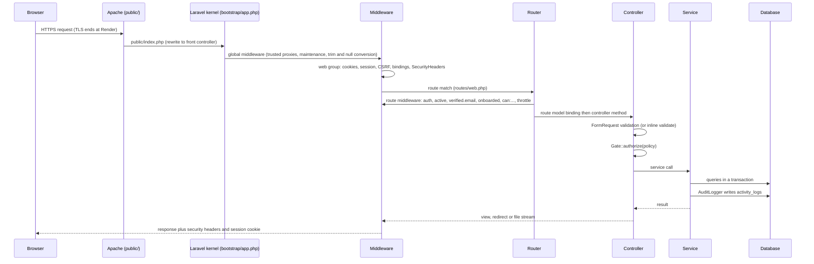
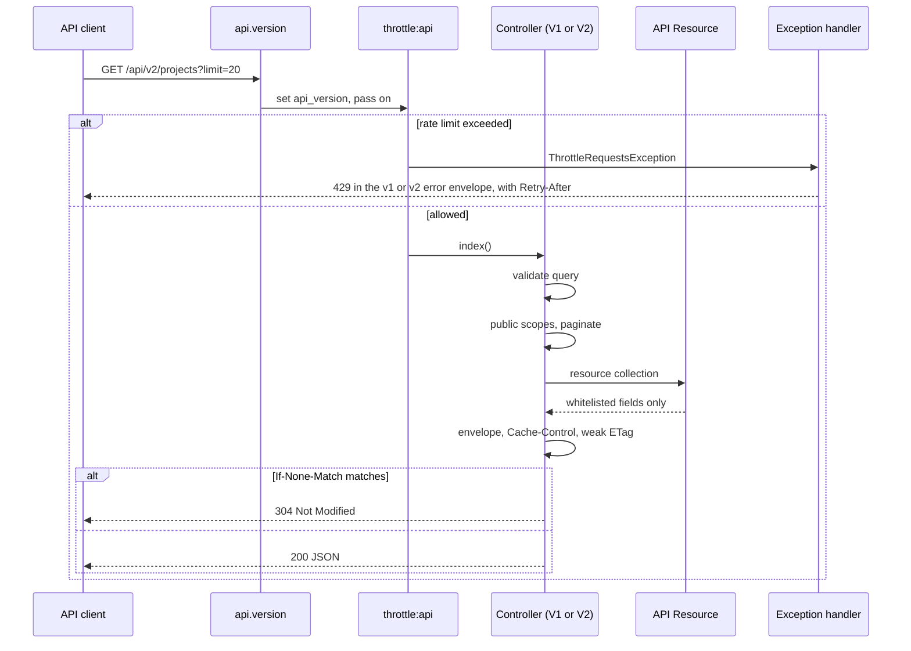
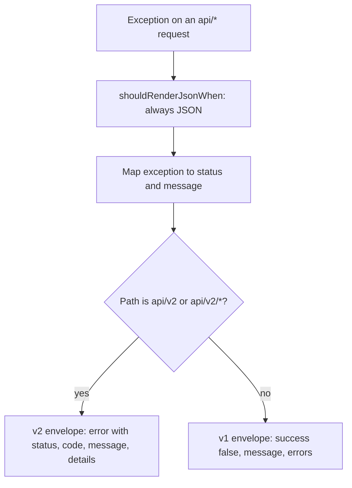

# Request and Response Lifecycle

> **Audience:** Developers · **Last verified:** 2026-11-30 against commit `d1296b1`
> **Related:** [Application architecture](application-architecture.md), [Authorization architecture](authorization-architecture.md), [Backend architecture](backend-architecture.md), [API overview](../06-api-reference/api-overview.md), [Debugging guide](../05-developer-guide/debugging-guide.md)

This page follows one HTTP request from Apache to the response, for the three request types in the application: a web page, a form post and an open data API call. It then covers the error responses.

## Web request: step by step

### What happens at each stage

| # | Stage | Detail |
| --- | --- | --- |
| 1 | Apache | `DocumentRoot /var/www/html/public`, `AllowOverride All` (uses `public/.htaccess` to route to `index.php`). Dotfiles denied. Logs go to stdout and stderr. `/build/assets/` gets a one-year immutable cache header. |
| 2 | Front controller | `public/index.php` boots `bootstrap/app.php`. On Render the config, route and view caches were built at container start by `php artisan optimize`. |
| 3 | Trusted proxies | Installed only when `TRUSTED_PROXIES` is set. Render sets `*`, so `$request->ip()` and `isSecure()` use the forwarded values. This matters for rate limits, the audit log IP and the `Strict-Transport-Security` header. |
| 4 | `web` group | Laravel's defaults: cookie encryption, session start (database driver), validation-error sharing, CSRF token check, route model binding. `SecurityHeaders` is appended (see [Frontend architecture](frontend-architecture.md#content-security-policy)). CSRF is skipped for `unsubscribe/*` only. |
| 5 | Route match | `routes/web.php`. CMS pages (`/{page}`) are registered last and exclude reserved words (`up`, `api`, `workspace`, `portal`, ...). Old URLs redirect: `/login`, `/register`, `/admin`, `/apply`, `/track`, `/news-and-blogs`. |
| 6 | Route middleware | In the order listed on the route: for the workspace `auth`, `active`, `verified.email`, `can:workspace.access`, then the group `can:` and any `throttle`. A guest is redirected to `/sign-in` (`redirectGuestsTo`). A signed-in user hitting a guest route goes to `User::homeUrl()`. |
| 7 | Binding | Slugs for programmes, projects, posts, albums and publications (`HasUniqueSlug::getRouteKeyName()`). `{application:reference_no}` for legacy grants. Numeric constraints with `whereNumber` or `whereUuid`. Soft-deleted rows are not bound, so they return 404. |
| 8 | Validation | A `FormRequest` (16 of them) or `$request->validate()`. Failure redirects back with errors and old input (422 for JSON). |
| 9 | Authorisation | `Gate::authorize('update', $model)` and similar. Denial is a 403. |
| 10 | Service | One method per business action. Writes inside `DB::transaction` where several rows change. Audit entry. Notifications. Mail is queued or sent. |
| 11 | Response | Blade view, redirect with a flash `status`, or a streamed file or CSV. |
| 12 | Post-processing | Session saved to `sessions`, cookie queued, `SecurityHeaders` adds headers. |

Redirect-after-POST is the pattern for every form: `POST` then `redirect()` with `->with('status', ...)`. The layouts show `status` as a dismissible banner.

## Example: member submits an application

`POST /programmes/{program}/apply`

1. Middleware: `auth`, `active`, `verified.email`, `onboarded`, `throttle:30,1`.
2. Binding: `{program}` by slug.
3. `Portal\ApplicationController::store()` aborts 404 unless the programme is visible, then validates answers with `FormSchema::rules()` built from that programme's form.
4. `ApplicationService::save()` re-checks `isAcceptingApplications()`, locks nothing but runs in a transaction, stores files, saves answers, sets status `submitted`, snapshots demographics, audits.
5. After the transaction: +10 XP, notices (in-app to the member, e-mail to opted-in reviewers).
6. Redirect to the application page with a status message.

## API request lifecycle

The open data API has two versions. `routes/api.php` loads `routes/api/v1.php` and `routes/api/v2.php` under the prefixes `/api/v1` and `/api/v2`. Each group has the middleware `api.version:vN` and then `throttle:api`, on top of the `api` group (no session, cookies or CSRF; `SecurityHeaders` is appended). `GET /api` (`Api\VersionsController`, `throttle:api` only) lists the versions.

`ApiVersion` adds `API-Version` to the response on the way out, and `Deprecation`, `Sunset` and `Link rel="deprecation"` when the dates in `config/api.php` are set.

The error branch lives in `bootstrap/app.php`:

The diagram shows the v2 query step. The v1 path is the same, with page-number pagination (`per_page`, `page`) and the `{success, data, meta, links}` envelope.

| Aspect | v1 | v2 | Source |
| --- | --- | --- | --- |
| Route file and controllers | `routes/api/v1.php`, `Api\V1\*` | `routes/api/v2.php`, `Api\V2\*` | `routes/api.php` |
| Base controller | `Api\V1\ApiController`: `ok()`, `paginated()`, `perPage()`, `cached()` | `Api\V2\ApiController`: `validateList()`, `requestedIncludes()`, `paginate()`, `respond()`, overridable `sorts()` and `includes()` | `app/Http/Controllers/Api` |
| Resources | `app/Http/Resources/Api/V1` | `app/Http/Resources/Api/V2` (base class `Resource` for money, dates and ids) | |
| Limiter | `api`: 60 per minute per IP (`API_RATE_LIMIT_PER_MINUTE`). One counter is shared by both versions and `GET /api`. | same | `AppServiceProvider::registerRateLimiters()` |
| Query validation | List controllers validate their filters. `per_page` must be 1 to 50 (default 15), otherwise 422. `ApiController::perPage()` also clamps to that range. | `limit` 1 to 100 (default 20), `cursor` string up to 512 characters, `sort` must be in the endpoint whitelist, `include` is a string up to 200 characters whose items must be in the endpoint whitelist, `updated_since` must be a date. A bad value gives 422 `validation_failed`. | `V2\ApiController::validateList()` |
| Visibility | Public scopes, `abort_unless(... is_public, 404)` | Same rules. Albums only when published, photos only when the file exists. | controllers |
| Success body | `{"success": true, "data": [...], "meta": {current_page, per_page, total, last_page}, "links": {first, prev, next, last}}` | `{"data": [...], "meta": {per_page, has_more, next_cursor, prev_cursor}, "links": {self, next, prev}}` | `paginated()`, `paginate()` |
| Caching | `Cache-Control: public, max-age=60, s-maxage=60` (constant) | Same headers, lifetime from `API_CACHE_SECONDS` (default 60) | `cached()`, `respond()` |
| ETag | Weak ETag (md5 of the body). A matching `If-None-Match` returns 304. Added to v1 as an additive change. | Same | `isNotModified()` |
| Version headers | `API-Version: v1`. `Deprecation`, `Sunset` and `Link` once `API_V1_DEPRECATED_AT` or `API_V1_SUNSET_AT` is set. | `API-Version: v2`, same optional headers from `API_V2_*` | `ApiVersion`, `config/api.php` |
| JSON rendering | Any `api/*` request is rendered as JSON, even with an HTML `Accept` header | same | `shouldRenderJsonWhen` |
| Methods | `GET` only. Other methods return 405 in the version's error envelope. | same | `routes/api/*.php` |

Error responses carry no `Cache-Control` and no ETag. Whether they carry `API-Version` is not tested: `tests/Feature/Api/ApiV2Test.php` asserts the header on successful responses only.

> **Requires confirmation:** that 4xx and 5xx API responses include `API-Version`. `ApiVersion` wraps the later layers, and Laravel's router pipeline converts exceptions into responses inside that wrapper, so it should. No test covers it.

`GET /api/v1` and `GET /api/v2` (`IndexController`) describe each version. All routes and parameters are in [API endpoints](../06-api-reference/endpoints.md).

## Error responses

### Web

| Status | Cause | What the user sees |
| --- | --- | --- |
| 302 to `/sign-in` | Guest on a protected route | Sign-in page, then the intended URL |
| 302 to `/verify-email` | Unverified account | Code entry page |
| 302 to `/onboarding` | Member who has not finished the profile | Onboarding form |
| 403 | Missing permission, failed policy, invalid signature | `errors/403`. For an invalid, expired or reused signed link: the `auth.link-expired` view (status 403) |
| 404 | Unknown route, hidden or soft-deleted record, deactivated user's reset link | `errors/404` |
| 419 | CSRF token expired | `errors/419` |
| 422 | Validation failure on a JSON or XHR request | JSON errors. Normal form posts redirect back instead. |
| 429 | Throttle | `errors/429` |
| 500 | Unhandled exception | `errors/500`. Logs go to stderr on Render. |
| 503 | Maintenance mode | `errors/503` |

### API envelopes

Defined in `bootstrap/app.php`. One render callback maps each exception to a status and message, then picks the envelope by path: `api/v2` and `api/v2/*` get the v2 envelope, every other `api/*` path gets the v1 envelope (`GET /api` also gets v1).

| Exception | Status | v1 message | v2 `code` |
| --- | --- | --- | --- |
| `ValidationException` | 422 | The given data was invalid. (with `errors`) | `validation_failed` (field messages in `details`) |
| `ModelNotFoundException`, `NotFoundHttpException` | 404 | Resource not found. | `not_found` |
| `AuthenticationException` | 401 | Unauthenticated. | `unauthenticated` |
| `AuthorizationException` | 403 | This action is unauthorized. | `forbidden` |
| `ThrottleRequestsException` | 429 | Too many requests. Please slow down. (keeps `Retry-After`) | `rate_limited` |
| Other `HttpExceptionInterface` | its status | its message, or "Request failed." | by status: `bad_request` (400), `method_not_allowed` (405), `service_unavailable` (503), otherwise `http_error` |
| Anything else | 500 | "Server error." (the real message only when `APP_DEBUG` is true) | `server_error` |

v1 shape: `{"success": false, "message": "...", "errors": {...}}` (`errors` only for validation). v2 shape: `{"error": {"status": 422, "code": "validation_failed", "message": "...", "details": {...}}}` (`details` only when present). Headers from the exception, such as `Retry-After`, are kept in both. Details: [API error codes](../06-api-reference/error-codes.md).
## Console and queue lifecycle

Queued work does not pass through HTTP middleware. The worker boots the framework once and loops. `AppServiceProvider::boot()` runs at that boot (gates, rate limiters, `MailSettings::apply()`). See [Backend architecture](backend-architecture.md) for jobs and mail and [Integration architecture](integration-architecture.md) for the worker and settings caveat.

## Debugging tips tied to this lifecycle

| Symptom | Look at |
| --- | --- |
| Every visitor shares one rate limit | `TRUSTED_PROXIES` not set behind a proxy |
| 403 on workspace page | `can:` group and the role matrix in [Authorization architecture](authorization-architecture.md) |
| CSP errors in the browser console only on the built site | `SecurityHeaders` is skipped during `npm run dev` (hot mode) |
| Old behaviour after deploy | `php artisan optimize` caches config at boot. The container restarts on each deploy, so this rarely applies to Render |
