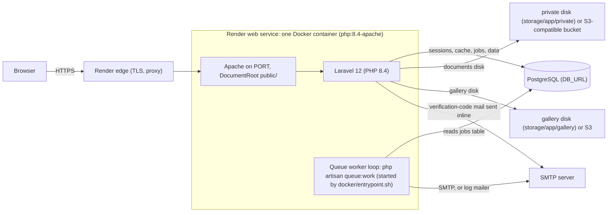
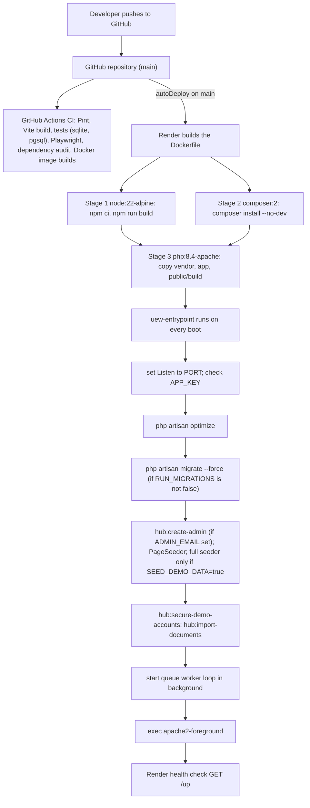

# System Architecture

> **Audience:** Developers, operators, technical reviewers · **Last verified:** 2026-11-30 against commit `d1296b1`
> **Related:** [Application architecture](application-architecture.md), [Data flow](data-flow.md), [Integration architecture](integration-architecture.md), [Docker guide](../09-deployment-and-operations/docker-guide.md), [Infrastructure overview](../09-deployment-and-operations/infrastructure-overview.md)

The UEW Innovation Hub is one Laravel 12 application that serves four surfaces from a single Docker container: the public website, the member portal, the staff workspace and a read-only open data API (versions `/api/v1` and `/api/v2`). State lives in PostgreSQL (SQLite for local work and one CI job), uploaded files live on a storage disk, and e-mail goes out through a queue. This page shows the runtime pieces and how they connect.

## High-level diagram

Notes on the diagram:

- The worker and Apache run in the **same container**. The worker is a bash `while true` loop started in the background by `docker/entrypoint.sh` before `exec apache2-foreground`. It runs as `www-data`: `php artisan queue:work --sleep=3 --tries=3 --max-time=3600 --memory=128`. It restarts two seconds after it exits. Set `RUN_QUEUE_WORKER=false` to skip it (for a separate worker service). It is also skipped when `QUEUE_CONNECTION=sync`.
- Verification and password-reset codes are sent with `Mail::send` inside the web request (`TemplatedMail` does not implement `ShouldQueue`). Welcome mail, broadcasts, application notices and password-changed notices use the queue.
- `MAIL_MAILER` defaults to `log` in `render.yaml` and `.env.example`. A Hub Director can switch to SMTP at run time from the workspace (Site settings, E-mail). `MailSettings::apply()` runs on every boot outside tests. See [Integration architecture](integration-architecture.md).
- On the free Render plan there is no persistent disk. Documents and gallery photos on the container disk are lost on redeploy. Use `DOCUMENTS_DISK=s3` and `GALLERY_DISK=s3` for durable files. `render.yaml` sets `DOCUMENTS_DISK=private` and does not set `GALLERY_DISK` at all (see [Known gaps](#known-gaps)).

## Runtime components

| Component | Where it is defined | What it does |
| --- | --- | --- |
| Apache 2.4 + mod_rewrite | `Dockerfile`, [`docker/apache-vhost.conf`](../../docker/apache-vhost.conf) | Serves `public/` only, denies dotfiles, sets long cache headers on `/build/assets/`. `ServerTokens Prod`, signature off. |
| PHP 8.4 | `Dockerfile` (`php:8.4-apache`) | Extensions: `pdo_pgsql`, `pdo_mysql`, `zip`, `intl`, `bcmath`, `opcache`, `gd`. Settings in [`docker/php.ini`](../../docker/php.ini). |
| Laravel 12 | `app/`, `bootstrap/app.php`, `routes/` | All application behaviour. See [Application architecture](application-architecture.md). |
| Queue worker | [`docker/entrypoint.sh`](../../docker/entrypoint.sh) step 6 | Runs queued mail and the `SendBroadcast` job from the `jobs` table. |
| PostgreSQL | `render.yaml` (`databases:`), `DB_URL` | Application data, `sessions`, `cache`, `jobs`, `failed_jobs`, `notifications`. |
| Documents disk | [`config/filesystems.php`](../../config/filesystems.php), `config/hub.php` (`DOCUMENTS_DISK`) | Project reports, publication PDFs, application uploads. Never under `public/`. |
| Gallery disk | `config/hub.php` (`GALLERY_DISK`) | Re-encoded JPEG photos, served through `/media/photos/{photo}/{size}`. |
| SMTP | `config/mail.php`, `MailSettings` | Outgoing e-mail. |
| Vite build | `vite.config.js`, Dockerfile stage 1 | Builds Tailwind CSS and Alpine into `public/build`. |

## Surfaces and route groups

| Surface | URL prefix | Route names | Middleware (summary) | Who |
| --- | --- | --- | --- | --- |
| Public website | `/` | `site.*` | `web` group only | Anyone |
| Accounts | `/sign-in`, `/sign-up`, `/verify-email`, `/forgot-password` | `login`, `register`, `verification.*`, `password.*` | `guest` or `auth,active`, throttles | Anyone / signed-in |
| Member portal | `/portal`, `/programmes/{program}/apply` | `portal.*` | `auth, active, verified.email, onboarded` | Members |
| Staff workspace | `/workspace` | `workspace.*` | `auth, active, verified.email, can:workspace.access`, then per-group `can:` | Staff |
| Open data API | `/api` (version list), `/api/v1`, `/api/v2` (current) | `api.versions`, `api.v1.*`, `api.v2.*` | `api` group, `api.version:v1` or `api.version:v2`, then `throttle:api` (60 per minute per IP, shared by both versions) | Anyone, read-only |
| Health check | `/up` | none | Laravel built-in | Render, Docker `HEALTHCHECK` |

The route table is in the output of `php artisan route:list` (208 routes). Endpoint detail is in [API endpoints](../06-api-reference/endpoints.md). API routes are in `routes/api.php`, `routes/api/v1.php` and `routes/api/v2.php`. Version status, deprecation dates and limits are in [`config/api.php`](../../config/api.php).

## Deployment shapes

| Target | Status in the repository | Notes |
| --- | --- | --- |
| Render (Docker + PostgreSQL) | Primary. `render.yaml`, `autoDeploy: true`, health check `/up`. | Live site https://uew-innovation-hub.onrender.com. See [Deployment architecture](#deployment-architecture). |
| Any Docker host | Supported by the same `Dockerfile`. | Set `PORT`, `APP_KEY`, `DB_URL` and the other variables. |
| Vercel | Entry present: `vercel.json`, `api/index.php`. | Redirects storage and Laravel caches to `/tmp/storage`, sets `QUEUE_CONNECTION=sync`, `DOCUMENTS_DISK=s3`. Not referenced by CI. Gallery uploads need `GALLERY_DISK=s3` there, and `vercel.json` does not set it. |

> **Requires confirmation:** whether a Vercel deployment is in use and how complete it is. Nothing in CI builds or tests it.
| Local development | `composer setup`, `composer dev` | SQLite by default (`DB_CONNECTION=sqlite`). See [Development environment setup](../05-developer-guide/development-environment-setup.md). |

## Deployment architecture

Facts behind the diagram:

- `render.yaml` sets `autoDeploy: true` and `healthCheckPath: /up`. Render deploys `main` on every push. The CI file states that "Wait for CI" or branch protection must be enabled in GitHub so a red build does not ship. That setting is not in the repository. > **Requires confirmation:** whether it is enabled.
- Every entrypoint step is idempotent. `php artisan migrate --force` runs on every boot unless `RUN_MIGRATIONS=false`. See [Rollback procedures](../09-deployment-and-operations/rollback-procedures.md) for the consequences.
- `hub:secure-demo-accounts` and `hub:import-documents` failures print a warning and do not stop the boot (`|| echo`).
- `.dockerignore` keeps `.git`, `.env*`, `tests`, `docs`, `legacy`, `*.md`, `vercel.json` and `api` out of the image. Apache serves only `public/` in any case.

## Known gaps

| Gap | Where | Effect |
| --- | --- | --- |
| `GALLERY_DISK` is in `.env.example` (value `gallery`) but not in `render.yaml`. | `config/hub.php`, `.env.example`, `render.yaml` | Gallery photos default to the container disk and are lost on redeploy on the free plan. |
| Queue worker and web server share one container and one memory budget. | `docker/entrypoint.sh` | A crashed worker restarts, but a container restart drops in-flight jobs. Jobs stay in the `jobs` table and are retried (`--tries=3`). `SendBroadcast` has `$tries = 1`, so a failed broadcast is not retried. It is marked `failed` and audited as `broadcast.failed`. |
| No scheduler. | `routes/console.php` | Nothing runs on a timer. Scheduled posts work because state is derived from `published_at` at read time. See [Architectural decisions](architectural-decisions.md). |
| `docker/php.ini` sets `max_file_uploads = 5`, but the gallery upload accepts up to 10 files per request (`AlbumController::MAX_FILES`). | `docker/php.ini`, `app/Http/Controllers/Workspace/AlbumController.php` | PHP drops files beyond the fifth before Laravel sees them, so a batch of more than 5 photos loses the extras without a validation error. Not tested. |
| Free Render PostgreSQL expires after 30 days (comment in `render.yaml`). | `render.yaml` | Needs an upgraded plan or an external database for real use. |
