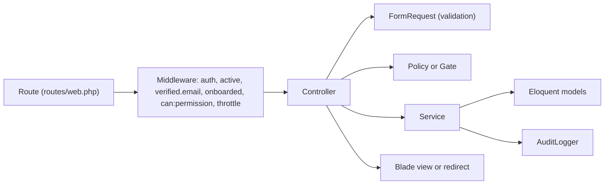

# Backend Development

> **Audience:** Developers · **Last verified:** 2026-11-30 against commit `9f3bdee`
> **Related:** [coding-standards](coding-standards.md), [adding-new-features](adding-new-features.md), [database-development](database-development.md), `../04-architecture/backend-architecture.md`, `../04-architecture/request-response-lifecycle.md`

How the PHP side is organised and the patterns to follow when you write controllers, requests, services, policies, jobs and commands.

## Request path

Middleware aliases are registered in `bootstrap/app.php`: `active` (`EnsureAccountIsActive`), `verified.email` (`EnsureEmailIsVerified`), `onboarded` (`EnsureOnboarded`). `SecurityHeaders` is appended to the `web` and `api` groups. `can:<permission>` uses the gates registered from `Permission::cases()`.

Route groups in `routes/web.php`:

| Group | Middleware |
| --- | --- |
| Public site | none (rate limits on forms) |
| `guest` | sign-in, sign-up, password reset (with throttles) |
| Signed-in, unverified | `auth`, `active`: e-mail verification |
| Member portal | `auth`, `active`, `verified.email`, `onboarded`, prefix `portal` |
| Staff workspace | `auth`, `active`, `verified.email`, `can:workspace.access`, prefix `workspace`; inner groups add `can:<permission>` |
| API | `throttle:api` (60 per minute per IP), prefix `api/v1` |

## Controllers

- Keep them short: authorise, validate, call a service, return a view or redirect.
- Authorise records with `Gate::authorize('update', $album)` or `$this->authorize()`. The route middleware is a first gate, not a replacement.
- Flash messages use `->with('status', '...')`.
- Return JSON only from `Api\V1` controllers, through resources in `app/Http/Resources/Api/V1/`.
- Add a `/** ... */` class comment saying which middleware gates the routes, as `AlbumController` does.

## Validation

Use a FormRequest in `app/Http/Requests/<Area>/`. Put input clean-up in `prepareForValidation()` (for example lower-casing e-mail addresses in `RegisterRequest`). Use `Rule::enum(...)` for enum fields and `config('hub....')` for lists such as `hub.post_categories`. Upload rules reference `config('hub.max_upload_kb')`.

Some controllers validate inline instead (for example `AlbumController::validated()`). Do not copy that for new code.

## Services

All 24 classes in `app/Services/` follow the same shape: `final`, constructor-injected collaborators, public methods that take validated arrays plus the acting `User`. The container injects them into controllers.

| Service | Role |
| --- | --- |
| `AuditLogger` | Writes `activity_logs` rows. Actor and IP come from the server |
| `DocumentStorage` | Stores and streams PDFs on the documents disk with random names |
| `GalleryService` | Album saving and photo processing with GD |
| `ProjectService`, `PublicationService`, `PostService`, `ProgramService`, `UserService`, `MemberService` | Create and update records for the matching area |
| `ApplicationService`, `ConversationService`, `ProgressReportService`, `GrantApplicationService` | Programme application lifecycle |
| `BroadcastService` | Audience and sending for broadcasts (queues `App\Jobs\SendBroadcast`) |
| `NotificationCenter`, `StaffNotifier` | In-app notifications; failures are logged, never thrown |
| `MailSettings`, `SettingsService` | Site settings (cached), SMTP applied at boot except in unit tests |
| `MetricsService`, `InsightsService` | Cached dashboard and public figures (`METRICS_CACHE_TTL`, default 300 s) |
| `ReportExportService` | CSV and PDF exports (PDF through `barryvdh/laravel-dompdf`) |
| `VerificationService`, `EngagementService`, `ContactMessageService` | Verification codes, badges and XP, contact enquiries |

Write a new service when a controller would otherwise hold logic, touch several tables, or call storage or mail. Use `DB::transaction()` for multi-table writes and call `AuditLogger::record()` for state changes. Name the action `<model>.<verb>` (`album.created`).

## Authorisation

Two layers:

1. **Permissions** (`app/Enums/Permission.php`) mapped to roles (`app/Enums/Role.php`). Check with `$user->hasPermission(Permission::X)`, `$user->can('x.y')`, `@can('x.y')` or `can:x.y` on routes.
2. **Policies** (`app/Policies/`) for record-level rules, such as "an intern can edit an unpublished album, only a publisher can edit a published one" (`AlbumPolicy`).

Detail: `../04-architecture/authorization-architecture.md`.

## Configuration

- Domain settings: `config/hub.php`. Read with `config('hub.documents_disk')`.
- Environment values enter only through `config/*.php` (plus `TRUSTED_PROXIES` in `bootstrap/app.php`). Application code never calls `env()`.
- Add a new Hub variable by adding a key in `config/hub.php`, a line with a safe default in `.env.example`, and a row in `../09-deployment-and-operations/environment-configuration.md`. (`GALLERY_DISK` is currently missing from `.env.example`.)

## Files and documents

- PDFs go through `DocumentStorage` (disk `hub.documents_disk`: `private` locally, `s3` hosted). They are streamed through authorised controllers, never linked from `public/`.
- Gallery photos go through `GalleryService` to the disk named by `hub.gallery_disk` (default `gallery`, `storage/app/gallery`).
- Never store a client-supplied file name or path.

## Queues, mail and notifications

- Mail is built from templates by `App\Mail\TemplatedMail` and `App\Support\EmailTemplates`. Staff can edit templates in the workspace.
- `App\Jobs\SendBroadcast` is the only job class. Queue driver: `database` locally and on Render (container starts `queue:work` unless `RUN_QUEUE_WORKER=false`), `sync` in tests and Playwright.
- In-app notifications use `App\Notifications\HubNotification` via `NotificationCenter`.
- There is no scheduler. `routes/console.php` holds only the default `inspire` command. Scheduled posts work because visibility is derived from `published_at` at read time.

## Artisan commands

`app/Console/Commands/` holds three commands, auto-registered:

| Command | Purpose |
| --- | --- |
| `php artisan hub:create-admin` | Create the first Hub Director if none exists. Options `--email`, `--name`, `--password`; falls back to `ADMIN_EMAIL`, `ADMIN_NAME`, `ADMIN_PASSWORD` |
| `php artisan hub:import-documents` | Copy `reports/` and `publications/` PDFs onto the documents disk. Option `--source=` |
| `php artisan hub:secure-demo-accounts` | Replace well-known default passwords with `SEED_PASSWORD` |

New commands: `php artisan make:command`, name the signature `hub:<verb>-<noun>`, keep them idempotent when they run in `docker/entrypoint.sh`.

## Error handling

`bootstrap/app.php` configures: JSON envelope for `/api/*` (`{"success": false, "message": ..., "errors": ...}`) with 401, 403, 404, 422, 429 and generic mappings; a friendly page for expired signed links (`auth.link-expired`, status 403). Throw framework exceptions (`abort(404)`, `ValidationException`) and let those handlers format them.

## Security reminders

- CSRF is on for all web routes except `unsubscribe/*` (signed URL).
- Rate-limit anything public that writes or sends mail.
- Never log passwords, codes or tokens.
- Treat uploaded files as hostile: validate, re-encode images, random names.
