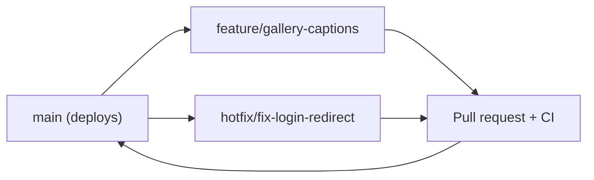

# Branching Strategy

> **Audience:** Developers · **Last verified:** 2026-11-30 against commit `9f3bdee`
> **Related:** [git-workflow](git-workflow.md), [development-workflow](development-workflow.md), `../09-deployment-and-operations/ci-cd-pipeline.md`, `../12-maintenance/release-management.md`

How branches are used today, and a lightweight branching model that fits a one-service project that deploys from `main`.

## Current practice

| Fact | Evidence |
| --- | --- |
| One long-lived branch, `main` | `git branch -a` shows `main`, `origin/main`, `origin/HEAD` only |
| Commits go straight to `main` | Linear history, no merge commits |
| CI runs on pushes to `main`, on every pull request, and on manual dispatch | `.github/workflows/ci.yml` (`on:`) |
| CI cancels older runs of the same ref | `concurrency` group `ci-${{ github.ref }}` with `cancel-in-progress: true` |
| `main` auto-deploys to Render | `render.yaml` (`autoDeploy: true`) |
| No release branches, tags or staging branch | `git branch -a`; the repository has no `staging` configuration |

`git tag --list` returns nothing, so there are no tags.

## Recommended model (not implemented)

Keep it simple: trunk-based development with short-lived branches.

| Branch | Name pattern | Lifetime | Merges into |
| --- | --- | --- | --- |
| Default | `main` | Permanent | Deploys on push |
| Feature | `feature/<short-description>` | Days | `main` through a pull request |
| Fix | `fix/<short-description>` | Hours to days | `main` |
| Hotfix | `hotfix/<short-description>` | Hours | `main`, fast |
| Docs only | `docs/<short-description>` | Days | `main` |
| Migration-heavy | `migration/<short-description>` | Days | `main`, after the PostgreSQL CI job passes |

Rules to adopt with it:

1. Branch from an up-to-date `main`: `git switch main; git pull; git switch -c feature/<name>`.
2. Push the branch and open a pull request. CI then runs the same jobs as on `main`.
3. Merge only when "Code style", "Front-end build", "Tests (sqlite)" and "Tests (pgsql)" pass. The e2e and docker jobs should also pass for UI or Dockerfile changes.
4. Prefer squash merge so each change is one commit on `main`.
5. Delete the branch after merging.
6. Keep a branch under a week old. Rebase onto `main` (`git rebase main`) instead of merging `main` into it, unless the branch is shared.

## Why a database change deserves its own care

A push to `main` runs `php artisan migrate --force` on the next Render boot (`docker/entrypoint.sh`, unless `RUN_MIGRATIONS=false`). A bad migration therefore runs against production data without a human in the loop. CI helps: on PostgreSQL it runs `migrate`, `migrate:rollback --step=1`, `migrate` and `db:seed`. See [database-development](database-development.md).

## Hotfixes

With the current single-branch setup, a hotfix is a small commit on `main`. To make the fix safe:

1. Reproduce it in a test.
2. Fix it, run `php artisan test` and `vendor/bin/pint --test`.
3. Push and watch CI and the Render deploy. The health check is `/up`.
4. If the deploy fails, revert the commit (`git revert <sha>`).

## Release and versioning

The repository does not use version numbers or tags. `composer.json` still has the default `laravel/laravel` name and no `version`. Release practice is in `../12-maintenance/release-management.md` and `../12-maintenance/versioning-strategy.md`.
