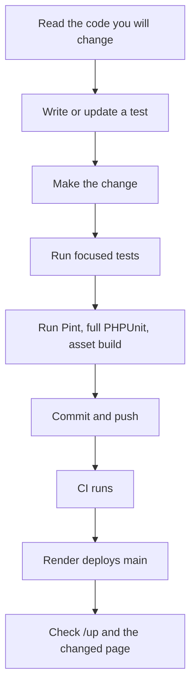

# Development Workflow

> **Audience:** Developers · **Last verified:** 2026-11-30 against commit `9f3bdee`
> **Related:** [git-workflow](git-workflow.md), [testing-guide](testing-guide.md), [adding-new-features](adding-new-features.md), `../09-deployment-and-operations/ci-cd-pipeline.md`

The loop to follow for any change, from picking up a task to seeing it live, and the exact commands CI runs so you can run the same ones first.

## The loop



1. **Understand.** Find the route, controller, service, policy, model and view for the feature ([project-structure](project-structure.md)). Read the existing test.
2. **Test first where practical.** For a bug, write a failing feature test that reproduces it.
3. **Change.** Keep the change scoped. Do not refactor unrelated code in the same commit.
4. **Run focused tests** while working: `php artisan test --filter GalleryTest`.
5. **Run the full checks** (next section).
6. **Update documentation** when behaviour, routes, permissions, environment variables or commands change. `.ai/state.md` and `.ai/changelog.md` are the project memory files that `AGENTS.md` asks you to update after meaningful changes.
7. **Commit and push** ([git-workflow](git-workflow.md)).
8. **Watch CI** on GitHub Actions. Fix red jobs before doing anything else.
9. **Verify the deploy.** Render builds the Docker image, runs `docker/entrypoint.sh` (cache, migrate, seed pages, create admin) and checks `/up`.

## Pre-push checklist

Run these from the repository root. They mirror CI.

```powershell
vendor\bin\pint --test        # CI job "Code style"
npm run build                 # CI job "Front-end build"
php artisan view:cache        # CI step "Blade templates compile"
php artisan view:clear
php vendor/bin/phpunit --no-progress   # CI job "Tests (sqlite)"
```

```bash
vendor/bin/pint --test
npm run build
php artisan view:cache && php artisan view:clear
php vendor/bin/phpunit --no-progress
```

`php artisan test` (also `composer test`, which first runs `config:clear`) is equivalent to the PHPUnit call for local use and gives nicer output. Details and Playwright commands are in [testing-guide](testing-guide.md).

Also check manually:

- `git status` shows no `.env`, `*.sqlite`, `test-results/` or `playwright-report/` files.
- If you added a migration: it has a working `down()`, and CI's up, down, up run on PostgreSQL will pass ([database-development](database-development.md)).
- If you changed a view: look at it at 320 px and 1280 px wide.

## What CI runs

Defined in `.github/workflows/ci.yml`. Triggers: push to `main`, any pull request, manual dispatch. PHP 8.4, Node 22.

| Job (name in GitHub) | Runs | Needs |
| --- | --- | --- |
| Code style (`lint`) | `composer install --no-interaction --prefer-dist --no-progress`, then `vendor/bin/pint --test` | |
| Front-end build (`assets`) | `npm ci`, `npm run build`, uploads `public/build` as an artifact | |
| Tests (`tests`, matrix `sqlite` and `pgsql`) | Installs PHP with `pdo_sqlite, pdo_pgsql, intl, gd, zip`, `composer install`, copies `.env.example` to `.env`, `php artisan key:generate`. On `pgsql`: `migrate --force`, `migrate:rollback --step=1 --force`, `migrate --force`, `db:seed --force`. Both: compile Blade (`php artisan view:cache`, `php -l` on each compiled file, `php artisan view:clear`), then `php vendor/bin/phpunit --no-progress` | `assets` |
| Browser tests (`e2e`) | `composer install`, `npm ci`, `npx playwright install --with-deps chromium firefox webkit`, `npx playwright test` | `assets` |
| Dependency audit (`security`) | `composer audit --locked --no-interaction`, `npm audit --omit=dev --audit-level=high` | |
| Docker image builds (`docker`) | `docker/build-push-action` with `push: false` | `lint`, `tests` |

A new dependency with a known vulnerability fails the "Dependency audit" job. See [dependency-management](dependency-management.md).

## Working on a database change

Follow [database-development](database-development.md). Short version: new migration file, never edit an old one that has run in production, test both directions, and expect production to migrate automatically on deploy.

## Working with the AI-agent files

The repository ships `AGENTS.md` and a `.ai/` folder with rules and workflows (`.ai/workflows/new-feature.md`, `bug-fix.md`, `database-change.md`, `ui-change.md`, `release.md`). They are consistent with this page. If they disagree with the code, follow the code and fix the file.

## Definition of done

- The behaviour works in the browser and a test covers it.
- `vendor/bin/pint --test`, `php artisan test` and `npm run build` pass.
- Permissions are enforced on the server and covered by `PrivilegesTest` where a route is gated.
- Docs and `.ai/state.md` are updated if behaviour or commands changed.
- No secrets, no debugging output, no stray files.
