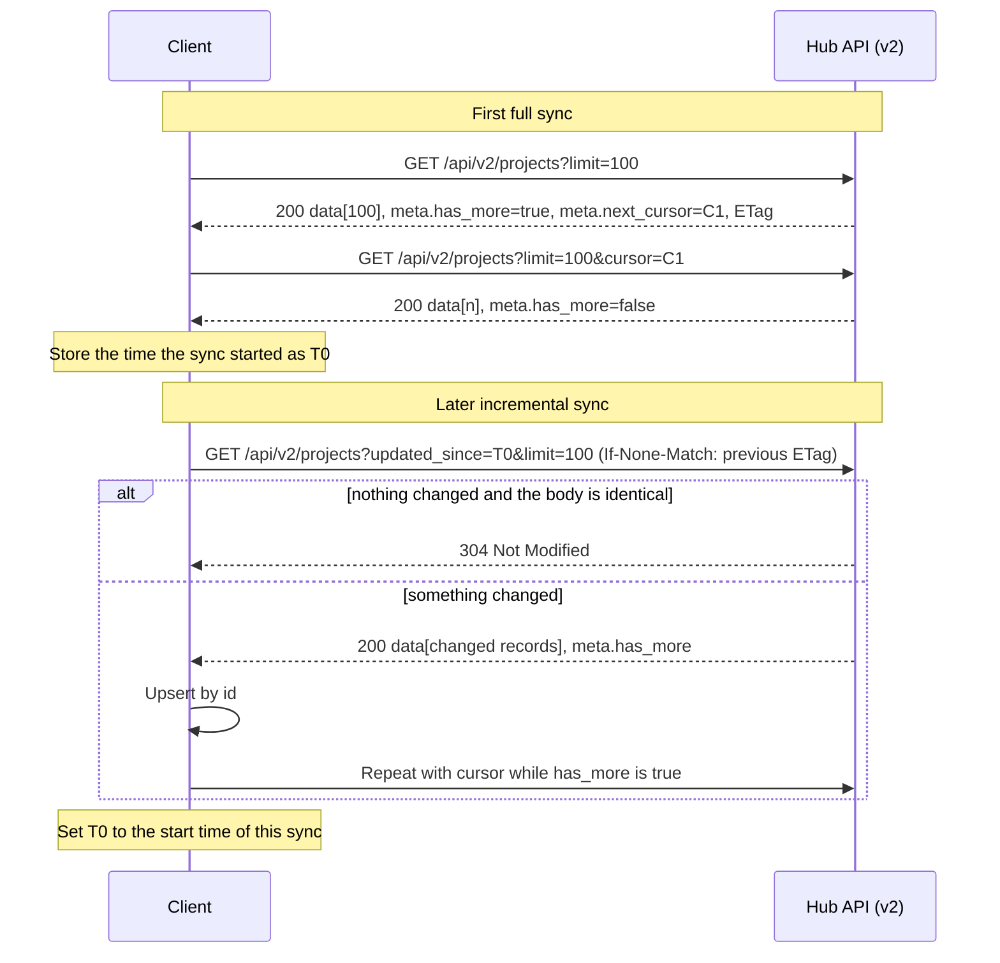

# API overview

> **Audience:** Developers, integrators, partners · **Last verified:** 2026-11-30 against commit `d1296b1`
> **Related:** [Endpoints](endpoints.md), [Request and response examples](request-response-examples.md), [Error codes](error-codes.md), [Rate limiting](rate-limiting.md), [Authentication](authentication.md), [API integrations](api-integrations.md), [Older v1 summary](../api.md)

The Hub publishes a read-only, public JSON API called the open data API. It has two versions, `v1` and `v2`. New clients should use `v2`. `v1` is supported and frozen. Both versions are unauthenticated and share one rate limiter. This page explains the versions, the versioning policy, how `v2` is built for clients that sync data for a long time, and how to move from `v1` to `v2`.

There is no OpenAPI or Swagger file in the repository (a search for `openapi*`, `swagger*` and Postman files outside `vendor/` and `node_modules/` finds none). These Markdown pages are the reference. [`docs/api.md`](../api.md) is the older summary of `v1` only.

## Versions

| | `v1` | `v2` |
| --- | --- | --- |
| Status (`config/api.php`) | `supported` | `current` |
| Base URL | `https://uew-innovation-hub.onrender.com/api/v1` | `https://uew-innovation-hub.onrender.com/api/v2` |
| Route file | [`routes/api/v1.php`](../../routes/api/v1.php) | [`routes/api/v2.php`](../../routes/api/v2.php) |
| Controllers | [`Api/V1`](../../app/Http/Controllers/Api/V1) | [`Api/V2`](../../app/Http/Controllers/Api/V2) |
| Resources | [`Resources/Api/V1`](../../app/Http/Resources/Api/V1) | [`Resources/Api/V2`](../../app/Http/Resources/Api/V2) |
| Endpoints | 12 | 15 (adds `/reference`, `/albums`, `/albums/{album}`) |
| Pagination | Page number: `page`, `per_page` (1 to 50, default 15). Returns totals. | Cursor: `limit` (1 to 100, default 20), `cursor`. No totals. |
| Success envelope | `{ "success": true, "data": ..., "meta": ..., "links": ... }` | `{ "data": ..., "meta": ..., "links": ... }` |
| Error envelope | `{ "success": false, "message": "...", "errors": {...} }` | `{ "error": { "status", "code", "message", "details" } }` |
| Incremental sync | None | `updated_since` on every list |
| Sorting, includes | Fixed order, no `include` | Whitelisted `sort` and `include` |
| Ids | `slug` (numeric `id` for partners) | `id`, always a string |
| Money | Float plus a separate `currency` field | `{ "amount": "1500.00", "currency": "GHS" }` |
| Revalidation | Weak `ETag`, `304` on `If-None-Match` | Weak `ETag`, `304` on `If-None-Match` |

`GET /api` lists the versions, which one is current, and the deprecation and sunset dates. It is served by [`VersionsController`](../../app/Http/Controllers/Api/VersionsController.php).

```json
{
  "data": {
    "name": "<site name> API",
    "current": "v2",
    "documentation": "https://github.com/mhiskall282/uew-innovation-hub/tree/main/docs/06-api-reference",
    "versions": [
      { "version": "v1", "status": "supported", "url": ".../api/v1", "deprecated_at": null, "sunset_at": null },
      { "version": "v2", "status": "current",   "url": ".../api/v2", "deprecated_at": null, "sunset_at": null }
    ]
  }
}
```

The `status` becomes `deprecated` as soon as `deprecated_at` is set for that version.

## Which version to use

Use `v2` for every new client. Choose `v1` only to keep an existing integration running. `v1` will not change shape, but new features (`updated_since`, `include`, albums, reference lists) go to `v2` only.

## Versioning and deprecation policy (as implemented)

The rules are in the comment at the top of [`config/api.php`](../../config/api.php) and enforced by [`ApiVersion`](../../app/Http/Middleware/ApiVersion.php) (middleware alias `api.version`).

- Each version keeps its URL prefix and response shape for its whole life.
- Breaking changes ship as a new version. Additive changes (new fields, new endpoints) may land in an existing version. Clients must ignore fields they do not know.
- Every API response carries `API-Version: v1` or `API-Version: v2`.
- To retire a version, an operator sets environment variables. No code change is needed:
  1. Set `API_V1_DEPRECATED_AT`. Responses then carry `Deprecation: @<unix timestamp>` ([RFC 9745](https://www.rfc-editor.org/rfc/rfc9745)) and `Link: <docs url>; rel="deprecation"`. `GET /api` shows status `deprecated`.
  2. Set `API_V1_SUNSET_AT` at least 6 months later. Responses carry `Sunset: <HTTP date>` ([RFC 8594](https://www.rfc-editor.org/rfc/rfc8594)).
  3. After the sunset date, a release removes the version's routes.
- The same variables exist for `v2`: `API_V2_DEPRECATED_AT`, `API_V2_SUNSET_AT`.
- Today no dates are set in `.env.example`, so no `Deprecation` or `Sunset` header is sent. The "at least 6 months" gap is a policy in the config comment. Code does not enforce it.

Example of a deprecated version's headers (values illustrative, from `tests/Feature/Api/ApiV2Test.php`):

```text
API-Version: v1
Deprecation: @1798761600
Sunset: Thu, 01 Jul 2027 00:00:00 GMT
Link: <https://github.com/mhiskall282/uew-innovation-hub/tree/main/docs/06-api-reference>; rel="deprecation"
```

Clients should log a warning when they see `Deprecation` or `Sunset`.

## v2 conventions and why they scale

**Simple explanation:** a list endpoint should cost the same to serve whether the client asks for the first page or the thousandth, and a client that already has the data should be able to ask "what changed?" instead of downloading everything again.

**Technical explanation:**

| Convention | How it works | Why it helps |
| --- | --- | --- |
| Cursor pagination | `ApiController::paginate()` calls `cursorPaginate($limit)`. The query is ordered by an indexed key. The last ordering column is always `id`, which is unique, so the cursor is stable. | The cost of a page does not grow with its position. No `OFFSET` scan. Inserts during paging do not cause skipped or repeated rows. |
| No `COUNT(*)` | `meta` holds `per_page`, `has_more`, `next_cursor`, `prev_cursor`. There is no `total`. | The database never counts the whole table. |
| `updated_since` | `?updated_since=<date>` adds `WHERE updated_at >= <date>` on every list. Every v2 resource returns `updated_at`. | A client downloads only changed records after its first sync. |
| ETag and `304` | `respond()` sets a weak ETag, the MD5 of the JSON body, then calls `isNotModified()`. A matching `If-None-Match` returns `304 Not Modified` with no body. | Saves bandwidth. A `304` still costs the server the query, but not the transfer. |
| CDN-cacheable headers | `Cache-Control: max-age=60, public, s-maxage=60` (from `API_CACHE_SECONDS`). | A CDN or proxy can absorb repeated requests for 60 seconds. |
| One capacity subquery | Programme lists use `Program::scopeWithActiveApplicationsCount()`: one `withCount` subquery that gives each programme `active_applications_count`. `isAcceptingApplications()` uses it. | No `COUNT` query per programme row. |
| Whitelists | `sort` must be one of the endpoint's keys and `include` one of its relations. Unknown values give `422`. | Clients cannot ask for expensive orderings or joins. |
| Opaque string ids | Slugs, or numeric ids as strings (partners, photos). | Clients cannot depend on integer ids. |

Limits of these conventions, verified against the code:

- `v2` has no tombstones. A record that is deleted or unpublished simply stops appearing, and `updated_since` cannot report that. Clients must do an occasional full resync to drop removed records.
- `updated_since` is inclusive (`>=`), so the record at the boundary comes back again. Deduplicate by `id`.
- An invalid or tampered `cursor` is not rejected. Laravel treats it as no cursor and returns the first page. Treat `next_cursor` as opaque and only reuse values the server gave you.
- `include` is validated only on `/projects`. On other lists `?include=x` is ignored without an error.
- `/community` and `/reference` are not paginated and ignore `cursor`, `sort` and `updated_since`.
- The `/stats` body contains `meta.generated_at` (the current time, to the second), so its ETag changes on almost every request and a `304` is unlikely there.
- Errors are sent with `Cache-Control: no-cache, private` and no ETag.

### Syncing with v2



Keep the `ETag` per exact URL. An `ETag` is only valid for the same URL, query string and cursor.

## Migrating from v1 to v2

Mappings below are taken from the resource classes in `Resources/Api/V1` and `Resources/Api/V2`.

### Request and envelope changes

| Topic | v1 | v2 |
| --- | --- | --- |
| Base path | `/api/v1` | `/api/v2` |
| Page size | `per_page` (1 to 50) | `limit` (1 to 100) |
| Page position | `page` | `cursor` (from `meta.next_cursor`) |
| Totals | `meta.total`, `meta.last_page`, `meta.current_page` | Removed. Use `meta.has_more`. |
| Links | `links.first`, `prev`, `next`, `last` | `links.self`, `next`, `prev` |
| Success flag | `"success": true` | Removed. Use the HTTP status. |
| Error body | `{ "success": false, "message", "errors" }` | `{ "error": { "status", "code", "message", "details" } }` |
| Validation errors | `errors` | `error.details` |
| Incremental sync | Not possible | `updated_since` |
| Community list size | Fixed 25 | `limit` 1 to 100, default 25 |

### Field changes

| Resource | v1 field | v2 field |
| --- | --- | --- |
| All | `slug` (projects, publications, news, programmes) | `id` (same value, a string) |
| Partner | `id` (integer) | `id` (string) |
| All v2 resources | not present | `updated_at` (ISO 8601 with offset) |
| All v2 resources | `url` (HTML page; projects, news, programmes) | `links.html` |
| All v2 resources | not present | `links.self` (API URL) |
| Project | `grant_amount` (float or `null`) plus `currency` | `grant` = `{ "amount": "1500.00", "currency": "GHS" }` or `null` |
| Project | `partners[]` with `name`, `role` (always present on lists and `show`) | `partners[]` with `id`, `name`, `role`. On lists only when requested with `?include=partners`; always on `show` |
| Project | `url` | `links.html` |
| Project | `report_url` | `report_url` (unchanged) |
| Publication | `slug` | `id` |
| Publication | `publish_date` | `published_on` |
| Publication | `project.slug` | `project.id`, plus `project.links.self` |
| Publication | `document_url` | `document_url` (unchanged) |
| News | `slug` | `id` |
| News | `url` | `links.html` |
| News | `content` (only on `show`) | `content` (only on `show`), plus `content_format: "markdown"` |
| News | `published_at` (ISO 8601) | `published_at` (ISO 8601 with offset) |
| Programme | `slug` | `id` |
| Programme | `funding_amount` (float or `null`) plus `currency` | `funding` = `{ "amount", "currency" }` or `null` |
| Programme | `availability`: a display label such as `Open`, `Closed`, `Opens 3 Dec` | `availability`: one of `open`, `upcoming`, `closed` |
| Programme | `url` | `links.html` |
| Programme | `apply_url` | `links.apply` |
| Stats | `funding_secured` (float) plus `currency` | `funding_secured` = `{ "amount", "currency" }` |
| Stats | counts (JSON integers) | counts (JSON integers, cast with `(int)`) |
| Community member | `profile_url` | `links.html` |
| Community badge | `awarded_at` (date) | `awarded_on` (date) |
| Community member | `xp` | `xp` (cast to integer) |
| Index (`/api/v1`, `/api/v2`) | `data.version`, `data.endpoints` | adds `data.conventions`; `endpoints` also lists `reference` and `albums` |

Fields that did not change: project `title`, `summary`, `focus_area`, `status`, `start_date`, `end_date`, `beneficiaries.{target,reached,progress_percent}`, `lead_researcher`, `department`; publication `title`, `type`, `authors`, `abstract`, `journal`, `doi_url`, `downloads`; news `title`, `type`, `category`, `summary`, `author`, `is_featured`, `reading_minutes`; partner `name`, `type`, `website`, `public_projects`.

### Migration checklist

1. Change the base URL to `/api/v2`.
2. Replace page-number loops with a cursor loop (see [examples](request-response-examples.md#cursor-paging-loop)).
3. Read ids from `id`, not `slug`. Treat them as opaque strings.
4. Parse money as decimal strings. Do not convert to float for arithmetic.
5. Read errors from `error.code`.
6. After the first full sync, switch to `updated_since` and send `If-None-Match`.
7. Plan an occasional full resync, because `v2` has no tombstones.

## Behaviour common to both versions

- Methods: `GET` and `HEAD` only. Other methods return `405` with an `Allow: GET, HEAD` header.
- Authentication: none. See [authentication.md](authentication.md).
- Rate limit: 60 requests per minute per IP by default. See [rate-limiting.md](rate-limiting.md).
- Security headers from [`SecurityHeaders`](../../app/Http/Middleware/SecurityHeaders.php) are added to every API response (`X-Content-Type-Options: nosniff` and others).
- CORS: Laravel's default CORS configuration applies to `api/*` (`config('cors')` is not published, so the framework defaults are used): `Access-Control-Allow-Origin: *`, all methods and headers allowed, no credentials. Browser code on any origin can call the API. `exposed_headers` is empty, so browser JavaScript cannot read `ETag`, `X-RateLimit-*`, `Retry-After` or `API-Version` from a cross-origin response. The browser still uses the ETag itself for its HTTP cache.

## Known inconsistencies

| Issue | Where |
| --- | --- |
| `GET /api/v1` reports `documentation` from `config('hub.api_docs_url')` (default `docs/api.md`), while `GET /api` and `GET /api/v2` use `config('api.docs_url')` (default the `06-api-reference` folder). | [`V1/IndexController.php`](../../app/Http/Controllers/Api/V1/IndexController.php) |
| `v1` ignores `API_CACHE_SECONDS`. Its cache lifetime is the constant `CACHE_SECONDS = 60`. | [`V1/ApiController.php`](../../app/Http/Controllers/Api/V1/ApiController.php) |
| A request for an unknown slug on `v2` (route-model-binding failure) returned no `API-Version` header in a local test, because binding runs before `ApiVersion`. Other errors such as `422` carry it. | [`ApiVersion.php`](../../app/Http/Middleware/ApiVersion.php) |
| Unknown paths such as `/api/v3/x` answer in the `v1` error envelope, because only `api/v2` paths use the `v2` envelope. | [`bootstrap/app.php`](../../bootstrap/app.php) |
