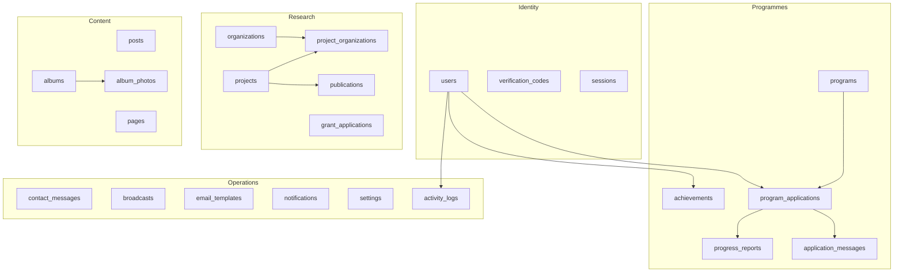

# Database Schema

> **Audience:** Developers · **Last verified:** 2026-11-30 against commit `d1296b1`
> **Related:** [Tables and columns](tables-and-columns.md), [Entity relationships](entity-relationships.md), [Indexes and constraints](indexes-and-constraints.md), [Migrations](migrations.md), [Database overview](database-overview.md)

This page is the table inventory: each table, the Eloquent model that owns it, its row key, whether it soft deletes, and what it is for. Column detail is in [tables-and-columns.md](tables-and-columns.md). The schema was read from a schema dump of a fresh migration run (see [tables-and-columns](../07-database/tables-and-columns.md)), which was generated by running all migrations on SQLite, and checked against the models in [`app/Models/`](../../app/Models).

## Table inventory

| Table | Model | Soft deletes | Purpose |
| --- | --- | --- | --- |
| `users` | [`User`](../../app/Models/User.php) | No | Every account: members and all staff roles. The `role` column separates them. |
| `password_reset_tokens` | none | n/a | Laravel default. Appears unused (see below). |
| `sessions` | none (database session driver) | n/a | Browser sessions, with `user_id`, IP and user agent. |
| `verification_codes` | [`VerificationCode`](../../app/Models/VerificationCode.php) | No | Hashed one-time codes for e-mail verification and password reset. |
| `programs` | [`Program`](../../app/Models/Program.php) | Yes | Programmes members can apply to (grant, fellowship, incubation, competition, training, event). Holds the custom application form in `form_schema`. |
| `program_applications` | [`ProgramApplication`](../../app/Models/ProgramApplication.php) | No | One member's application to one programme. Unique per `(program_id, user_id)`. |
| `application_messages` | [`ApplicationMessage`](../../app/Models/ApplicationMessage.php) | No | Conversation between an applicant and staff, attached to an application. |
| `progress_reports` | [`ProgressReport`](../../app/Models/ProgressReport.php) | No | Periodic progress and budget reports from accepted teams. |
| `achievements` | [`Achievement`](../../app/Models/Achievement.php) | No | Badges and XP awards to members. |
| `projects` | [`Project`](../../app/Models/Project.php) | Yes | Funded research and innovation projects. `is_public` controls website and API visibility. |
| `organizations` | [`Organization`](../../app/Models/Organization.php) | No | Partner organisations. |
| `project_organizations` | pivot (no model) | No | Links projects to organisations, with a partner `role`. |
| `publications` | [`Publication`](../../app/Models/Publication.php) | Yes | Research papers, briefs, newsletters and reports, optionally linked to a project. |
| `grant_applications` | [`GrantApplication`](../../app/Models/GrantApplication.php) | Yes | Legacy grant applications from the old system. Still shown in the staff workspace. |
| `posts` | [`Post`](../../app/Models/Post.php) | Yes | News, blog and announcement posts. |
| `pages` | [`Page`](../../app/Models/Page.php) | No | CMS pages (About, FAQ, Privacy, Terms). |
| `albums` | [`Album`](../../app/Models/Album.php) | No | Gallery albums, one per event. |
| `album_photos` | [`AlbumPhoto`](../../app/Models/AlbumPhoto.php) | No | Photo files (large and thumbnail paths) in an album. |
| `contact_messages` | [`ContactMessage`](../../app/Models/ContactMessage.php) | No | Enquiries from the public contact form. |
| `broadcasts` | [`Broadcast`](../../app/Models/Broadcast.php) | No | Announcement e-mails to members, with audience filters. |
| `email_templates` | [`EmailTemplate`](../../app/Models/EmailTemplate.php) | No | Editable subject and body for system e-mails. Keyed by template name. |
| `notifications` | none (Laravel `DatabaseNotification`) | No | In-app notifications for users. |
| `settings` | [`Setting`](../../app/Models/Setting.php) | No | Key/value site and mail settings. |
| `activity_logs` | [`ActivityLog`](../../app/Models/ActivityLog.php) | No | Audit log. Append-only by convention. |
| `cache`, `cache_locks` | none | n/a | Laravel database cache store and locks. Also holds API rate-limit counters. |
| `jobs`, `job_batches`, `failed_jobs` | none | n/a | Laravel database queue. |
| `migrations` | none | n/a | Laravel migration ledger. |

## Layered view

The full relationship set, with cardinalities, is in [entity-relationships.md](entity-relationships.md).

## How the schema is split by feature

| Feature | Tables | First created in |
| --- | --- | --- |
| Original project register (legacy port) | `users`, `organizations`, `projects`, `project_organizations`, `publications`, `activity_logs`, `posts`, `grant_applications` | `0001_01_01_000000`, `2026_11_23_000001` to `000007` |
| Composite indexes for list pages | indexes on `activity_logs`, `posts`, `grant_applications`, `publications`, `projects` | `2026_11_24_000001` |
| Workspace redesign (public/internal projects, user activity) | columns on `users`, `projects`, `publications`, `grant_applications`, `activity_logs` | `2026_11_25_000001` |
| Site settings and contact inbox | `settings`, `contact_messages` | `2026_11_26_000001` |
| Programmes, members, CMS | `programs`, `program_applications`, `verification_codes`, `email_templates`, `broadcasts`, `pages`, member columns on `users` | `2026_11_27_000001` |
| Member demographics | columns on `users`, `program_applications.applicant_snapshot` | `2026_11_28_000001` |
| Engagement | `notifications`, `achievements`, `application_messages`, `progress_reports`, `users.xp`, `users.public_profile` | `2026_11_29_000001` |
| Gallery | `albums`, `album_photos` | `2026_11_30_000001` |

## Notes

- `password_reset_tokens` comes from Laravel's stock users migration. The sign-in flow resets passwords with codes stored in `verification_codes` (purpose `reset_password`), and no model or service reads `password_reset_tokens`. Treat the table as unused.
- `grant_applications` is the legacy intake. New applications go to `program_applications`. See [business-logic](../04-architecture/business-logic.md) for how the two relate.
- `activity_logs` has a polymorphic `subject_type` and `subject_id`. These hold the model class and id of the record the action concerned, with no database foreign key.
- `notifications` is polymorphic too (`notifiable_type`, `notifiable_id`) and has no foreign key.
- `settings.value` is JSON. Mail settings keep the SMTP password encrypted with `APP_KEY` (see `MailSettings`).
