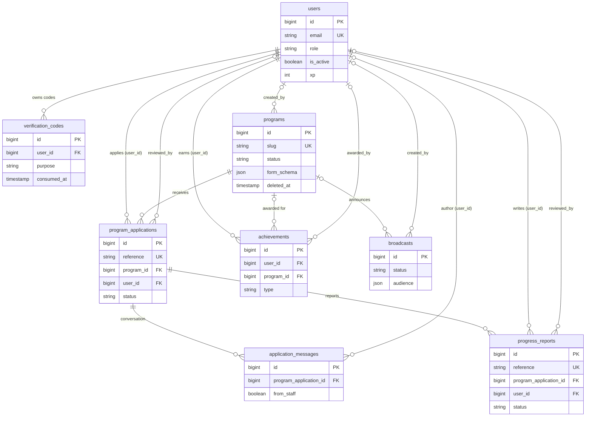
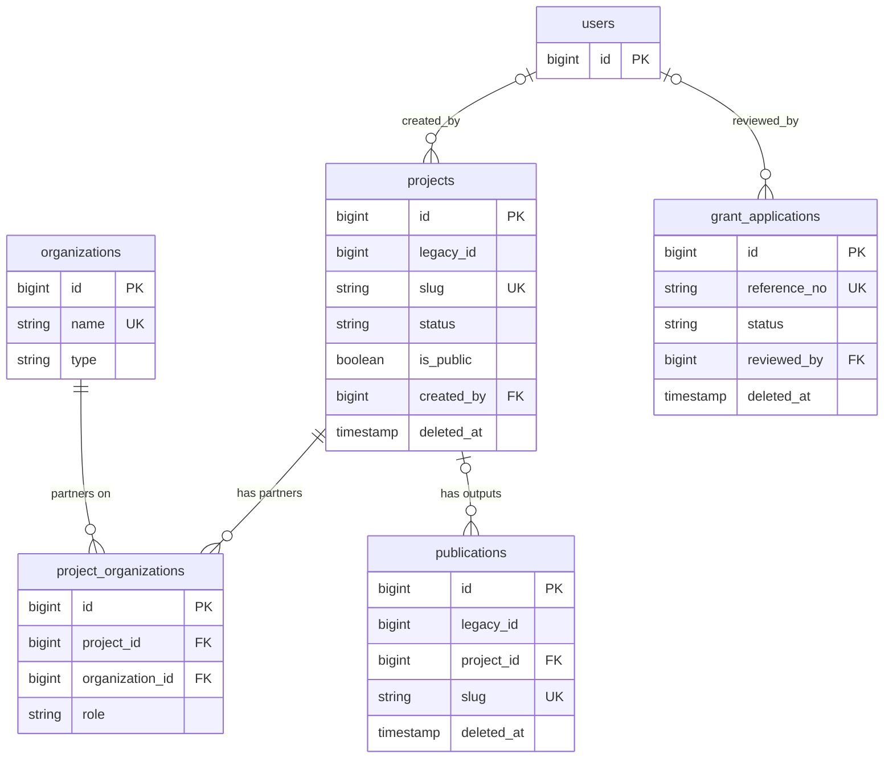
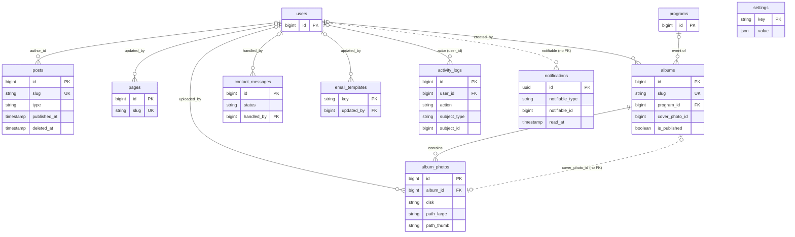

# Entity Relationships

> **Audience:** Developers · **Last verified:** 2026-11-30 against commit `d1296b1`
> **Related:** [Tables and columns](tables-and-columns.md), [Indexes and constraints](indexes-and-constraints.md), [Database schema](database-schema.md), [Database architecture](../04-architecture/database-architecture.md)

This page shows how the domain tables relate, in three diagrams: people and programmes, portfolio and publications, and content, gallery and engagement. Cardinalities follow the foreign keys in a schema dump of a fresh migration run (see [tables-and-columns](../07-database/tables-and-columns.md)) and the relation methods on the models in [`app/Models/`](../../app/Models). Framework tables (`cache`, `jobs`, `sessions` and so on) are not drawn, except for `notifications`, which is polymorphic.

## Reading the diagrams

- `||` means exactly one, `o|` means zero or one, `o{` means zero or many.
- A parent that is optional on the child side (`|o--o{`) is a nullable foreign key with `ON DELETE SET NULL`. A required parent (`||--o{`) is a `NOT NULL` foreign key, and every one of those in this schema is `ON DELETE CASCADE`.
- Most links point at `users`. Only the link that carries the main meaning is labelled in full. The full list of foreign keys, with their delete rules, is in [indexes-and-constraints.md](indexes-and-constraints.md).
- A dotted line (`..`) marks a link that has no database foreign key.
- Soft deletes (`programs`, `projects`, `publications`, `posts`, `grant_applications`) never fire a database cascade, because the row is not removed. Only a hard delete or `forceDelete` does. See [data-retention.md](data-retention.md).

## Diagram 1: people and programmes

| Relationship | Foreign key | On delete | Model methods | Notes |
| --- | --- | --- | --- | --- |
| user has many verification codes | `verification_codes.user_id` | cascade | `VerificationCode::user` | Codes are removed with the account. |
| programme has many applications | `program_applications.program_id` | cascade | `Program::applications`, `ProgramApplication::program` (with trashed) | Unique with `user_id`: one application per member per programme. |
| user has many applications | `program_applications.user_id` | cascade | `User::applications`, `ProgramApplication::applicant` | Applications go when the account goes. |
| application has many messages | `application_messages.program_application_id` | cascade | `ProgramApplication::messages`, `ApplicationMessage::application` | Ordered by `id`. |
| application has many progress reports | `progress_reports.program_application_id` | cascade | `ProgramApplication::progressReports`, `ProgressReport::application` | Ordered by `period_end` descending. |
| user has many progress reports | `progress_reports.user_id` | cascade | `User::progressReports`, `ProgressReport::author` | Always the applicant. |
| user has many achievements | `achievements.user_id` | cascade | `User::achievements`, `Achievement::user` | Ordered by `awarded_at` descending. |
| programme has many achievements | `achievements.program_id` | set null | `Achievement::program` (with trashed) | Nullable, for badges not tied to a programme. |
| user created programmes | `programs.created_by` | set null | `Program::creator` | |
| user reviewed applications | `program_applications.reviewed_by` | set null | `ProgramApplication::reviewer` | |
| user wrote messages | `application_messages.user_id` | set null | `ApplicationMessage::author` | `NULL` shows as a deleted account. |
| user reviewed reports | `progress_reports.reviewed_by` | set null | `ProgressReport::reviewer` | |
| user awarded badges | `achievements.awarded_by` | set null | `Achievement::awarder` | |
| programme has many broadcasts | `broadcasts.program_id` | set null | `Broadcast::program` (with trashed) | |
| user created broadcasts | `broadcasts.created_by` | set null | `Broadcast::author` | |

## Diagram 2: portfolio and publications

`projects` and `organizations` are many-to-many through `project_organizations`, which carries the partner `role`. `grant_applications` is the legacy intake and is related only to the user who reviewed it.

| Relationship | Foreign key | On delete | Model methods | Notes |
| --- | --- | --- | --- | --- |
| project has many partner links | `project_organizations.project_id` | cascade | `Project::organizations` (belongsToMany) | Unique with `organization_id`. |
| organisation has many partner links | `project_organizations.organization_id` | cascade | `Organization::projects` (belongsToMany) | Deleting an organisation removes its links but not the projects. |
| project has many publications | `publications.project_id` | set null | `Project::publications`, `Publication::project` | A publication survives the removal of its project. |
| user created projects | `projects.created_by` | set null | `Project::creator`, `User::projects` | |
| user reviewed grant applications | `grant_applications.reviewed_by` | set null | `GrantApplication::reviewer` | No inverse relation on `User`. |

`projects.legacy_id` and `publications.legacy_id` hold ids from the old MySQL system. They are plain indexed integers, not foreign keys.

## Diagram 3: content, gallery and engagement

`albums.cover_photo_id` points at `album_photos.id` with no foreign key. `activity_logs` and `notifications` are polymorphic, so they have no foreign keys to the records they describe.

`settings` has no relationships. It is a key/value table.

| Relationship | Foreign key | On delete | Model methods | Notes |
| --- | --- | --- | --- | --- |
| user wrote posts | `posts.author_id` | set null | `Post::author`, `User::posts` | |
| user edited pages | `pages.updated_by` | set null | `Page::editor` | |
| user created albums | `albums.created_by` | set null | `Album::creator` | |
| programme has albums | `albums.program_id` | set null | `Album::program` (with trashed) | |
| album has many photos | `album_photos.album_id` | cascade | `Album::photos`, `AlbumPhoto::album` | Ordered by `sort_order`, then `id`. Removing rows does not remove files; `GalleryService` deletes files first. |
| album has one cover | `albums.cover_photo_id` | none | `Album::cover` | No foreign key. `GalleryService` sets it to the first uploaded photo and re-points it when the cover is deleted. |
| user uploaded photos | `album_photos.uploaded_by` | set null | none | |
| user handled enquiries | `contact_messages.handled_by` | set null | `ContactMessage::handler` | |
| user edited templates | `email_templates.updated_by` | set null | `EmailTemplate::editor` | |
| user performed actions | `activity_logs.user_id` | set null | `ActivityLog::user`, `User::activityLogs` | The log keeps the row when the actor is deleted. |
| log entry concerns a subject | `activity_logs.subject_type`, `subject_id` | none | `ActivityLog::subject` (`morphTo`, without global scopes) | Polymorphic. The subject can be any model, including a soft-deleted or hard-deleted one. |
| user has notifications | `notifications.notifiable_type`, `notifiable_id` | none | `User::notifications` (`Notifiable`) | Polymorphic. Only `App\Models\User` is used as the notifiable. |

## Polymorphic links

| Table | Columns | Values in use | Consequence |
| --- | --- | --- | --- |
| `activity_logs` | `subject_type`, `subject_id` | Full class names such as `App\Models\Project`, `App\Models\User`, `App\Models\Program`, `App\Models\Album`. `NULL` for events with no subject. | No referential integrity. A log row can point at a record that no longer exists. `ActivityLog::subject()` then returns `null`. The application sets no morph map, so renaming a model class orphans old rows. |
| `notifications` | `notifiable_type`, `notifiable_id` | `App\Models\User` | Deleting a user leaves their notifications behind. |

Both column pairs are indexed. See [indexes-and-constraints.md](indexes-and-constraints.md).

## What cascades when a user is deleted

Only staff accounts can be deleted from the interface (`UserService::delete`, which refuses to delete the last active Hub Director). Members have no delete function yet. A hard delete of a user row has these effects:

| Effect | Tables |
| --- | --- |
| Rows deleted (cascade) | `verification_codes`, `program_applications` (and through them `application_messages` and `progress_reports`), `progress_reports` (author), `achievements` (recipient) |
| Reference set to `NULL` | `activity_logs.user_id`, `projects.created_by`, `programs.created_by`, `posts.author_id`, `pages.updated_by`, `albums.created_by`, `album_photos.uploaded_by`, `contact_messages.handled_by`, `email_templates.updated_by`, `broadcasts.created_by`, `grant_applications.reviewed_by`, `program_applications.reviewed_by`, `progress_reports.reviewed_by`, `achievements.awarded_by`, `application_messages.user_id` |
| Left as is | `sessions` rows (the application deletes them first), `notifications` rows |

Files uploaded with an application (stored on the documents disk and referenced in `program_applications.answers`) are not deleted when the application row cascades. See [data-retention.md](data-retention.md).

## What cascades when a programme is deleted

`ProgramService::delete` soft deletes, so nothing cascades. Applications, achievements, albums and broadcasts keep their `program_id`, and the relations use `withTrashed()` so the programme title still shows. A hard delete (not available in the application) would delete every application for that programme and, through them, the messages and progress reports.
