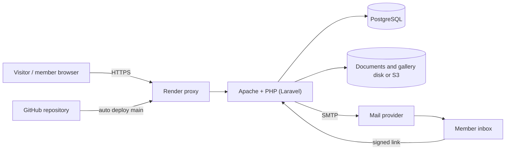

# Threat Model

> **Audience:** developers, security reviewers, project owners · **Last verified:** 2026-11-30 against commit `d1296b1`
> **Related:** [Security overview](security-overview.md), [Authentication security](authentication-security.md), [Authorization security](authorization-security.md), [System architecture](../04-architecture/system-architecture.md), [Technical debt register](../12-maintenance/technical-debt-register.md)

This page applies STRIDE (Spoofing, Tampering, Repudiation, Information disclosure, Denial of service, Elevation of privilege) to each surface of the system. Each row names a threat, the mitigation that exists in code (with a file), and the residual risk. It is a desk analysis from reading the source; no penetration test or DAST scan was run (`docs/audit/TEST_RESULTS.md`).

## Assets and actors

| Asset | Why it matters |
| --- | --- |
| Member and applicant personal data (demographics, contact details, application PDFs) | Act 843 obligations; harm to individuals |
| Staff accounts, above all the Hub Director | Full control of content, settings, mail, users |
| Review decisions and audit trail | Fairness and accountability |
| Uploaded documents and photos | Confidentiality and integrity |
| Hub reputation (public site, broadcasts) | Phishing or defacement |
| Secrets (`APP_KEY`, DB, SMTP, S3) | Total compromise |

| Actor | Capability assumed |
| --- | --- |
| Anonymous visitor or bot | Any HTTP request |
| Registered member | Verified account, can upload PDFs and send messages |
| Malicious or compromised staff | Role-limited access, may be a trusted insider |
| Network attacker | Observes or alters traffic if HTTPS fails |
| Repository reader | Public GitHub repository and its history |
| Platform operator | Render dashboard access |

## Trust boundaries

## 1. Public website (`site.*`)

| STRIDE | Threat | Existing mitigation | Residual risk |
| --- | --- | --- | --- |
| S | Bot registers many accounts | Honeypot `company_website`, `registrations` limiter 5/min and 30/day per IP (`RegisterRequest`, `AppServiceProvider`), e-mail code required | No CAPTCHA; many IPs defeat per-IP limits |
| T | Form tampering to set `role` | Not mass assignable (`User::$fillable`); `RegisterRequest` returns a fixed field list; test `role_cannot_be_injected_at_sign_up` | Low |
| T | Stored XSS through CMS, news, programme text | Markdown with `html_input => escape`, `allow_unsafe_links => false`; CSP without inline script | Staff-authored content; CSP has `unsafe-eval` (see [input validation](input-validation.md)) |
| R | User denies sending a contact message | `contact_messages` row with time; IP not stored there | Weak non-repudiation, acceptable |
| I | Draft or internal content leaks | Public queries filter on published/public flags; `internal_projects_are_hidden...`, `only_published_posts_are_public` | Low |
| I | Partner contact e-mails or private profiles exposed | Fields not in API Resources; `public_profile` opt-in | Low |
| D | Contact-form flooding | `contact-messages` limiter 3/min, 20/day per IP | Spoofed `X-Forwarded-For` if proxy trust is wrong |
| E | Reserved URL shadowed by a CMS page | Reserved slug list in `Workspace/PageController` | Low |

## 2. Member portal (`portal.*`)

| STRIDE | Threat | Mitigation | Residual risk |
| --- | --- | --- | --- |
| S | Account takeover by password guessing | Per e-mail+IP and per-account lockout, route throttle, generic error (`LoginRequest`) | No MFA; no breached-password check |
| S | Session hijack or fixation | Session regenerated on sign-in; `HttpOnly`, `Secure`, `SameSite=Lax`; HTTPS forced | Stolen cookie works until expiry (120 min) or revocation |
| T | Edit another member's application or report | `ProgramApplicationPolicy`, `ProgressReportPolicy`; 404 for others' reports | Low |
| T | Tampered budget totals | `budget_spent` recomputed on the server (`ProgressReportService`) | Low |
| R | Member disputes a submission | Audit entries and stored snapshot `applicant_snapshot` freeze submitted details | Low |
| I | Read others' applications, files, messages, notifications | Policies and `Gate::authorize('view', ...)` on file download; notifications read via own relation | Application PDFs are not virus-scanned |
| I | Open redirect via notification link | Relative path check | Low |
| D | Message flooding | `throttle:20,1` messages, `10,1` reports, `30,1` apply | Low |
| E | Member reaches workspace | `can:workspace.access` fails for `member`; sign-in redirects members to the portal | Low |

## 3. Staff workspace (`workspace.*`)

| STRIDE | Threat | Mitigation | Residual risk |
| --- | --- | --- | --- |
| S | Stolen staff password | Lockout, 12-character policy, session revocation on reset | **No MFA. Highest-impact gap** |
| T | Officer edits users or roles | `UserPolicy` needs `users.manage`; nobody changes their own role; last Hub Director protected | Hub Director compromise is total |
| T | Insider changes a review decision | Audit with field diff (`GrantApplicationService`, `ApplicationController`) | Log is editable by DB admins |
| R | Staff deny actions | `activity_logs` with actor, IP, diff. CSV and PDF exports are audited (`member.exported`, `report.projects_exported`, `application.exported`, `report.exported`). | Document reads and API access are not logged |
| I | Reviewer sees gender or disability | Snapshot view omits them; `reviewers_do_not_see_gender_or_disability` | Prefilled answers and age still visible; see [authorization security](authorization-security.md#demographics-privacy) |
| I | SMTP password exposed | Encrypted with `APP_KEY`; redacted in audit; not sent to browser | Anyone with `APP_KEY` and DB can decrypt |
| D | PDF or photo export abuse | `throttle:10,1` PDF; photo upload `throttle:20,1`; 30 megapixel cap | Large uploads cost memory (`memory_limit` raised to 512M during decode) |
| E | Privilege escalation through forms | `$fillable` guards; `PrivilegesTest` iterates all state-changing routes | A new route without a gate would be open to all staff |

## 4. Open data API (`api.v1.*` and `api.v2.*`)

| STRIDE | Threat | Mitigation | Residual risk |
| --- | --- | --- | --- |
| S | None: no authentication by design | n/a | Anyone can read public data |
| T | Not applicable: read-only (`GET` routes only) | Route list shows only `GET\|HEAD` in both versions | None |
| I | Leaking internal fields | Resource whitelists in `Http/Resources/Api/V1` and `V2`; `projects_are_paginated_filtered_and_hide_internal_fields`, `partners_endpoint_never_exposes_contact_emails` | A new field added to a Resource is public at once |
| I | Scraping | Public data; `throttle:api` 60/min/IP, one counter for both versions | Bulk scraping through many IPs. v2 `updated_since` makes a full incremental copy cheap by design. |
| I | v2 album photos leaking unpublished or missing files | `/api/v2/albums` returns published albums and only photos whose files exist (`ApiV2Test::test_albums_list_published_events_with_available_photos_only`) | None known |
| D | High request rate or large pages | 60/min/IP; v1 `per_page` max 50; v2 `limit` max 100 and cursor pagination with no `COUNT(*)`; `sort` and `include` whitelists; public cache headers and weak ETag with 304 | Free-plan instance is small. Shared caches only help if a CDN sits in front. |
| D | Expensive query through user-chosen sort or relation | v2 accepts only whitelisted `sort` keys and `include` values; anything else returns 422 `validation_failed` | None known |
| R | Client cannot tell that a record was removed | Not mitigated: v2 has no tombstones, so `updated_since` sync cannot see deleted or unpublished records | Integrity gap for syncing clients, not a confidentiality risk |
| E | None | No write endpoints | None |

An old API version stays reachable until its routes are removed. Retirement is signalled by the `Deprecation` and `Sunset` headers once `API_V1_DEPRECATED_AT` and `API_V1_SUNSET_AT` are set (`config/api.php`).

## 5. E-mail links and codes

| STRIDE | Threat | Mitigation | Residual risk |
| --- | --- | --- | --- |
| S | Guess a 6-digit code | bcrypt hash, 10 min, 5 attempts, row lock, per-IP and per-email throttles | New codes allow 5 more guesses each; resend limited to 1/min and 10/hour per `email\|ip` |
| S | Forge or alter a link | Signed URL (`signed` middleware, `APP_KEY`); `user` and `record` are in the signature | Anyone with `APP_KEY` can forge links |
| T | Mail scanner consumes link | GET only shows a confirm page; POST acts | Low |
| I | Account enumeration by reset form | Same response for unknown and known e-mail | Timing difference (mail sent synchronously) |
| I | Code in server log | Not logged by the app | `MAIL_MAILER=log` logs the whole mail |
| D | Reset requests spam a victim | `password-codes` limiter, 60 second resend | Victim receives up to 10 mails/hour from one source |
| E | Reused link | Record consumed on first use (`consumeLink`) | Unsubscribe links never expire (effect: unsubscribe only) |

## 6. Uploads (PDF and photos)

| STRIDE | Threat | Mitigation | Residual risk |
| --- | --- | --- | --- |
| T | Upload executable or script as "PDF" | `mimes:pdf`, `mimetypes:application/pdf`; random server name with fixed `.pdf`; private disk; `nosniff`; Apache serves only `public/` | Content beyond the PDF header is not validated |
| T | Malformed image to exploit GD | `getimagesize` type check, 30 MP limit, re-encode to JPEG | GD vulnerabilities in the PHP image remain possible; keep the base image updated |
| T | Path traversal on download | `..` rejected; folder allow-list (`DocumentStorage::resolve`) | Low |
| I | Direct URL to a private file | `private` and `gallery` disks have `serve => false`; documents streamed by record; gallery written with visibility `private` | Photos of a published album are public by design |
| I | EXIF leaks location | GD re-encode drops EXIF (`GalleryTest` asserts) | PDFs may contain metadata |
| D | Decompression bomb, huge uploads | 30 MP cap; `upload_max_filesize=25M`; `max_file_uploads=5` | Several parallel requests on a small instance |
| E | Web shell in `storage/` or `public/` | Executable-file scan (`scripts/security-scan.ps1`) | Scan is manual |

## 7. Infrastructure and supply chain

| STRIDE | Threat | Mitigation | Residual risk |
| --- | --- | --- | --- |
| S | Spoofed client IP | `TRUSTED_PROXIES` | `*` is only safe behind Render's proxy |
| T | Malicious dependency | `composer audit`, `npm audit --omit=dev --audit-level=high` in CI; lockfiles; `npm ci` | No Dependabot, no SAST, no image scan, no scheduled run |
| T | Push to `main` deploys at once | CI runs, but `autoDeploy: true` deploys without waiting unless "Wait for CI" is enabled in Render (comment in `ci.yml`) | **Requires confirmation:** branch protection and the Render setting |
| R | Unclear who changed infrastructure | Render and GitHub activity logs | Outside the app |
| I | Secrets in the repository | `.env` ignored; `scripts/security-scan.ps1`; no secrets found in tracked files | Tester password in `87df882`; `legacy/` credentials; no CI secret scan |
| I | Debug pages | `APP_DEBUG=false`, `display_errors=Off` | Misconfiguration if env is wrong |
| D | Free-plan limits | Health check, restart on failure | Instance sleeps; ephemeral disk loses local files |
| E | Container escape or shell | Apache and queue worker run as `www-data`; no `disable_functions` | Recommended hardening not implemented |
| E | Default demo passwords on hosted demo | `hub:secure-demo-accounts`, `BLOCK_DEFAULT_PASSWORDS`, seeder refuses weak `SEED_PASSWORD` in production | `BLOCK_DEFAULT_PASSWORDS` is not set in `render.yaml`; `docs/audit` F-01 describes the risk |

## Top risks, ranked

1. No MFA on privileged staff accounts.
2. Hosted demo with demo accounts: confirm `SEED_PASSWORD` is strong and `BLOCK_DEFAULT_PASSWORDS=true`, and that the tester password from `87df882` is retired.
3. No alerting or centralised monitoring; incidents depend on someone reading logs.
4. `MAIL_MAILER=log` on a site with real users exposes codes and links in logs.
5. No pruning or retention: PII and audit data accumulate.
6. Auto-deploy of `main` without confirmed required CI.
