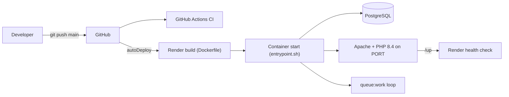

# Deployment Overview

> **Audience:** Developers, operators · **Last verified:** 2026-11-30 against commit `d1296b1`
> **Related:** [Environment configuration](environment-configuration.md), [Production deployment](production-deployment.md), [Docker guide](docker-guide.md), [CI/CD pipeline](ci-cd-pipeline.md), [Existing deployment notes](../deployment.md)

This page lists every way the Hub can be run, which files define each one, and which one is in use today. The Hub is one Laravel 12 application. The same code runs locally, in a Docker container on Render, and (in an alternative, less proven setup) as a Vercel serverless function.

## Deployment targets

| Target | Defined by | Database | Documents and photos | Queue worker | Status |
| --- | --- | --- | --- | --- | --- |
| Local development | `.env.example`, `composer.json` scripts | SQLite (`database/database.sqlite`) | Local disk | Run `php artisan queue:work` yourself | Used daily by developers |
| Render (Docker) | [`render.yaml`](../../render.yaml), [`Dockerfile`](../../Dockerfile), [`docker/entrypoint.sh`](../../docker/entrypoint.sh) | Render PostgreSQL (free plan) | Container disk unless `DOCUMENTS_DISK=s3` | Started inside the web container | **Live** at https://uew-innovation-hub.onrender.com |
| Any Docker host | `Dockerfile` | Any PostgreSQL or MySQL via `DB_URL` | Same as above | Same as above | Supported by the image, not documented as in use |
| Vercel (serverless PHP) | [`vercel.json`](../../vercel.json), [`api/index.php`](../../api/index.php), [`.vercelignore`](../../.vercelignore) | External (for example Neon) | S3 only (`/tmp` is the only writable path) | None (`QUEUE_CONNECTION=sync`) | Alternative entry point |

> **Requires confirmation:** whether the Vercel deployment has ever been run end to end. The files exist and [`../deployment.md`](../deployment.md) describes the steps, but nothing in the repository proves a working Vercel site, and there is no CI job for it. Treat it as unverified.

## What "deploy" means for this project

1. A developer pushes to `main` on https://github.com/mhiskall282/uew-innovation-hub.
2. GitHub Actions runs the CI workflow (see [CI/CD pipeline](ci-cd-pipeline.md)).
3. Render builds the `Dockerfile` and starts the container because `autoDeploy: true` is set in `render.yaml`.
4. On every container start, `docker/entrypoint.sh` caches configuration, runs migrations, creates the first Hub Director if none exists, seeds the default CMS pages, and starts a queue worker.
5. Render calls `GET /up` (the `healthCheckPath`) and routes traffic once it answers.

There is no separate build artifact, release tag or staging stage. See [Build and release process](build-and-release-process.md).

## Runtime stack inside the container

| Layer | Value | Source |
| --- | --- | --- |
| Base image | `php:8.4-apache` | `Dockerfile` stage 3 |
| PHP extensions | `pdo_pgsql`, `pdo_mysql`, `zip`, `intl`, `bcmath`, `opcache`, `gd` | `Dockerfile` |
| Front-end build | Node 22, `npm ci`, `npm run build` (Vite, Tailwind v4) | `Dockerfile` stage 1 |
| PHP dependencies | Composer 2, `--no-dev`, optimised classmap | `Dockerfile` stage 2 and 3 |
| Web server | Apache, document root `public/`, `Listen $PORT` | `docker/apache-vhost.conf`, `docker/entrypoint.sh` |
| PHP settings | `display_errors=Off`, 25 MB uploads, OPcache with `validate_timestamps=0` | `docker/php.ini` |
| Default port | `8080` (`ENV PORT=8080`); Render supplies its own `PORT` | `Dockerfile` |

## Documents in this section

| Page | Use it for |
| --- | --- |
| [Environment configuration](environment-configuration.md) | Every environment variable |
| [Local deployment](local-deployment.md) | Running on a developer machine |
| [Staging deployment](staging-deployment.md) | The test/demo site and how to add a real staging service |
| [Production deployment](production-deployment.md) | Launch checklist and Render free-plan limits |
| [Build and release process](build-and-release-process.md) | How code becomes a running release |
| [CI/CD pipeline](ci-cd-pipeline.md) | Each GitHub Actions job |
| [Docker guide](docker-guide.md) | Building and running the image |
| [Infrastructure overview](infrastructure-overview.md) | Services, storage and network |
| [Logging and monitoring](logging-and-monitoring.md) | Where logs go, what is missing |
| [Health checks](health-checks.md) | `/up` and the Docker `HEALTHCHECK` |
| [Backup and recovery](backup-and-recovery.md) | Data protection |
| [Rollback procedures](rollback-procedures.md) | Undoing a bad release |
| [Scaling considerations](scaling-considerations.md) | Growing beyond one container |

## Known gaps at a glance

- No staging environment. The live Render site is also the test/demo site (`SEED_DEMO_DATA=true` in `render.yaml`).
- The Render free plan sleeps after 15 minutes, expires its PostgreSQL after 30 days and has no persistent disk.
- No external monitoring, alerting or backup automation exists in the repository.
- Details and owners: [Technical debt register](../12-maintenance/technical-debt-register.md).
