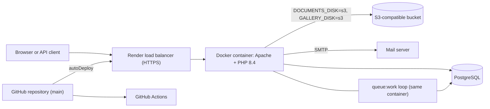

# Infrastructure Overview

> **Audience:** Developers, operators · **Last verified:** 2026-11-30 against commit `d1296b1`
> **Related:** [Deployment overview](deployment-overview.md), [Docker guide](docker-guide.md), [Scaling considerations](scaling-considerations.md), [System architecture](../04-architecture/system-architecture.md), [Integration architecture](../04-architecture/integration-architecture.md)

This page lists the infrastructure the Hub uses today, what each piece stores, and what is missing. The hosted site is a single Render web service with one PostgreSQL database. Everything else (object storage, SMTP, monitoring) is optional or not provisioned by the repository.

## Components

| Component | Provided by | Defined in | Notes |
| --- | --- | --- | --- |
| Web service | Render, `runtime: docker`, `plan: free` | [`render.yaml`](../../render.yaml) | Name `uew-innovation-hub`, health check `/up`, `autoDeploy: true` |
| Database | Render PostgreSQL, `plan: free` | `render.yaml` `databases` block | Name `uew-innovation-hub-db`, database `uew_innovation_hub`, user `uew_hub`. Connection string injected as `DB_URL`. |
| Application runtime | `php:8.4-apache` image | [`Dockerfile`](../../Dockerfile) | Apache plus `mod_php`. One process tree per container. |
| Queue | `jobs` table in the same database | `config/queue.php` (`QUEUE_CONNECTION=database`) | Worker runs inside the web container. |
| Sessions and cache | `sessions` and `cache` tables | `render.yaml` (`SESSION_DRIVER=database`, `CACHE_STORE=database`) | Every request reads the session from the database. |
| Documents | `private` disk (container) or `s3` | `config/hub.php`, `config/filesystems.php` | `DOCUMENTS_DISK` |
| Gallery photos | `gallery` disk (container) or `s3` | `config/hub.php`, `config/filesystems.php` | `GALLERY_DISK`, not set in `render.yaml` |
| Outgoing e-mail | SMTP configured in the workspace or `MAIL_*` | `config/mail.php`, `app/Services/MailSettings.php` | Default mailer is `log`, so nothing is sent until SMTP is set |
| Source and CI | GitHub, GitHub Actions | `.github/workflows/ci.yml` | See [CI/CD pipeline](ci-cd-pipeline.md) |
| TLS and CDN | Render edge | Platform | No separate CDN is configured |
| Alternative host | Vercel serverless PHP | `vercel.json`, `api/index.php` | Unverified, see [Deployment overview](deployment-overview.md) |

## What lives where

| Data | Location | Survives a redeploy on Render free? |
| --- | --- | --- |
| Users, projects, programmes, applications, audit log, settings | PostgreSQL | Yes, until the free database expires after 30 days |
| Uploaded PDFs (reports, publications, grant proposals) | `storage/app/private` or bucket | Only with `DOCUMENTS_DISK=s3` |
| Gallery photos (JPEG thumbnails and large copies) | `storage/app/gallery` or bucket | Only with `GALLERY_DISK=s3` |
| Laravel log file | `storage/logs/laravel.log` (local only; Render uses stderr) | No |
| Compiled views, config and route caches | `storage/framework`, `bootstrap/cache` | Rebuilt at every boot by `php artisan optimize` |
| Legacy PDFs | `reports/` and `publications/` in the repository | Yes, they ship in the image and are copied to the documents disk by `hub:import-documents` |

## Network and ports

| Item | Value |
| --- | --- |
| Listening port | `$PORT`. Render injects it. The image default is `8080`. |
| Protocol inside the container | HTTP only. The platform terminates HTTPS. |
| Trusted proxies | `TRUSTED_PROXIES=*` in `render.yaml` |
| Outbound | PostgreSQL, S3 endpoint, SMTP, and Composer or npm during build |
| Inbound API | `/api/v1` and `/api/v2` are public and unauthenticated, rate limited to `API_RATE_LIMIT_PER_MINUTE` (default 60) per IP |

## Background work

- There is **no scheduler**. `routes/console.php` holds only Laravel's default `inspire` command, and no cron or Render cron job is defined. Scheduled posts work because state is derived from `published_at` at read time. Nothing prunes old sessions, cache rows, failed jobs or audit logs.
- The queue worker is started by `docker/entrypoint.sh` as a `while true` loop around `php artisan queue:work --sleep=3 --tries=3 --max-time=3600 --memory=128`. It restarts after exit, but is not supervised by anything else. If Apache dies the container ends and the worker with it.
- `SendBroadcast` has `tries = 1` and `timeout = 600`. Other queued mail uses the worker's `--tries=3`.

## Costs and plans (from `render.yaml`)

| Service | Plan in the file | Alternative named in the docs |
| --- | --- | --- |
| Web | `free` | Render Starter, about 7 USD a month per [`../deployment.md`](../deployment.md) |
| Database | `free` (30-day expiry) | Paid Render Postgres, or a Neon database via `DB_URL` |
| Object storage | not provisioned | Cloudflare R2 (free tier), AWS S3, Backblaze B2 |

> **Requires confirmation:** the Render prices quoted from `docs/deployment.md` can change. Check the Render pricing page before budgeting.

## Gaps

| Gap | Impact |
| --- | --- |
| Single instance, single region | No redundancy. A restart means downtime. |
| Worker and web share a container | A heavy broadcast competes with page requests for CPU and memory. |
| No Infrastructure as Code for the bucket, SMTP or DNS | Set up by hand. |
| No external uptime monitor or alerting | See [Logging and monitoring](logging-and-monitoring.md). |
| No automated backups in the repository | See [Backup and recovery](backup-and-recovery.md). |
| `composer.json` still named `laravel/laravel` | Cosmetic, listed in the debt register. |
