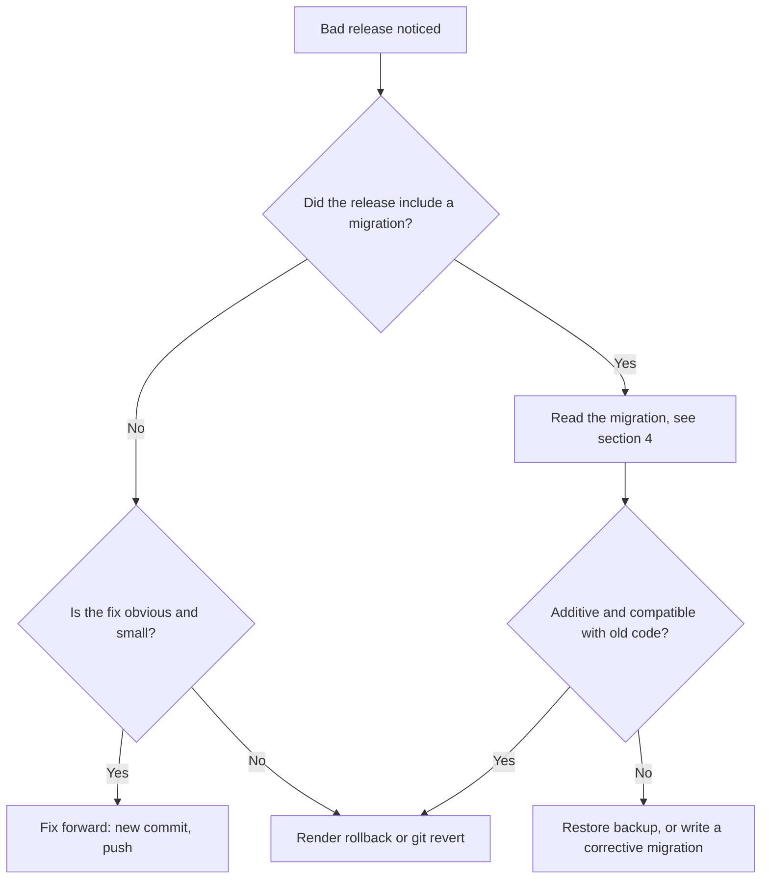

# Rollback Procedures

> **Audience:** Operators, developers · **Last verified:** 2026-11-30 against commit `d1296b1`
> **Related:** [Build and release process](build-and-release-process.md), [Backup and recovery](backup-and-recovery.md), [CI/CD pipeline](ci-cd-pipeline.md), [Database migrations](../07-database/migrations.md), [Deployment problems](../11-troubleshooting/deployment-problems.md)

How to undo a bad release. Code rolls back easily. Database changes do not: migrations run automatically at every deploy, so the schema may already have moved forward when you decide to roll back. Read the migration section before you roll back anything that included a migration.

## Decide first



| Option | Speed | Leaves git history consistent | Touches the database |
| --- | --- | --- | --- |
| Render dashboard rollback (section 1) | Fastest | No (git `main` still has the bad commit) | No |
| `git revert` and push (section 2) | Minutes (full build) | Yes | Only through new migrations |
| Fix forward | Minutes | Yes | Depends |
| Restore a database backup (section 4) | Slowest | Not applicable | Yes, overwrites data |

## 1. Roll back in the Render dashboard

Render keeps previous deploys and can redeploy one.

1. Open the service `uew-innovation-hub` in the Render dashboard.
2. Open **Events** (deploy history) and find the last good deploy.
3. Choose **Rollback** on that deploy and confirm. Render starts the older image and moves traffic to it after the health check (`/up`) passes.
4. Check `/up` and the home page.

Rules that matter:

- Rolling back in Render **does not change the database**. If the bad release ran a migration, the old code now runs against the new schema.
- Rolling back **may turn off auto-deploy** for the service in Render so the next push does not immediately redeploy the bad code. This is Render's behaviour. Check the service **Settings** afterwards and re-enable **Auto-Deploy** only after the fix is merged.
- The old image's entrypoint runs again. It runs `php artisan migrate --force`, which does nothing for migrations already applied (it never rolls back). The old code does not know the newer migration files, which Laravel tolerates.
- On the free plan the rollback may be slower because the service wakes up.

> **Requires confirmation:** the exact wording of the Render buttons and whether a rollback disables auto-deploy on your plan. Render's UI changes. Check https://render.com/docs/rollbacks before relying on the steps.

## 2. Roll back with `git revert`

Use this when you want `main` itself to stop containing the bad change. **Do not force push.** A revert is a new commit, so history stays intact and Render deploys it like any other change.

PowerShell or bash:

```bash
git checkout main
git pull origin main
git log --oneline -10                    # find the bad commit
git revert <bad-commit-hash>             # for a merge commit: git revert -m 1 <hash>
git push origin main
```

Then:

1. Watch the GitHub **Actions** run for the revert commit ([CI/CD pipeline](ci-cd-pipeline.md)).
2. Watch the Render deploy log until `/up` answers.
3. If several commits are bad, revert them newest first, or revert a range with `git revert <oldest-bad>^..<newest-bad>`.

Commits for reference: API v2 landed in `e68fca3` and the audit fixes in `d1296b1` (this page was verified against the latter). Neither is known to be bad. They are examples of what a revert target looks like.

> **Warning:** Do not run `git reset --hard` followed by `git push --force` on `main`. Render deploys the force-pushed state, collaborators lose commits, and the commit referenced in security notes (`87df882`) shows why history is already sensitive.

## 3. Roll back configuration

| Change | How to undo |
| --- | --- |
| A bad environment variable in Render | Set the previous value in **Environment**, then **Save**. Render redeploys. |
| `render.yaml` change | `git revert` the commit. Blueprint syncs are applied from `main`. |
| `APP_KEY` changed by mistake | Restore the old key. Sessions and the stored SMTP password depend on it. |
| Workspace settings (**Site settings**) | These live in the `settings` table, not in git. Change them back by hand. They are recorded in the audit log (`settings` area). |

## 4. Migration rollback

Migration files are in `database/migrations/`. The entrypoint runs only `migrate --force` (forward). It never runs `migrate:rollback`.

CI proves that the **latest batch step** can go down and up again on PostgreSQL (`migrate`, `migrate:rollback --step=1`, `migrate`). It does not prove that data survives.

> **Warning:** `php artisan migrate:rollback` runs the `down()` methods. A `down()` that drops a column or table **deletes the data in it**. Take a database dump first ([Backup and recovery](backup-and-recovery.md)) and run it on production only when you have read the migration.

Decision guide:

| Migration type | Old code still works? | Action |
| --- | --- | --- |
| Adds a nullable column or a new table | Usually yes | Roll back the code only. Leave the schema. |
| Adds a NOT NULL column without a default | Old inserts fail | Fix forward, or add a default in a corrective migration |
| Renames or drops a column or table | No | Restore the pre-deploy backup, or fix forward. Rolling back the migration deletes or breaks data. |
| Data migration (updates rows) | Depends | Restore the backup. `down()` rarely reverses data changes. |
| Enum values (enums are stored as strings) | Old code may fail on new values | Update rows to old values, then roll back the code |

To roll back a single migration step on a server (Render shell, or a local copy against a restored database):

```bash
php artisan migrate:status
php artisan migrate:rollback --step=1 --force     # asks for nothing; destructive
```

Prefer a **corrective forward migration** over `migrate:rollback` on production. There is no automatic backup before deploy migrations, so take a manual dump before merging any destructive migration.

## 5. API considerations

| Topic | Effect |
| --- | --- |
| v1 is frozen | `/api/v1` keeps its contract (page-number pagination, `{success, data, meta, links}` envelope), apart from additive ETag and 304 support. Rolling back to any release that has v1 leaves v1 clients unaffected. |
| v2 | `/api/v2` and the `GET /api` version list were added in commit `e68fca3`. Rolling back to an earlier commit removes them, and v2 clients then get 404 responses. Check that no client depends on v2 first. |
| Headers | `API-Version`, `Deprecation` and `Sunset` come from `config/api.php` and environment variables. A rollback to code before `ApiVersion` removes the header. |
| Deprecation dates | If you set `API_V1_DEPRECATED_AT` or `API_V1_SUNSET_AT` in the environment, a rollback does not unset them. Clear them in Render if you retract a deprecation. |
| Caching | Responses carry `Cache-Control: public` with `max-age` and `s-maxage` of 60 seconds (`API_CACHE_SECONDS` for v2, a fixed 60 seconds for v1), plus weak ETags. After a rollback, caches and CDNs can serve the old shape for up to a minute. |
| Synchronisation clients | v2 `updated_since` sync has no tombstones. A rollback that un-publishes records cannot be detected by clients that already synced. |

## 6. After a rollback

1. Confirm the site: `/up`, home page, sign-in, `/api/v2/projects?limit=1` (if v2 is present).
2. Check the Render log for repeated migration or queue errors.
3. Tell staff what happened. Check the audit log for actions taken during the bad window.
4. Check queued mail: `php artisan queue:failed`. A broadcast sent during the bad release may be `failed` ([Logging and monitoring](logging-and-monitoring.md)).
5. Write the incident down in `.ai/changelog.md` and, if it changes a decision, `.ai/decisions.md`.
6. Add a regression test before re-applying the fix ([Testing guide](../05-developer-guide/testing-guide.md)).
