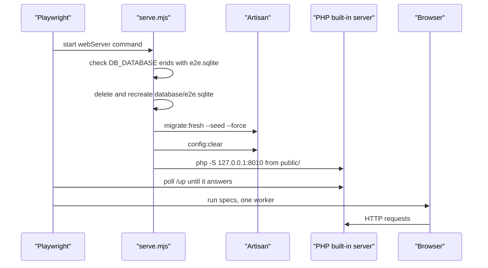

# End-to-End Testing

> **Audience:** Developers, QA · **Last verified:** 2026-11-30 against commit `d1296b1`
> **Related:** [testing-strategy](testing-strategy.md), [frontend-testing](frontend-testing.md), [test-data-management](test-data-management.md), [testing guide (commands)](../05-developer-guide/testing-guide.md), [CI/CD pipeline](../09-deployment-and-operations/ci-cd-pipeline.md)

End-to-end (browser) tests use Playwright against the real application, served by PHP's built-in server with an isolated SQLite database. There are three spec files (`journeys`, `a11y`, `responsive`), one helper module, and three Node files that start the server or run diagnostics. This page explains how the suite works, what each spec checks, how to run it, and what it does not cover.

## How it works



| File | Role |
| --- | --- |
| `../../playwright.config.ts` | Projects, one worker, retries only in CI, 60 s timeout, web server environment |
| `../../tests/e2e/serve.mjs` | Refuses to run unless `DB_DATABASE` ends in `e2e.sqlite`. Rebuilds the database with `migrate:fresh --seed`, then starts the PHP server from `public/` using Laravel's `server.php` router |
| `../../tests/e2e/helpers.ts` | `signIn()`, `watchConsole()`, `expectNoHorizontalScroll()`, `expectImagesLoaded()`, and a `PASSWORD` constant equal to the `SEED_PASSWORD` set in the Playwright config |
| `../../tests/e2e/journeys.spec.ts` | Visitor, member and staff journeys |
| `../../tests/e2e/a11y.spec.ts` | axe-core WCAG checks and a keyboard check |
| `../../tests/e2e/responsive.spec.ts` | Horizontal overflow and image loading at seven widths |
| `../../tests/e2e/find-overflow.mjs`, `measure-performance.mjs` | Manual diagnostic scripts, not tests |

The server environment (set by `playwright.config.ts`): `APP_ENV=local`, `APP_DEBUG=false`, SQLite `database/e2e.sqlite`, `SESSION_DRIVER=file`, `CACHE_STORE=array`, `QUEUE_CONNECTION=sync`, `MAIL_MAILER=array`, `SEARCH_INDEXING=false`, and a `SEED_PASSWORD` of the config's choosing. Mail is never sent. The development and live databases are never touched. Because `APP_ENV` is not `production`, `Model::preventLazyLoading` is active, so an N+1 query fails a journey (see [performance-testing](performance-testing.md)).

## Projects

| Project | Device | Specs | Approx. tests |
| --- | --- | --- | --- |
| `chromium` | Desktop Chrome | all three | 52 |
| `firefox` | Desktop Firefox | `journeys`, `a11y` (not `responsive`) | 38 |
| `webkit` | Desktop Safari | `journeys`, `a11y` | 38 |
| `mobile-android` | Pixel 7 | `journeys` | 22 |
| `mobile-ios` | iPhone 14 | `journeys` | 22 |

Counts come from reading the specs, not from a run. `npx playwright test --list` gives the exact figures.

## What the specs check

### `journeys.spec.ts` (22 tests)

| Group | Test | Checks |
| --- | --- | --- |
| visitor | 14 tests, one per public page (`/`, `/programmes`, `/projects`, `/publications`, `/news`, `/partners`, `/community`, `/contact`, `/about`, `/faq`, `/privacy`, `/terms`, `/sign-in`, `/sign-up`) | HTTP 200, first `h1` visible, images loaded, no page errors and no console errors (including CSP violations) |
| visitor | main navigation reaches every section | Uses the "Main" navigation on desktop and the "Open menu" button with the "Mobile" navigation on phones, for Programmes, Projects, Publications, News, Partners, Contact |
| visitor | unknown pages show the branded 404 | Status 404 and a "not found" text |
| visitor | private areas send visitors to sign in | `/workspace`, `/portal`, `/notifications`, `/workspace/reports/pdf` redirect to `/sign-in` |
| visitor | wrong password shows a generic error | "These details do not match an active account." |
| visitor | sign-up form validates | Submitting an empty form stays on `/sign-up` |
| member | sign in, save an application draft, read notifications, sign out | Lands on `/portal` with a greeting. Saves a draft application and sees "Draft saved" with the field kept. Opens notifications and reports. `/workspace` returns 403. Signs out through the real form (with its CSRF token), sees "You have been signed out.", and `/portal` redirects to sign-in again |
| staff | reviewer sees only what the role allows | Reviewer sidebar has Applications, no "Staff accounts" and no "Site settings"; `/workspace/users` returns 403 |
| staff | reports change with the period and export a PDF | Director opens reports, switches to "All time" and a custom range, exports a PDF, and the download name matches `uew-innovation-hub-report-YYYYMMDD-YYYYMMDD.pdf` |

### `a11y.spec.ts` (16 tests)

Uses `@axe-core/playwright` with tags `wcag2a`, `wcag2aa`, `wcag21a`, `wcag21aa`, `wcag22aa`. Any violation fails the test, and the message lists the rule, impact and first three selectors.

| Scope | Pages |
| --- | --- |
| 13 public pages (one test each) | `/`, `/programmes`, one programme page, `/projects`, `/publications`, `/news`, `/partners`, `/community`, `/contact`, `/about`, `/sign-in`, `/sign-up`, `/forgot-password` |
| Member portal (one test) | `/portal`, `/portal/applications`, `/portal/reports`, `/portal/profile`, `/notifications`, a programme apply page |
| Staff workspace as Hub Director (one test) | `/workspace`, `/workspace/reports`, `/workspace/progress-reports`, `/workspace/applications`, `/workspace/programmes`, `/workspace/members`, `/workspace/settings` |
| Keyboard | First Tab focuses the "Skip to content" link and it is visible. Enter moves to `#main`. A header link has a visible outline or box shadow when focused |

The spec comment points to `docs/audit/ACCESSIBILITY_AUDIT_REPORT.md` for manual checks. **That file does not exist** in `docs/audit/` (it holds `FINAL_PROJECT_HANDOVER_REPORT.md`, `SYSTEM_AUDIT_REPORT.md` and `TEST_RESULTS.md`). Fix the comment or add the report. Automated axe checks find only part of the WCAG problems. Manual review (screen reader, zoom, keyboard-only use) is not recorded anywhere.

### `responsive.spec.ts` (14 tests, Chromium only)

For widths 320, 375, 390, 768, 1024, 1440 and 1920 px (viewport height 900), two tests each:

1. Eight public pages fit the screen (`document.scrollWidth` not more than the client width plus 1 px) and visible images load.
2. Four portal pages as a member, then four workspace pages as the Hub Director, do not overflow.

These are simulated viewports in Chromium, not real devices (the spec says so).

## Running

Prerequisites: PHP, Node 20.19+ or 22.12+, `npm install`, a built front end (`npm run build`), and a browser. See the [testing guide](../05-developer-guide/testing-guide.md) for the full list.

```powershell
npm install
npm run build
npx playwright install chromium
npm run test:e2e:chromium                 # chromium project only
npm run test:e2e                          # all five projects
npx playwright test tests/e2e/journeys.spec.ts --project=chromium
npx playwright test -g "wrong password"   # by title
npx playwright test --ui                  # interactive
$env:E2E_CHANNEL = 'msedge'; npm run test:e2e:chromium; Remove-Item Env:E2E_CHANNEL   # use installed Edge
```

```bash
npm install && npm run build
npx playwright install chromium
npm run test:e2e:chromium
npx playwright test --project=firefox
E2E_PORT=8020 npm run test:e2e:chromium
```

`E2E_PORT` changes the port (default 8010). Failures write screenshots and traces to `test-results/`. In CI, an HTML report goes to `playwright-report/`. Both folders are git-ignored, as is `database/e2e.sqlite`.

### Diagnostic scripts

Run them against an app you started yourself (for example `php artisan serve`) that already has demo data. They need the same accounts as the specs.

```powershell
node tests/e2e/find-overflow.mjs http://127.0.0.1:8000 320      # lists elements wider than the viewport
node tests/e2e/measure-performance.mjs http://127.0.0.1:8000    # see performance-testing.md
```

## In CI

Job `e2e` in `../../.github/workflows/ci.yml` (timeout 40 minutes): it downloads the `build` artefact from the `assets` job, installs Composer and npm dependencies, copies `.env.example` to `.env`, generates a key, installs Chromium, Firefox and WebKit with `npx playwright install --with-deps`, and runs `npx playwright test`. In CI, `retries` is 1. On failure it uploads `playwright-report` and `test-results` for 7 days. The job runs in parallel with the PHPUnit jobs and does not gate the `docker` job.

## Known weaknesses

| Weakness | Detail |
| --- | --- |
| One worker | PHP's built-in server handles one request at a time, so the run is serial and slow (five projects, one worker) |
| Retry hides flakiness | CI retries once. Check the HTML report for tests that passed on retry |
| Demo data coupled to specs | Specs name seeded records (a programme slug, member and staff demo accounts, a "Month 1" report, the greeting "Hello, Abena"). Changing `DemoContentSeeder` or `DemoProgrammesSeeder` can break them |
| Staff and member write paths barely covered | Only one draft save, one PDF export. No browser test creates a programme, publishes a post, uploads a photo or sends a broadcast |
| No cross-browser layout check | `responsive.spec.ts` runs only in Chromium |
| No visual regression | No screenshot comparison |
| No test of e-mail in the browser | `MAIL_MAILER=array` discards mail, so sign-up verification cannot be completed in a browser test |
| Manual accessibility audit missing | See above |

## Recommended, not implemented

1. A staff journey that signs in as an officer, creates a programme with an application form, publishes it, and checks it on the public page.
2. A full member journey: apply, submit, (staff approves in a second context), receive a notification, submit a progress report.
3. A gallery upload journey with a generated image.
4. Run `responsive.spec.ts` on Firefox and WebKit, or add a reduced set.
5. Use Playwright `storageState` to sign in once per role instead of in every test, to shorten the run.
6. Make the `e2e` job required before deploy, and upload the report on success as well.
7. Write the manual accessibility checklist (screen reader on one public page and the apply form, 200 percent zoom, keyboard-only apply flow) and store it in `docs/audit/`.
