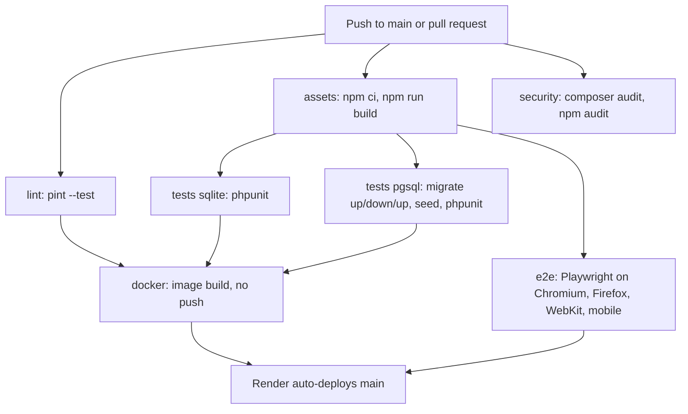

# Testing Strategy

> **Audience:** Developers, QA, maintainers · **Last verified:** 2026-11-30 against commit `d1296b1`
> **Related:** [unit-testing](unit-testing.md), [integration-testing](integration-testing.md), [end-to-end-testing](end-to-end-testing.md), [quality-assurance-checklist](quality-assurance-checklist.md), [testing guide (commands)](../05-developer-guide/testing-guide.md)

This page describes how the Hub is tested today: how many tests exist in each layer, what each layer protects, where the tests run, and what is not covered. It describes the suite as it is. Items marked "Recommended, not implemented" do not exist yet.

## The pyramid as it is

The project has very few isolated unit tests and a large set of feature tests that boot the whole Laravel application. Most behaviour is verified by sending HTTP requests to the app against a real (SQLite or PostgreSQL) database. A Playwright layer sits on top for browser behaviour, accessibility and layout.

| Layer | Location | Runner | Database | Test cases |
| --- | --- | --- | --- | --- |
| Unit | `tests/Unit` | PHPUnit 11 | none (plain `PHPUnit\Framework\TestCase`) | 5 |
| Feature (HTTP, integration) | `tests/Feature` | PHPUnit 11 | in-memory SQLite, or PostgreSQL in CI | 189 |
| Browser | `tests/e2e` | Playwright | `database/e2e.sqlite`, rebuilt every run | about 172 (see below) |

`php vendor/bin/phpunit --list-tests` reports **194** PHPUnit test cases (5 + 189). Three methods use data providers, so the list has more entries than methods: there are 175 test methods. The full suite last ran at 194 tests, 1461 assertions, all passing, and `pint --test` passed.

### Feature tests by folder

| Folder | Cases | Files |
| --- | --- | --- |
| `tests/Feature` (root) | 32 | `GalleryTest` (10), `RouteSmokeTest` (8), `SecurityHardeningTest` (7), `SecurityHeadersTest` (4), `SecureDemoAccountsTest` (3) |
| `tests/Feature/Api` | 18 | `ApiV2Test` (11), `PublicApiTest` (7) |
| `tests/Feature/Auth` | 30 | `AuthenticationTest` (11), `MemberAccountTest` (10), `EmailLinksTest` (9) |
| `tests/Feature/Portal` | 12 | `EngagementTest` (12) |
| `tests/Feature/Site` | 26 | `PublicSiteTest` (19), `DocumentAccessTest` (7) |
| `tests/Feature/Workspace` | 71 | `AdministrationTest` (13), `PrivilegesTest` (10), `AccessControlTest` (9), `UserManagementTest` (9), `ProjectManagementTest` (8), `ContentPublishingTest` (7), `OperationalFixesTest` (6), `GrantReviewTest` (5), `ReportExportTest` (4) |

### Browser tests by project

Counted from the spec files (not run for this page). `npx playwright test --list` prints the exact number.

| Playwright project | Specs | Approximate tests |
| --- | --- | --- |
| `chromium` | journeys (22), a11y (16), responsive (14) | 52 |
| `firefox` | journeys, a11y | 38 |
| `webkit` | journeys, a11y | 38 |
| `mobile-android` (Pixel 7) | journeys | 22 |
| `mobile-ios` (iPhone 14) | journeys | 22 |

## What each layer protects

| Layer | It protects | Examples |
| --- | --- | --- |
| Unit | Pure rules with no framework: the role and permission matrix, form-schema normalisation, number formatting | `DomainTest` |
| Feature: access control | Who may open or change what | `AccessControlTest` (role by page), `PrivilegesTest` (144 role/route pairs), `GalleryTest` role checks |
| Feature: security | Headers, CSP, lockout, default-password blocking, file access, e-mail link handling | `SecurityHardeningTest`, `SecurityHeadersTest`, `DocumentAccessTest`, `EmailLinksTest` |
| Feature: workflows | Programme applications, reviews, progress reports, publishing, broadcasts, exports, audit entries | `EngagementTest`, `GrantReviewTest`, `ContentPublishingTest`, `OperationalFixesTest` |
| Feature: public output | Public pages, sitemap and robots, open data API v1 and v2 | `PublicSiteTest`, `PublicApiTest`, `ApiV2Test` |
| Feature: safety net | No GET route returns HTTP 500 for any actor | `RouteSmokeTest` |
| Browser | Real navigation, JavaScript and CSP errors, WCAG 2.2 A/AA (axe-core), keyboard focus, viewport overflow (320 to 1920 px), PDF download | `journeys.spec.ts`, `a11y.spec.ts`, `responsive.spec.ts` |

## Where tests run

| Where | What runs | Database |
| --- | --- | --- |
| Developer machine | `php artisan test` or `php vendor/bin/phpunit`; `npm run test:e2e` (or `test:e2e:chromium`) | SQLite in memory; `database/e2e.sqlite` |
| CI job `tests` (sqlite) | `php vendor/bin/phpunit --no-progress` | SQLite in memory |
| CI job `tests` (pgsql) | Migrations up, down one step, up, then `db:seed`, then the same PHPUnit run | PostgreSQL 16 service `uew_test` |
| CI job `e2e` | `npx playwright test` with Chromium, Firefox and WebKit installed | `database/e2e.sqlite` |
| CI job `security` | `composer audit --locked`, `npm audit --omit=dev --audit-level=high` | none |
| CI jobs `lint`, `assets`, `docker` | Pint, `npm run build`, Docker image build (no push) | none |

The CI workflow is `../../.github/workflows/ci.yml`. It runs on every push to `main`, every pull request, and manual dispatch. A second run on the same ref cancels the first (`concurrency`).



> **Requires confirmation:** `ci.yml` says Render deploys `main` once CI is green, and recommends enabling "Wait for CI" or branch protection on `main`. The repository files do not show whether that setting is on. `docker` needs only `lint` and `tests`, so a failing `e2e` or `security` job does not block it. The project commits directly to `main` (see the [technical debt register](../12-maintenance/technical-debt-register.md)).

## Test environment

`phpunit.xml` sets `APP_ENV=testing`, SQLite `:memory:`, `CACHE_STORE=array`, `SESSION_DRIVER=array`, `QUEUE_CONNECTION=sync`, `MAIL_MAILER=array`, `BCRYPT_ROUNDS=4`. PHPUnit `<env>` values do not override variables already set in the shell. CI uses that to switch to PostgreSQL. Locally, unset `DB_DATABASE` and `DB_URL` before running, or `RefreshDatabase` will wipe the database they name.

```powershell
Remove-Item Env:DB_DATABASE, Env:DB_URL -ErrorAction SilentlyContinue
php vendor/bin/phpunit --no-progress
```

```bash
unset DB_DATABASE DB_URL
php vendor/bin/phpunit --no-progress
```

Full command list: [testing guide](../05-developer-guide/testing-guide.md).

## Existing coverage and gaps

I compared `app/Http/Controllers` and `app/Services` with the test files by searching the tests for route names and class names. A zero below means no test names the thing directly. Many of these pages are still requested by `RouteSmokeTest` (GET only, checks for no 500) and by the browser specs.

| Area | State |
| --- | --- |
| Email template editor (`workspace.templates.*`, `EmailTemplateController`) | No test edits, previews or resets a template. Only the smoke test requests the GET pages |
| `hub:import-documents` command (`ImportLegacyDocuments`) | No test. `hub:create-admin` and `hub:secure-demo-accounts` are tested |
| `InsightsService`, `MetricsService` (dashboard figures) | No direct test. Reports are tested through `ReportExportTest` |
| `StaffNotifier`, `NotificationCenter` | Only through `EngagementTest` flows. No test of notification text for each event |
| Policies (`app/Policies`, 9 classes) | Tested through HTTP only. No `Gate` or policy unit tests |
| `app/Support` (`DateRange`, `Demographics`, `EmailTemplates`, `Photos`) | `Format` and `FormSchema` have unit tests. The others are tested indirectly or not at all |
| Withdrawing an application | No test (the word "withdraw" appears in no test) |
| Staff workspace in the browser | Only a reviewer journey and a reports/PDF journey. No browser test creates a programme, post or album |
| API: 429, 405 and invalid cursor responses | Not asserted. See [api-testing](api-testing.md) |
| Code coverage, static analysis, mutation testing | Not configured. CI sets `coverage: none` |
| Parallel test runs | `brianium/paratest` is not installed |

## Recommended, not implemented

- Run the `e2e` and `security` jobs as required checks, and make `docker` depend on them.
- Add PHPStan or Larastan and a coverage report (Xdebug or PCOV) to CI. Start with a reported number, not a threshold.
- Add paratest to shorten the PHPUnit run.
- Add feature tests for the gaps in the table above, in this order: email template editing, application withdrawal, `hub:import-documents`, dashboard figures.
- Add contract tests for the frozen v1 API ([api-testing](api-testing.md)).
- Add a load test ([performance-testing](performance-testing.md)).

## Rules for new tests

1. Every new route gets a feature test for the allowed role, a denied role, and a guest. `PrivilegesTest` picks up new state-changing `/workspace` routes by itself. A new GET route with a model binding needs an entry in `RouteSmokeTest::urls()` or it is skipped.
2. Use factories and the `TestCase` helpers (`staff()`, `signInAs()`, `pdf()`). See [test-data-management](test-data-management.md).
3. Fake mail and storage. Never send real mail or write to the real disks.
4. Do not put real attack payloads or web-shell strings in fixtures ([security-testing](security-testing.md)).
5. Name tests `test_<behaviour_in_snake_case>`.
