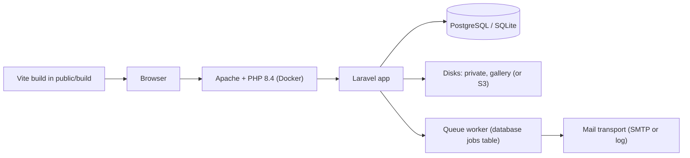

# Troubleshooting Overview

> **Audience:** Developers, operators, administrators · **Last verified:** 2026-11-30 against commit `9f3bdee`
> **Related:** [Admin troubleshooting](../03-administration/admin-troubleshooting.md), [Logging and diagnostics](logging-and-diagnostics.md), [Deployment guide](../deployment.md), [Testing guide](../05-developer-guide/testing-guide.md)

This section lists real problems of the UEW Innovation Hub, each with symptoms, causes, diagnostic steps, commands, a resolution and a prevention tip. Start here to pick the right page, then use the first-response checklist.

## Pick a page

| Symptom area | Page |
| --- | --- |
| Cannot install, build or start locally | [Installation problems](installation-problems.md) |
| Sign-in, verification, reset, lockout, 419 | [Authentication problems](authentication-problems.md) |
| Migrations, SQLite or PostgreSQL errors | [Database problems](database-problems.md) |
| `/api/v1` errors, 429 on the API | [API problems](api-problems.md) |
| Missing CSS, JavaScript, broken layout | [Frontend problems](frontend-problems.md) |
| 500 errors, e-mail, queue, uploads, PDFs | [Backend problems](backend-problems.md) |
| Render or Docker deploy fails, files vanish | [Deployment problems](deployment-problems.md) |
| Slow pages, cold start, stale figures | [Performance problems](performance-problems.md) |
| Where to read logs, how to get more detail | [Logging and diagnostics](logging-and-diagnostics.md) |
| Administrator-level symptoms in plain language | [Admin troubleshooting](../03-administration/admin-troubleshooting.md) |

## System map for troubleshooting

Most incidents sit on one of these arrows: a missing build (`public/build`), a wiped disk, a stopped worker, a log-only mail transport or an old config cache.

## First-response checklist

1. **Is the app up?** Open `/up`. A 200 means Laravel boots. On Render's free plan, wait up to a minute after idle time.
2. **What changed?** Last deploy, last environment change, last migration. `git log -5 --oneline`.
3. **Read the log.** Local: `storage/logs/laravel.log`. Render: dashboard > Logs (`LOG_CHANNEL=stderr`). See [logging and diagnostics](logging-and-diagnostics.md).
4. **Reproduce with detail.** Locally, set `APP_DEBUG=true` and read the page. Never leave `APP_DEBUG=true` on a public site.
5. **Check the configuration the app really uses.** `php artisan about` and the **Site settings > System** tab show environment, database, queue and mail transport.
6. **Clear caches after configuration changes.** `php artisan optimize:clear` (the container runs `php artisan optimize` on boot, so a restart rebuilds the caches).
7. **Run the tests** that cover the area (`php artisan test --filter=...`). See [testing guide](../05-developer-guide/testing-guide.md).

## Commands used throughout

All of these exist in Laravel or in this repository.

| Purpose | Command |
| --- | --- |
| Environment summary | `php artisan about` |
| List routes | `php artisan route:list` |
| Migration state | `php artisan migrate:status` |
| Run migrations | `php artisan migrate` (production: `--force`) |
| Clear all caches | `php artisan optimize:clear` |
| Rebuild caches | `php artisan optimize` |
| Failed jobs | `php artisan queue:failed`, `php artisan queue:retry all` |
| Restart workers | `php artisan queue:restart` |
| Live log viewer | `php artisan pail` |
| Build front end | `npm run build` |
| All tests | `composer test` or `php artisan test` |

## Windows and PowerShell notes

Developers use Windows PowerShell 5.1 (the version shipped with Windows). Differences from bash that cause real mistakes:

| Bash habit | PowerShell 5.1 |
| --- | --- |
| `cmd1 && cmd2` | Not supported. Use `cmd1; if ($?) { cmd2 }` or separate lines. PowerShell 7 supports `&&` |
| `cp .env.example .env` | Works (alias of `Copy-Item`). `composer setup` already does this |
| `touch file` | Use `New-Item file -ItemType File` |
| `export VAR=x` | `$env:VAR = "x"`. Remove with `Remove-Item Env:VAR` |
| `unset VAR` | `Remove-Item Env:VAR` |
| `tail -f file` | `Get-Content file -Wait -Tail 50` |
| `grep pattern file` | `Select-String -Pattern pattern -Path file` |
| `> file` writes UTF-8 | Windows PowerShell 5.1 `>` and `Out-File` write UTF-16. `Set-Content -Encoding UTF8` writes a byte-order mark. Avoid both for `.env` and source files. Use an editor |

> **Warning:** A `DB_DATABASE` variable left in your PowerShell session overrides `phpunit.xml`, and the next test run can wipe that database. Run `Remove-Item Env:DB_DATABASE` after using it. See [development environment setup](../05-developer-guide/development-environment-setup.md).

## Escalation

If the page does not solve it, collect: the exact message, URL, time, the log lines around it, the commit (`git rev-parse --short HEAD`), the environment (`php artisan about`) and what you already tried. Do not paste `.env`, `APP_KEY`, SMTP passwords or one-time codes into tickets or chat.

## Known issues that look like faults

| Looks like | Is actually | Page |
| --- | --- | --- |
| E-mail never arrives on the hosted test site | `MAIL_MAILER=log` is the `render.yaml` default | [Backend problems](backend-problems.md#e-mails-only-appear-in-the-log) |
| Documents and photos vanish after a deploy | Free Render disk is wiped | [Deployment problems](deployment-problems.md#uploaded-files-disappear-after-a-deploy) |
| First visit takes a minute | Free web service sleeps after 15 minutes | [Performance problems](performance-problems.md#render-cold-start) |
| Only 5 of 10 photos upload | `max_file_uploads = 5` in `docker/php.ini` | [Backend problems](backend-problems.md#photo-upload-drops-files) |
| Audit log area menu lacks some areas | The list in `AuditLogController::AREAS` is short | [Audit and monitoring](../03-administration/audit-and-monitoring.md) |
