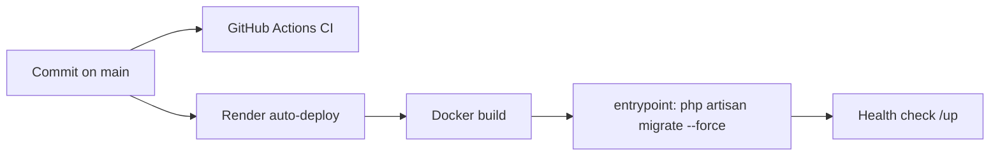

# Release Management

> **Audience:** Developers, maintainers · **Last verified:** 2026-11-30 against commit `d1296b1`
> **Related:** [versioning-strategy.md](versioning-strategy.md), [../09-deployment-and-operations/ci-cd-pipeline.md](../09-deployment-and-operations/ci-cd-pipeline.md), [../09-deployment-and-operations/rollback-procedures.md](../09-deployment-and-operations/rollback-procedures.md), [technical-debt-register.md](technical-debt-register.md)

## Actual practice

There is no tagged release process. A release is a push to `main`.

- Commits go straight to `main` (TD-014).
- CI (`.github/workflows/ci.yml`) runs Code style (Pint), Front-end build, Tests (sqlite), Tests (pgsql, including a migrate up/down/up check), Browser tests, Dependency audit and Docker image builds.
- Render builds the Docker image and deploys `main` on push (`render.yaml`, health check `/up`). Render does not wait for GitHub CI. A failing CI run does not stop a deploy.
- `docker/entrypoint.sh` runs `php artisan migrate --force` on start, so migrations apply automatically.
- `git tag` returns no tags.

## Release checklist (current)

1. Run locally: `vendor/bin/pint --test`, `php artisan test`, `npm run build`.
2. Update `.ai/state.md` and `.ai/changelog.md` (required by `AGENTS.md`).
3. Push. Watch the CI run and the Render deploy.
4. Check `/up`, the home page, sign-in, and `/api`.
5. If a migration was included, confirm it ran (Render logs).

> **Warning:** Migrations run on every deploy with `--force`. A destructive migration reaches production as soon as it is pushed. Back up the database first. See [database-maintenance.md](database-maintenance.md).

## Rollback

Redeploy the previous commit from the Render dashboard, or `git revert` and push. Migrations are not rolled back automatically. See [../09-deployment-and-operations/rollback-procedures.md](../09-deployment-and-operations/rollback-procedures.md).

## Recommended, not implemented

- Branch protection on `main`, pull requests, and required status checks, so CI gates the deploy.
- Render "deploy after CI checks pass" setting.
- Semantic version tags and GitHub releases ([versioning-strategy.md](versioning-strategy.md)).
- A staging service with its own database.
