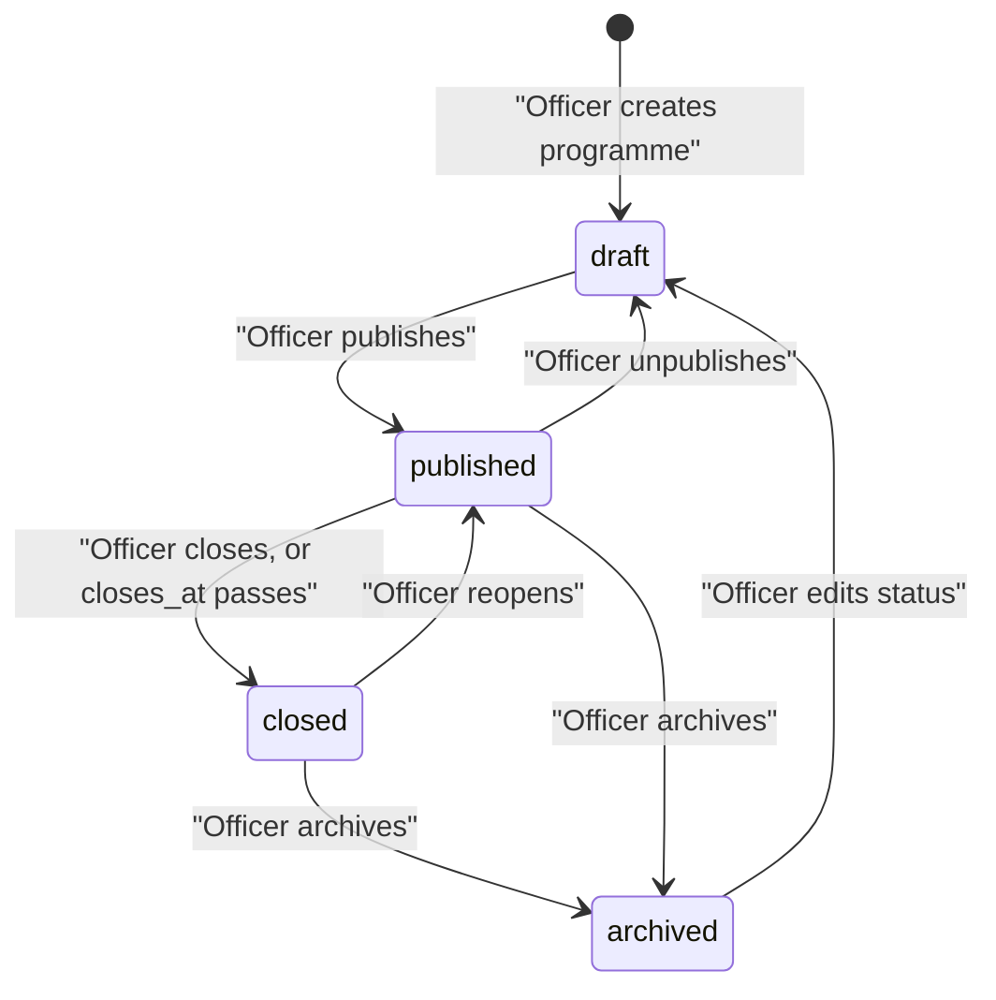
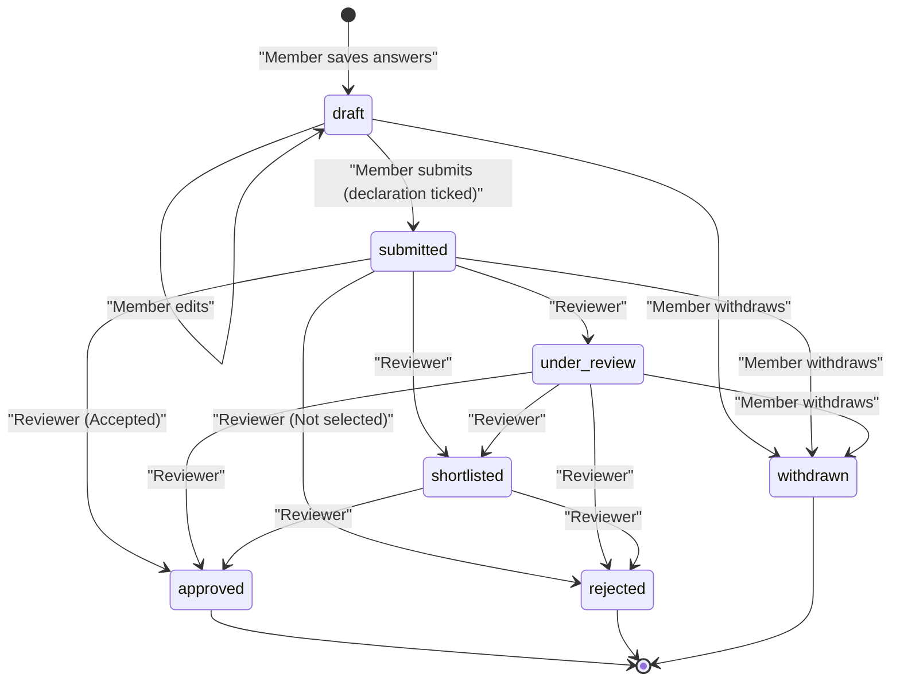
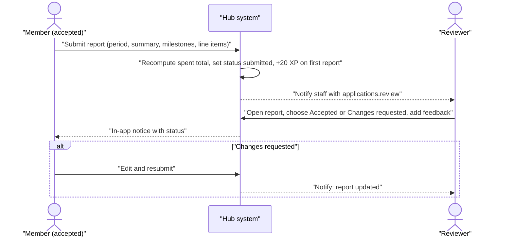
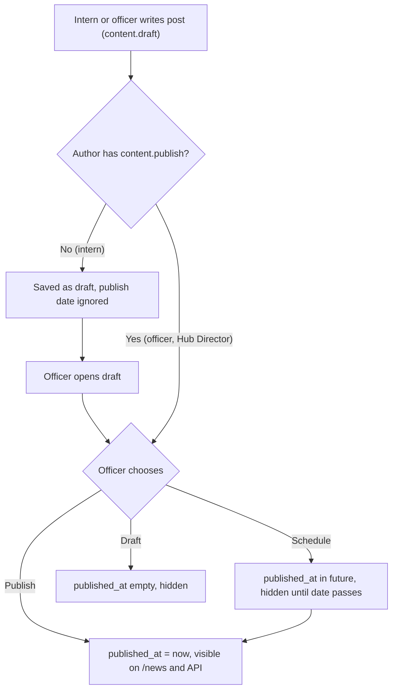
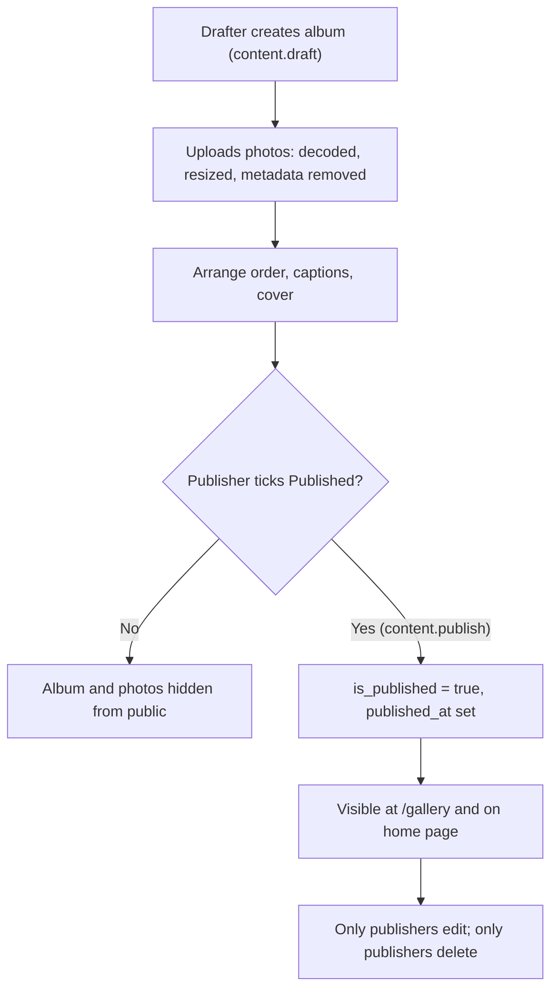
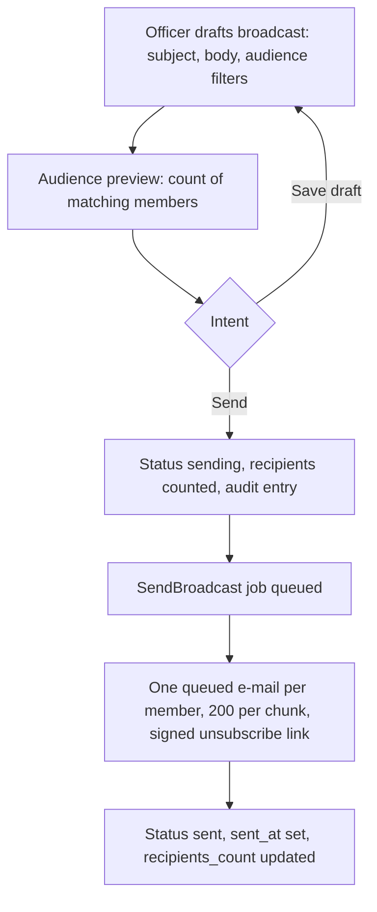
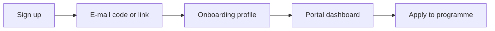

# Business workflows

> **Audience:** Product owners, analysts, staff trainers, developers · **Last verified:** 2026-11-30 against commit `9f3bdee`
> **Related:** [Step-by-step workflows (user guide)](../02-user-guide/step-by-step-workflows.md), [Administrative workflows](../03-administration/administrative-workflows.md), [Business logic](../04-architecture/business-logic.md), [Acceptance criteria](acceptance-criteria.md)

Six workflows with diagrams, taken from the code. All are **Implemented**; the file that proves each step is named under each diagram. Where the code is looser than the business might expect, a note says so.

## 1. Programme lifecycle

Stored statuses are `draft`, `published`, `closed`, `archived` ([`ProgramStatus`](../../app/Enums/ProgramStatus.php)). "Open" and "Opens soon" are computed from dates, not stored.

| Rule | Source |
| --- | --- |
| The status is a plain select on the programme form; the code does not enforce an order, so any status can be chosen from any other. | `ProgramRequest` (`Rule::enum(ProgramStatus::class)`), `ProgramService::update()` |
| The first time a programme becomes `published`, `published_at` is set. | `ProgramService::applyStatus()` |
| Public pages list `published` and `closed` programmes only. | `Program::scopeVisible()`, `ProgramStatus::publicValues()` |
| Applications are accepted only when status is `published`, `opens_at` has passed (or is empty), `closes_at` has not passed, and capacity is not reached. | `Program::isAcceptingApplications()` |
| The badge shows Draft, Archived, Closed, "Opens <date>" or Open. | `Program::availability()` |
| After publishing, an officer can announce it to opted-in members by e-mail. | `ProgramService::announce()` (`workspace.programs.announce`) |
| Only staff with `programs.manage` can change programmes. | `routes/web.php` |

The transitions in the diagram are the normal business path. They are drawn from what the form permits, not from a coded state machine.

## 2. Application lifecycle

| Step | What happens | Source |
| --- | --- | --- |
| Save draft | Answers stored; reference `UEW-AP-<year>-<code>` created with the record; one application per member per programme. | `ApplicationService::save()`, unique index in `schema.md` |
| Submit | Status `submitted`; `submitted_at` set; profile snapshot stored; +10 XP; member and reviewers get in-app notices; e-mail to member and to staff who opted in. | `ApplicationService::save()`, `notifySubmitted()` |
| After submit | No further edits. Messages are possible both ways. | `ProgramApplication::isEditable()`, `ProgramApplicationPolicy::message()` |
| Review | Reviewer sets status, score, internal notes, decision message. Final statuses set `decided_at`. A reviewer cannot review their own application. | `ApplicationService::review()`, `ProgramApplicationPolicy::review()` |
| Notify | In-app notice on each change; e-mail only if "notify" is ticked. | `ApplicationService::review()` |
| Accepted | A "Participant" badge is awarded; the member may now file progress reports. | `ApplicationService::review()`, `ProgramApplication::canReportProgress()` |
| Bulk | Same decision for up to 500 applications; drafts and withdrawn skipped. | `ApplicationService::bulkReview()` |

> **Note:** Reviewers may move an application between any reviewable statuses, including from Accepted back to Under review. Only withdrawal is limited (`ApplicationStatus::canWithdraw()`). If the Hub wants a strict order, that is a **Proposed** change (see [functional requirements](functional-requirements.md), FR-55).

## 3. Progress report review

Source: `ProgressReportService::submit()` and `review()`. A report is editable only in `changes_requested` (`ProgressReport::isEditable()`). Review sets `reviewed_by` and `reviewed_at` and writes the audit log.

## 4. Content publishing (news, blog, announcements)

| Rule | Source |
| --- | --- |
| Without `content.publish`, `published_at` stays as it was. A new post stays a draft. | `PostService::publishDate()` |
| Interns edit and delete only their own unpublished drafts. | `PostPolicy::update()` |
| Scheduling in the past is rejected. | `ContentPublishingTest::test_scheduling_in_the_past_is_rejected` |
| No timer publishes a scheduled post. It becomes visible when its date passes because visibility is derived from `published_at` when read. | `routes/console.php` is empty; BRIEF fact |
| Unpublish by saving as draft. | `ContentPublishingTest::test_officer_can_unpublish_by_saving_as_draft` |

## 5. Gallery publishing

Source: `GalleryService::save()`, `AlbumPolicy`, `GalleryTest`. Drafters can edit an album only while it is unpublished. Lost files are hidden, not shown broken. Set `GALLERY_DISK=s3` to keep photos across deploys.

## 6. Broadcast sending

| Rule | Source |
| --- | --- |
| Recipients are active, verified members with `marketing_opt_in`, optionally filtered by interests and affiliations. | `BroadcastService::recipients()` |
| Only drafts can be edited or sent. Sent broadcasts return 422 on edit. | `Workspace\BroadcastController` |
| Programme announcements create a broadcast from the `program_launched` template and send it immediately. | `ProgramService::announce()` |
| The job has one try and a 600-second timeout. A failure leaves the status at `sending`. **Requires confirmation:** there is no retry or "failed" status in `BroadcastStatus`. | `SendBroadcast`, `BroadcastStatus` |
| With `MAIL_MAILER=log` the messages are written to the log, not delivered. | `render.yaml` |

## 7. Supporting flow: new member

Sources: `Auth\RegisterController`, `VerificationService`, `Portal\OnboardingController`, middleware `verified.email` and `onboarded` in `routes/web.php`.
