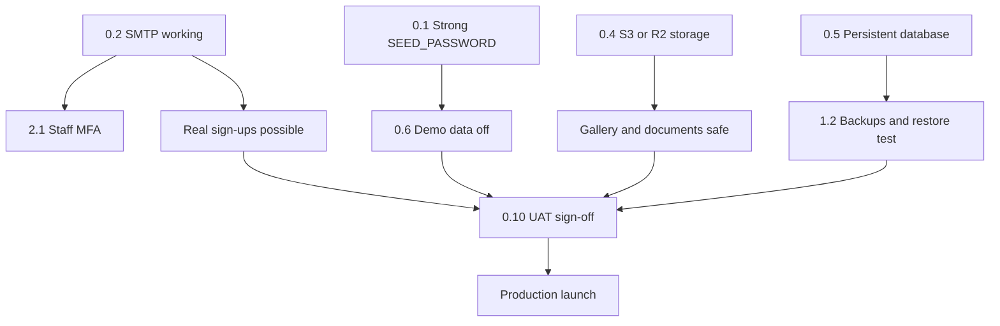

# Product roadmap

> **Audience:** Product owners, sponsors, project managers · **Last verified:** 2026-11-30 against commit `9f3bdee`
> **Related:** [Business requirements](business-requirements.md), [Technical debt register](../12-maintenance/technical-debt-register.md), [Long-term maintenance roadmap](../12-maintenance/long-term-maintenance-roadmap.md), [Handover report](../audit/FINAL_PROJECT_HANDOVER_REPORT.md)

> **Everything on this page is Proposed.** No roadmap file exists in the repository with committed dates (`.ai/roadmap.md` is a migration plan from the old system and was not used as a schedule). The items below come from the open items in [`.ai/state.md`](../../.ai/state.md), the owner actions in `docs/audit/FINAL_PROJECT_HANDOVER_REPORT.md` and the findings in `docs/audit/SYSTEM_AUDIT_REPORT.md`. Order and grouping are my suggestion. The owner decides what, and when. Dates are deliberately left out.

## What is already delivered

| Release | Content | Source |
| --- | --- | --- |
| Migration from legacy PHP | Laravel 12 app with portfolio, publications, public site | `.ai/state.md` |
| 1.3.0 | Notifications, application messages, progress and budget reports, badges and community, form builder pre-fill | `.ai/state.md` |
| 1.4.0 | Gallery, Roles and permissions page, least-privilege checks, branded e-mails, one-click unsubscribe | Handover report section 3a |
| Audit remediation | Per-account lockout, hidden placeholder phone, sitemap and robots, reduced-motion, Playwright and axe tests | Handover report section 1 |

## Phase 0: before real users (owner actions)

These block a launch. They are configuration and decisions, not new features.

| # | Action | Why | Source |
| --- | --- | --- | --- |
| 0.1 | Set a strong `SEED_PASSWORD` in Render, then `BLOCK_DEFAULT_PASSWORDS=true` | Demo accounts, including the Hub Director, can sign in with a default password until this is done (audit finding F-01) | Handover section 4, item 1 |
| 0.2 | Enter SMTP details in Site settings, E-mail, and send a test e-mail | Sign-up codes and decisions do not reach users while `MAIL_MAILER=log` | Handover section 4, item 2; `render.yaml` |
| 0.3 | Decide whether to rewrite git history to remove the tester password in commit `87df882` | The password is public in history (F-02); rewriting needs a force push | Handover section 4, item 3 |
| 0.4 | Set `DOCUMENTS_DISK=s3` and `GALLERY_DISK=s3` with an S3 or R2 bucket | Free Render disk is erased on redeploy | `.ai/state.md` open items; `render.yaml` |
| 0.5 | Move to a paid or Neon PostgreSQL database | Render free Postgres expires after 30 days | `.ai/state.md`; `render.yaml` |
| 0.6 | Set `SEED_DEMO_DATA=false` and start from a fresh database | Remove demo accounts and sample content | `render.yaml` |
| 0.7 | Set `SEARCH_INDEXING=true` at launch | Site is `noindex` otherwise | `config/hub.php` |
| 0.8 | Legal review of Privacy and Terms; update the Privacy page on an existing site (edited pages are not overwritten by the seeder) | Data collected now includes demographics, messages and reports (F-08) | Handover report |
| 0.9 | Replace the default contact details and add the official Hub phone number in Site settings | Placeholder phone is hidden until set (F-04) | `SettingsService` |
| 0.10 | Complete user acceptance testing using the [manual checklist](acceptance-criteria.md#uat-checklist-for-launch-manual) | Handover status is "ready for UAT" only | Handover report section 3 |

## Phase 1: launch hardening (short term)

| # | Proposed item | Reason | Related requirement |
| --- | --- | --- | --- |
| 1.1 | Move from Render free plan to an always-on plan | Avoid the one-minute wake-up before deadlines | BR-21, NFR-23 |
| 1.2 | Add automated database backups and test a restore | None exist in the repository | NFR-24 |
| 1.3 | Add uptime monitoring on `/up` and alerting on errors | `LOG_CHANNEL=stderr` only; no alerts | NFR-37 |
| 1.4 | Run and record performance measurements (`tests/e2e/measure-performance.mjs`) | Performance score in the handover report is "not measured" | NFR-18 |
| 1.5 | Add tests for gaps listed in [acceptance criteria](acceptance-criteria.md): closing-date and capacity rules, withdraw, bulk decision, application CSV export | No automated coverage found (AC-17, 18, 22, 23) | FR-14, FR-17, FR-19, FR-20 |
| 1.6 | Add `GALLERY_DISK` to `.env.example` | It is read in `config/hub.php` but missing from the example file | NFR-35 |
| 1.7 | Decide whether to keep `legacy/`, the empty view folders and the legacy grant routes | Reduces confusion for new developers | [Technical debt register](../12-maintenance/technical-debt-register.md) |
| 1.8 | Decide whether applications may move freely between statuses, or add an enforced order | Today any reviewable status can be set from any other | FR-55 |
| 1.9 | Add a "failed" state or retry for broadcasts | A failed job leaves the broadcast at `sending` | [Business workflows](business-workflows.md) section 6 |

## Phase 2: next improvements (medium term)

| # | Proposed item | Reason | Source |
| --- | --- | --- | --- |
| 2.1 | Staff multi-factor authentication | Strengthens the most privileged accounts; needs working e-mail first | F-12 |
| 2.2 | Self-service account deletion and data export | Data protection good practice | F-15, BR-24 |
| 2.3 | Deadline reminder e-mails (needs a scheduler such as Laravel's `schedule:run` driven by the host) | Members miss deadlines; no scheduler exists | BR-25 |
| 2.4 | Excel export for reports | Legacy system produced Excel; the new one has CSV and PDF | FR-53 |
| 2.5 | Move cache, sessions and queue to Redis when traffic grows | Recommended in `.env.example` | `.env.example` |
| 2.6 | Run a separate queue worker service (`RUN_QUEUE_WORKER=false` on the web service) | The worker currently lives in the web container | `docker/entrypoint.sh` |
| 2.7 | A person-led screen-reader test of key journeys | Not done yet | NFR-29 |
| 2.8 | Migrate remaining legacy MySQL data if any is still needed, with a verified checklist | No row-level import command exists | [Problem statement](../01-project-overview/problem-statement.md) |

## Phase 3: later options (long term)

| # | Proposed item | Reason |
| --- | --- | --- |
| 3.1 | API keys and rate tiers; webhooks for partner systems | Only if partners ask for them (BR-26) |
| 3.2 | Single sign-on with university accounts | Fewer passwords; needs UEW IT agreement |
| 3.3 | Laravel 13 and PHPUnit 13 upgrade when the 12.x line nears end of support | Deferred in the audit (F-13) |
| 3.4 | Remove `unsafe-eval` from the content security policy | Requires Alpine's CSP-safe build (F-11); effort not assessed |
| 3.5 | Reporting for donors (impact dashboards by programme and year) | `InsightsService` and `budgetByProgramme()` give a starting point |

## Dependencies between items

## Open questions for the owner

1. Who approves and who operates the production hosting (UEW IT or the Hub)?
2. Which mailbox sends official e-mail, and who owns it?
3. Should the legacy grant applications module be retired?
4. What are the target dates for launch and for the first programme call?
